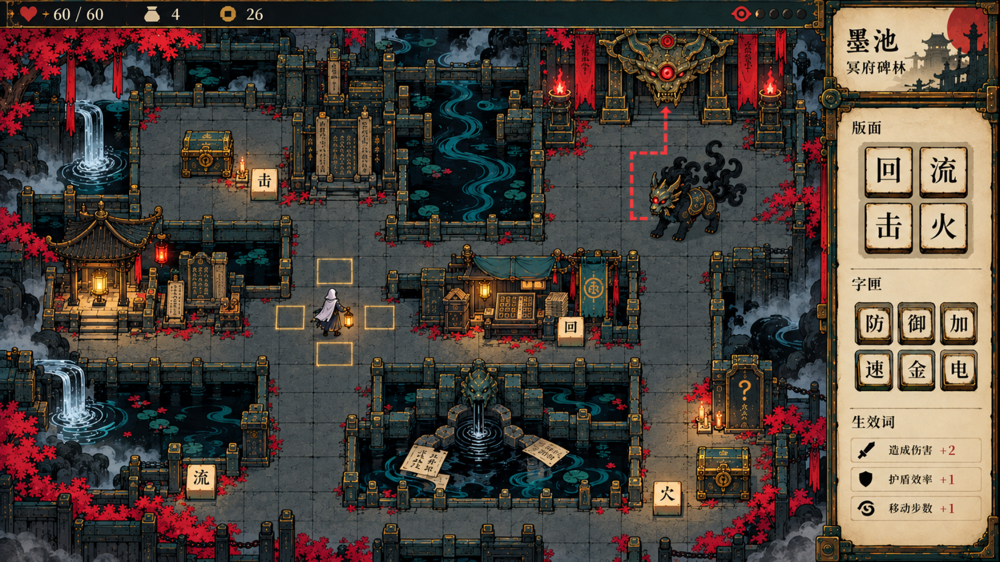
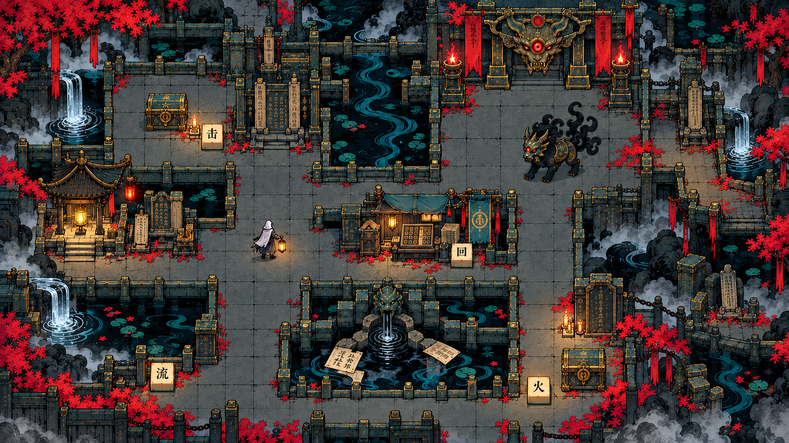
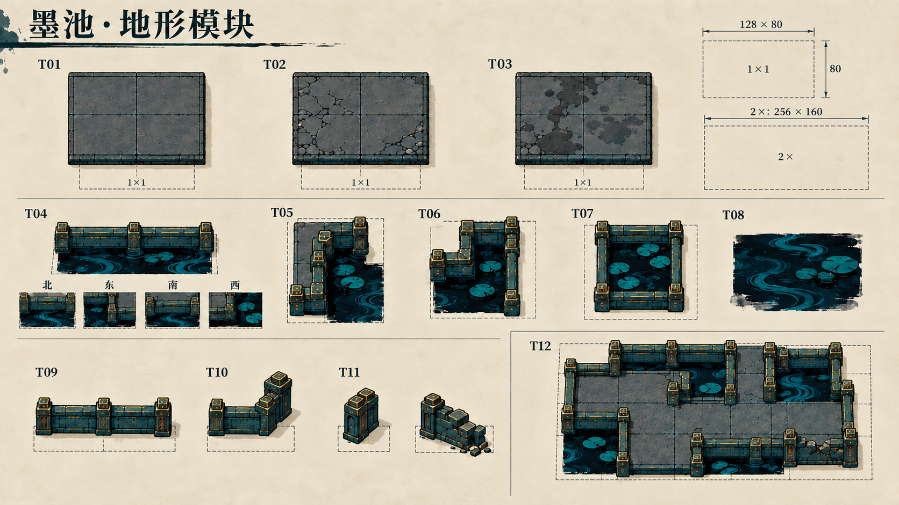
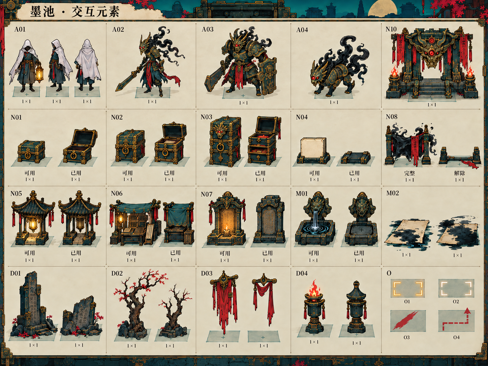

# 墨池 · 冥府碑林：大地图美术设计包

2026-10-16 · 第一轮概念设计与生产规范

最新美术基准：[《九日》官方资料与风格对标](九日美术对标.md)。现有运行版本用于验证空间与交互，尚未通过整屏美术统一检查；上传的战斗图片是目标参考，当前战斗实机同样需要统一。

后续实装已调整为**手绘立片＋浅层空间＋轻微视差**：[运行素材与接入说明](../../../assets/expedition/README.md) · [实机近景](runtime-v3/02-local-1280.png) · [镜头演示](runtime-v3/map-cutout-demo.mp4)。镜头采用45°斜俯视与25°弱透视，下文保留概念阶段的原始构图和资产约定，运行规范以接入说明为准。

固定手绘斜俯视的连续冥府地景。持灯行者穿行于墨河、残碑与青铜印坊之间，地图居主位，版面和字匣收在侧边。四张图用于确定视觉方向；地形和元素设定页是绘制依据，尚不是可直接切分投入游戏的瓦片图集。

[打开本地评审页](index.html) · [资产清单 CSV](asset-list.csv) · [生成与文件记录](manifest.json)

## 四张设计图

| 图 | 评审重点 |
|---|---|
| [01 整屏概念图](01-mochi-overview.png) | 地图与侧栏比例、环境和实时信息的层次、行者与设施比例 |
| [02 去 UI 场景图](02-mochi-environment.png) | 石地连通、墨池岸线、建筑立面、装饰疏密 |
| [03 地形模块设定页](03-mochi-terrain.png) | 三种石地、直岸和内外角、残墙、连接方式 |
| [04 交互元素设定页](04-mochi-elements.png) | 节点轮廓、占格、接地点、使用前后状态、行者与敌人 |

规范尺寸导出：[整屏 1920×1080](exports/01-mochi-overview-1920x1080.png) · [整屏 1280×720](exports/01-mochi-overview-1280x720.png) · [场景 1920×1080](exports/02-mochi-environment-1920x1080.png) · [场景 1280×720](exports/02-mochi-environment-1280x720.png)。原生生成文件保留在目录顶层；导出仅按目标画框缩放，不增加绘制细节。

## 风格基准

以随包保存的 [用户战斗参考图](reference-battle-style.png) 为唯一画风基准。提取其中的黑色不规则勾线、平涂色块、青铜雕刻、纸面颗粒、兽面与红绸，而非复用战斗界面的构图。

| 色彩 | 建议基准 | 使用位置 |
|---|---|---|
| 墨黑 | `#111B1A` | 水体深部、勾线、阴影；留出与前景的明度差 |
| 深青 | `#173F40` | 主要建筑、背景碑林；大面积低饱和铺底 |
| 铜绿 | `#3D6861` | 金属氧化层、岸石受光面 |
| 旧金 | `#B28B44` | 接头、锁件、交互引导；避免所有边缘都描金 |
| 朱砂 | `#AF342E` | 封印、敌人危险提示、少量绸带 |
| 纸白 | `#E5D4AC` | 活字正面、读数和纸面信息 |

色值为后续绘制的建议基准，不是从参考图逐像素取样。画面先读出道路、人物和可交互物，再读出纹饰。石地的碎纹、残字与铜器雕刻不能拥有和可拾取活字相同的对比度。

环境的印刷颗粒保持细而轻，近景轮廓略粗、远景轮廓略细。阴影使用少量明确色块，光源方向统一为画面左上；持灯的暖光只影响人物附近。建筑采用中式石阙、叠檐、碑座与兽面器物的统一造型语汇。

## 构图与空间

### 固定镜头

- 采用斜俯视的平行投影，能看见地面、屋顶和朝向画面下方的短立面。
- 地面行列与屏幕横纵轴一致，压缩纵向深度，不把方格旋转成菱形。四向相邻关系必须直观。
- 128×80 是设计用地面脚印，按两倍尺寸绘制为 256×160。它是生产对齐基准，不是现有 `MAP_CELL` 的代码替换值。
- 真实可通行地面保持同一高度。墙体、碑座和岸线的厚度属于表现层，不产生新的台阶路径或桥下通路。

### 整屏分配

概念图按 16:9、1920×1080 目标构图。运行布局以地图横向 75%、工具侧栏 25% 为起点；首张成图的地图偏大、约占八成，侧栏展示初期 2×2 版面。正式布局需为版面和字匣扩容调整侧栏宽度，顶部保持紧凑状态栏。具体图片的实际生成尺寸见 manifest。

地图中心保留宽阔、低细节的可走地面。墨河、残墙和外围碑林塑造分支、凹槽与视觉边界，避免把大部分地面画成只有一格宽的走廊。首领巢穴是远处的固定识别点；首领移动形象独立于门阙。

侧栏纵向放版面、生效词、字匣及行动入口。版面设计需容纳已有的 2×2、3×3 和 4×4 扩展；字匣默认六格，并预留扩容后的换行区域。事件内容通过同一侧边抽屉展开，遇到长选择列表时滚动，不永久挤占另一整栏。主地图不堆叠长段日志。

### 对齐、分层与遮挡

地面原点在每格左上，物件的落点位于地面格中心 `(64, 40)`；高大物件通过自身锚点对齐到该落点。排序看脚底的地面位置，不看图片中心。

| 部件规格 | 1×画布 | 1×接地点 | 2×导出与接地点 |
|---|---|---|---|
| 地面 | 128×80 | 原点 `(0, 0)` | 256×160，原点 `(0, 0)` |
| 标准设施／封匣 | 128×192 | `(64, 160)` | 256×384，`(128, 320)` |
| 行者／普通巡守 | 96×144 | `(48, 120)` | 192×288，`(96, 240)` |
| 精英／首领 | 144×208 | `(72, 176)` | 288×416，`(144, 352)` |
| 高碑／枯树 | 128×256 | `(64, 224)` | 256×512，`(128, 448)` |

上述是后续独立资产的制版规格，不能拿设定页上的缩略图直接推算像素锚点。独立 PNG 保留透明背景与一致留白；接地阴影拆层，动画帧不自动裁紧。

绘制顺序为：地面 → 墨水／岸线 → 贴地机关 → 接地阴影 → 按落点排序的人物和物件 → 可淡化的前景遮挡 → 迷雾 → 可达／选中／危险等信息覆盖层。被遮住的玩家与重要目标应有轮廓提示，遮挡物临时淡化。没有探索到的目标不能因轮廓提示而泄露。

## 资产拆分

资产编号与完整的占格、状态和现有数据来源见 [asset-list.csv](asset-list.csv)。编号是生产清单标识，设定页中的排版与编号如有简化，以清单为准。

### 地形模块

三种石地共用同一明度与四条无缝边界：平整石地、轻裂石地、少量湿痕石地。变化集中在内部，不改变落脚点，不用完整可读汉字充当装饰。

砖缝仅作为材质纹理，不代表逻辑步长；可移动格和交互脚印单独显示，避免把一块石砖误当成一步。

墨池岸线拆为四向直岸、四个外角、四个内角和独立小池；水面单独循环。转角按旋转方向分别绘制，保持左上受光，不直接旋转整张带阴影贴图。残墙拆成直段、转角、端头；地图外缘用低矮断面收口。

拼接检查采用含直岸、L形、U形、窄口、独立水格的 4×4 小样。岸石、墨水与地面的边缘不可露底或重叠成双线。实际铺图仍以现有不可通行格遮罩为依据。

设定页的 T12 用于展示连接关系，内部砖缝并非严格 4×4 工程格。后续制作独立瓦片时，需要按上述 4×4 模板重新拼接检查，不能直接把 T12 裁切验收。清单共 38 类部件与 1 项连接验证参考。

### 设施与奖励

所有现有互动节点均以一格为交互锚点，不把精美建筑改成多格碰撞。基部控制在地面脚印内；屋檐、旗帜和碑冠可以向上越界，但不能压住邻格的拾字与路线提示。

- 小赏为低矮单层铜匣，中赏为叠层印匣，大赏为带竖立印锁的封匣；三者在灰度下也能依轮廓区分。
- 已领取的封匣用打开的匣盖、空槽表示，移除奖励辉光；大赏的惊动首领提示单独显示。
- 休息点采用息灯亭，商店采用字摊，谜采用问字龛；用独特顶部轮廓区分，并绘制收灯、收摊、闭龛等已使用状态。
- 商店的收摊图只作为状态造型储备，不据此新增“一次访问后关闭”的规则；正式表现仍按既有商店库存和访问逻辑选用。
- 可拾活字使用纸白面与青铜底座。实际汉字由游戏文字层绘制，不能烘焙进生成图片；被看守、被封、已拾取分别使用独立覆盖标识或空槽状态。
- 墨障使用绷紧的墨膜和朱砂封条，解除后留下断开的封条与矮基座，轮廓发生变化。

### 人物与主题机关

持灯行者采用灰白斗篷、暗青衣与暖金提灯，头部简化，轮廓清楚，灯光不覆盖整格。普通巡守的形体窄而利，精英厚重且有高肩甲，墨渊首领具有更高兽面冠轮廓；三种敌人保持可移动小比例。巢穴使用固定兽面门阙，不能跟随首领一起移动。

墨泉是低矮砚池与出墨口，使用后成为干涸池；吸墨纸是贴地层叠纸片与浸墨边缘，保证看得见脚下道路，不额外画成阻挡地形。其余机关状态在后续主题中沿用同一生产规格。

## 信息状态设计

| 状态 | 视觉规则 | 对应现有逻辑 |
|---|---|---|
| 未探索 | 厚墨雾，不显示普通设施、敌人或可拾字 | `explored` 未记录；信标为例外 |
| 已探索但不在视野内 | 地形与已知设施暗化，保持轮廓记忆 | `explored` 有记录、`visible` 无记录 |
| 当前可见 | 恢复环境原色与交互对比度 | `visible` |
| 远处信标 | 只显示一枚简化暖金信号，不泄露周围地图 | `is_beacon()` |
| 可移动格 | 薄旧金角标，四向邻接清楚 | `can_step()` |
| 当前格／选中格 | 脚底定位圈／独立纸白角标 | `pos` 与界面选中状态分开 |
| 守卫／封印 | 地面范围与封条叠层，附警戒符号 | `guard_of()`、`sealed()`、已揭示伏兵 |
| 首领路径 | 朱砂断续直角折线与箭头，路点沿格中心 | 当前预测路线与首领位置 |
| 首领追逐／被定住 | 轮廓及附属符号变化，保持同一角色剪影 | 现有惊动、起身、定身状态 |

追逐路线、移动格和危险范围始终独立于环境贴图，不能当成瓦片纹饰画死。迷雾也独立合成。场景概念图中的标记用来说明美术意图，不代表固定种子的地图或真实战斗读数。

## 其余三主题方向

| 主题 | 主环境／材质 | 机关与轮廓差异 | 与墨池共用 |
|---|---|---|---|
| 熔铸坊 | 深青铜铸模、炭黑石地、暗红炉火；旧金属受热发暗 | 烈焰格采用低矮火口；熔炉采用兽面炉腹、打开／熄灭状态 | 地面脚印、石地接缝、封匣／商店轮廓、行者与覆盖标识 |
| 潮汐渠 | 冷青水渠、湿石、氧化铜水工构件 | 顺流箭头独立于水纹；潮闸有畅通与淹没两种结构状态，水位刻度清晰 | 岸线连接规则、设施基座、迷雾与拾字表现 |
| 雷池 | 深青与炭紫石材、刻雷纹铜器、少量纸白电弧 | 电闸明显开合；蓄电桩有充盈／耗尽状态，导流结构形成竖直剪影 | 线条、接地阴影、材质颗粒、节点大小与信息层级 |

三个主题均保持参考图的手绘勾线与平涂质感。特殊光源只在局部强化，不把整张地图染成高亮单色。

## 后续绘制与接入顺序

1. 先按本包确认场景与物件造型，制作石地、岸线和四种转角的小规模拼接试样。
2. 制作行者、散字、三种封匣、三种服务点和墨障的独立资源，统一锚点与脚底阴影。
3. 制作墨泉、吸墨纸、普通／精英／首领和固定巢穴，再补齐各状态。
4. 在保持 `MapGen` 与 `Expedition` 数据语义的前提下替换地图表现层，接入排序、遮挡淡化和迷雾。
5. 通过墨池样板后，把共用设施与地形规则扩展到其余三主题。

本设计包制作阶段只交付设计稿；后续已完成首版运行接入，具体实现范围见文件顶部的运行说明。现有地图生成、通行、奖励与追逐规则沿用。

## 评审和生产边界

- 在评审页切换 1920×1080 与 1280×720 查看框；检查行者、纸白活字、普通敌人与奖励节点是否仍能区分。
- 检查石地连接、墨池内外角和物件落点；实际的像素级无缝检查应对独立绘制的运行瓦片进行，不能仅凭概念图判定通过。
- 检查封匣开启、墨障解除等状态是否同时有结构变化，避免只用换色传达。
- 概念图的地面铺排、文字和比例是美术示意，不是现有种子的逐格复现。生产规格、逻辑占格、锚点及文字内容以本说明和 CSV 为准。
- 01 图的“字匣”存在生成字形偏差，侧栏的三行效果也是排版示例。正式 UI 必须重新排入项目的真实文字与实时数值，不能直接裁图作为功能界面。
- 本包图像由内置 imagegen 生成。每张图旁的 `.prompt.txt` 保存实际使用的提示词；manifest 记录文件、尺寸、哈希与生成关系。
