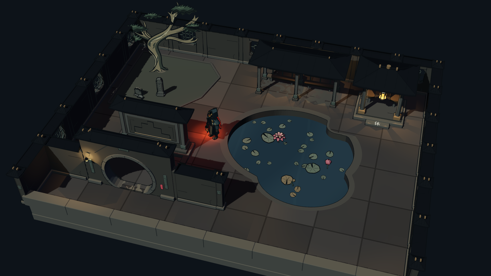
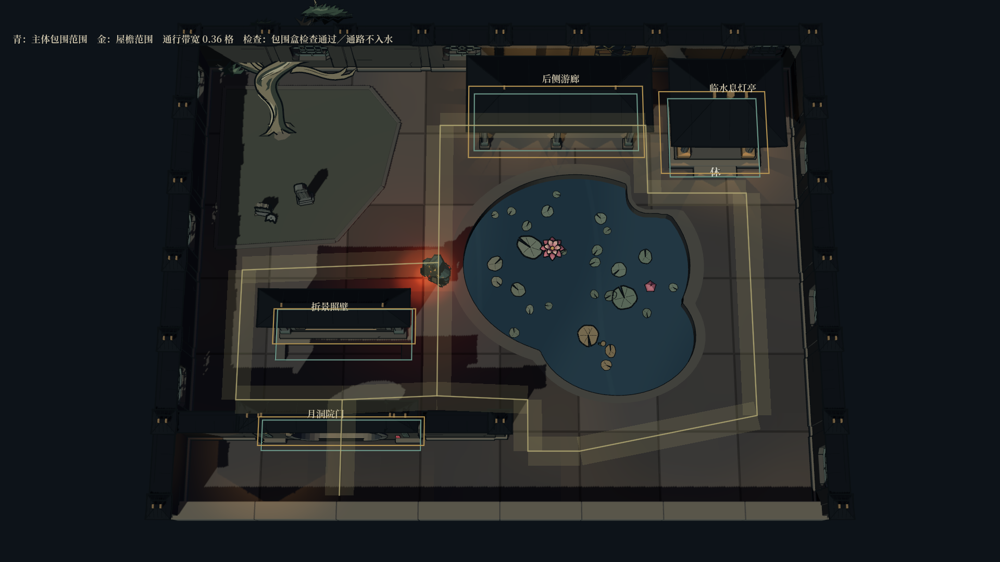

# 荷池小院：手工园林布局样板

2026-10-17。按“先做小庭院样板”的选择制作，使用项目既有 Godot 模型与材质。这里先检查建筑如何组成空间，以及实际模型的占地和通行净空；没有替换现有随机地图生成器。



## 原布局的问题

1. `garden_layout.gd` 用手写矩形做避让，主体、屋檐、支脚与入口没有分别描述。例如照壁的实际主体前后跨度约为 0.663 格，原登记仅为 0.50 格。
2. `map_gen.gd` 放功能建筑时，统一检查 1.12×1.12 的矩形；放置后只登记实体格，没有把该设施加入同一份 `structures` 避让表。后续设施不能通过这份表看见前面的真实建筑范围。
3. 逻辑占格、连通性检查没有覆盖这些模型细节。之前的检查可以通过，画面仍可能拥挤或穿插。
4. 月洞门、照壁、游廊、设施更接近独立陈列。门没有接分隔墙，廊与岸线、亭的入口缺少关系；大量均匀铺地也削弱了庭院层次。

## 这块样板怎样组织

采用 8×6 的小院：门墙分出入口前院，月洞门后以照壁挡住直线视野；从两侧绕行后见荷池。池子作为主要空间，游廊靠后墙，息灯亭面向池岸，怪松与残碑集中在另一侧的种植区。

- **门与墙是一组**：连接处共用门翼，不再叠放第二根端柱；以小段收口石封住接缝。
- **照壁负责折景**：前后留出绕行空间，不将它贴在月洞门上。
- **廊与亭靠边，池子居中偏侧**：保留连续的绕池干地，廊端转向、亭前落脚均有净空。
- **植物与碑石成组**：种植区与铺地分开，怪松、矮残碑与高碑共同构成冥府园景。
- **按空间选素材**：使用原有盛莲、花苞、残荷和零散小莲叶。这块池不需要跨水捷径，因此没有强放石桥、商店、赏匣等其他资产。

前墙在样板中剖低以便观察，其他三面保留完整漏窗围墙。正式地图的四边围合逻辑没有变更。

## 占地与重叠检查



`garden_asset_bounds.gd` 从已构建的网格读取世界坐标范围，分别记录主体与屋檐；不计屏幕描边和地面刻字。建筑间先检查整件包围盒，再检查分件包围盒，避免仅凭一格代理判断。

当前四件主建筑的实际外包尺寸如下，单位为样板地面格，已包含各自的实例缩放：

| 建筑 | 主体宽×深 | 屋檐宽×深 |
|---|---:|---:|
| 月洞院门 | 2.000×0.384 | 2.090×0.360 |
| 折景照壁 | 1.740×0.663 | 1.825×0.460 |
| 后侧游廊 | 2.190×0.810 | 2.340×1.015 |
| 临水息灯亭 | 1.188×1.109 | 1.426×1.159 |

青线显示主体外包范围，金线显示屋檐范围。外包矩形包含门洞、廊下等空处，不能直接当作实心碰撞体。半透明带显示宽 0.36 格的通行净空，每约 0.05 格采样检查水岸及低处构件；游廊地板允许通过，柱子与座凳则阻挡通路。

本次也把游廊的完整吊灯组件移到后排座凳上方，避免吊灯悬在中央行走带。人物采用这块小院的统一观察比例，保留既有瘦高造型。

这些检查是保守的分件包围盒筛查，未做逐三角形碰撞检测，也没有验证正式地图的四向格网寻路。门墙的明确共用接缝单独豁免；其他建筑与外墙仍参与检查。树与碑石位于通路外的种植区，本轮没有把它们当作可通行建筑验证。

## 接回生成器时采用的规则

| 需要区分的数据 | 用途 |
|---|---|
| 实体占地与廊下可走区 | 避开柱、支脚、座凳，允许从真实门洞和廊下通过 |
| 屋檐与高处轮廓 | 拒绝非预期的屋顶穿插；普通前后遮挡交给局部淡化处理 |
| 入口与交互前场 | 放建筑之前就保留玩家能站立、接近和点击的位置 |
| 门墙、廊、桥的连接口 | 按连接口拼接，允许标记过的共用柱和接缝 |
| 同一份占用登记 | 景观建筑与功能设施都写入，避免后放的建筑忽略先放的设施 |

先生成庭院分区、门墙关系、池岸和通路，再选适合的位置放建筑，最后填奖励与装饰。接入正式地图前还要把样板通路适配到四向格网，并复查首领追逐、功能入口和探索迷雾；本轮没有改动这些玩法规则。

## 预览与验证

直接运行 `res://src/tools/expedition_courtyard_study.tscn`。

- 三个视图：小院总览、占地与通行检查、入口近看。
- 左键拖动转看，中键拖看，滚轮缩放；可切换检查覆盖层、灯笼及材质颜色。
- 独立场景不创建远征，也不消耗玩法随机数。

原生捕获命令：

```text
<godot> --path . --resolution 1920x1080 --scene res://tests/expedition_courtyard_capture.tscn
```

本轮原生检查 **11 项通过、0 项失败**，包括建筑与净空筛查、相邻地形共边采样一致、状态隔离和两种分辨率截图。Godot 4.7.2 Forward+ 捕获；这些图是运行画面。

| 截图 | 内容 |
|---|---|
| [总览 · 1920](01-courtyard-overview-1920.png) | 门墙、照壁、荷池、后廊与亭的整体关系 |
| [范围检查](02-clearance-plan-1920.png) | 主体、屋檐和通行净空 |
| [入口近景](03-entrance-1920.png) | 门墙收口、折景与岸壁厚度 |
| [另一个角度](04-courtyard-reverse-1920.png) | 检查立面及前后关系 |
| [总览 · 1280](05-courtyard-overview-1280.png) | 缩小后的整体辨识 |
| [可交互工作台](06-courtyard-workbench-1280.png) | 视角、配色和检查开关 |
