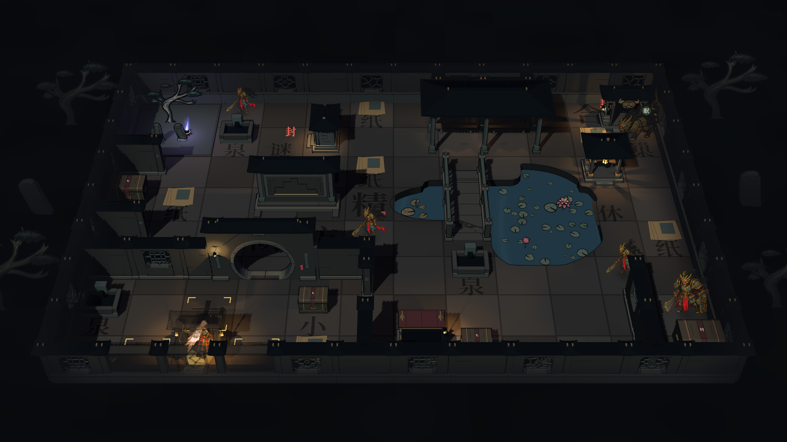
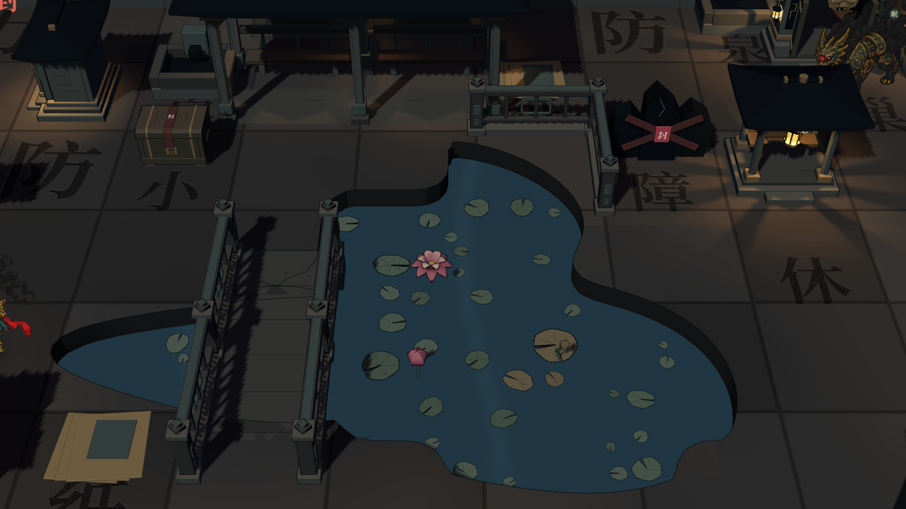
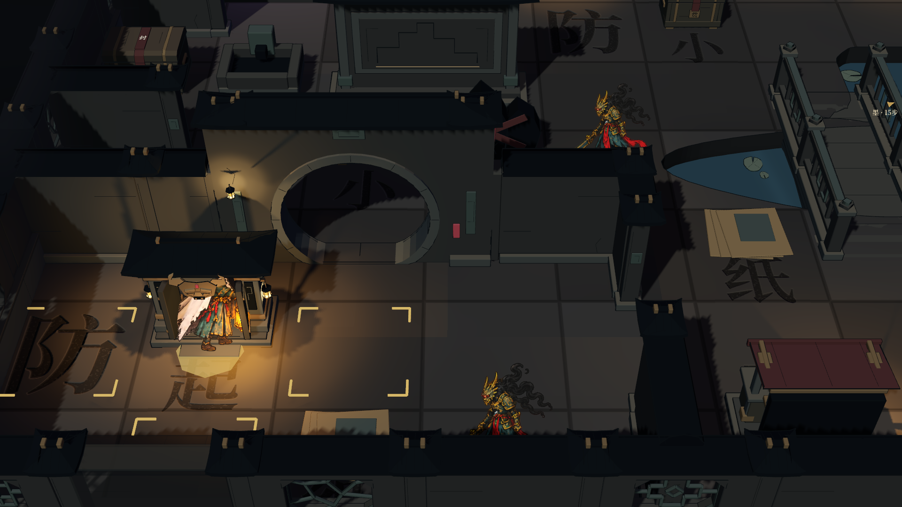

# garden_v2：连续池形与连接庭院

2026-10-17。手工小院的空间关系已接入正常远征随机生成，新开远征和后续幕次使用此版本。仍为 12×8、四向移动，沿用视野、主题机关、伏兵、首领追逐及战斗往返。



截图为 Godot 4.7.2 Forward+ 实机，全揭示用于检查布局；正常游戏继续使用探索迷雾。

## 生成顺序

1. 划分门前小庭、折景碑庭和临池区域，起点位于前庭。
2. 决定庭院宽度、门的位置、桥位和池塘家族，用独立布局种子生成轮廓。
3. 把门接入内墙，预留侧门；安排照壁、怪松碑石种植区、后廊和桥头。
4. 在边缘生成奖励院角，再放首领门阙、临池休息亭、前庭字摊与问字龛。
5. 统一检查建筑范围、实体格、入口与连通性，然后安排其余奖励、散字、敌人和机关。
6. 校验伏兵领地、首领可达和初见节奏，生成实际连续地面与岸壁。

这是同一庭院骨架的可控随机变体：庭院有两种宽度，桥位和门位置会变化，内容位置仍受玩法约束；还不是任意形状的园林片段求解器。

## 池塘怎样变化

| 家族 | 轮廓构成 |
|---|---|
| 绕池型 | 宽池与较小侧池平滑合并，改变长宽、偏移和旋转 |
| 双汀型 | 两块偏移水面通过较窄部分连接，再切出岸边凹湾 |
| 曲渠型 | 多块沿折线错开的水面合并，形成较长的曲池 |

形状使用同一个连续标量场裁切地面与岸壁，相邻模块读取相同世界坐标，不靠随机旋转独立方池。低幅岸线扰动继续打散轮廓；没有为每块地砖另起随机数。

桥的侧汊单独保留，凹湾不能把桥两侧的水格削成干地。每条合法移动边保留半径 0.26 格的干地带，桥头、廊前和建筑范围也约束池岸。干地中远离真实水格的小水片受到抑制，避免廊前出现细碎孤立水面。

原有盛莲、花苞、残荷和零散小莲叶继续按实际水域放置，不附带重复方池。



## 墙体与建筑关系

- 前庭内墙从西侧外围墙接到月洞门，经门翼转折；另一段接回南侧外围墙，中间留出侧门。因此前庭有两个出口，不形成唯一咽喉。
- 后廊背后的座凳有对应的逻辑阻挡，薄夹墙两端接回北侧外围，不能从廊下穿过后座。
- 奖励支路以接在外围墙上的院角围合，替代原来的 U 形零散水坑。每组内墙都通过连接点或门翼接回外围。
- 墙体支持半段实墙补齐，半段不压缩雕花漏窗。转角共用柱，门翼接缝省去重复端柱并补石收口。
- 内墙按段接入探索、暗化和遮挡淡化；外围墙继续保留不透明墙基。



## 占地与交互

`garden_asset_layout.gd` 集中维护生产缩放下的模型范围；景观、功能设施、起点与首领门阙都写入同一份 `occupancy`。设施放下后，后续放置会检查它的范围，包含朝向和边缘内缩后的实际偏移。

功能建筑的实体格与站立入口分开：点建筑选择入口，不能站进建筑基座。点击包围范围与遮挡计算也改为使用模型偏移，旋转后的字摊不会继续沿用未旋转的点击框。

游廊按通行净空调整生产比例；地台衔接修复后，地板与桥面高于普通地面 0.07 地图单位，通过石坡接回 y=0，详见[地台衔接修复](../2026-10-17-floor-joins/README.md)。吊灯移到后座上方，中央行走带保持空出。怪松与高低残碑集中放入种植区。

生成阶段使用保守外包范围，原生检查再读取实际网格做分件包围盒筛查，并检查生成范围是否覆盖模型。它不是逐三角形碰撞求解器；门墙的共用接缝属于明确的拼接关系。

## 确定性与兼容

- 布局和装饰使用独立种子；镜头、素材组装与迷雾刷新不消耗玩法随机数。
- 不同请求种子使用分散的候选序列，避免相邻种子在重试后汇聚成同一张图。
- 候选耗尽时先尝试经验证的同主题庭院，保留拒绝原因和保底标记；若后续规则使保底也失效，仍保留旧生成器作为最后兜底。
- 地形缓存签名包含完整布局，池形、建筑范围或墙体变化不会误用旧网格。
- 已生成的地图不在中途重写；旧版园林数据保留原来的模型比例。四主题复用新布局与既有机关，专属主题建筑素材仍按后续制作处理。

## 实机与验证

| 请求种子／墨池 | 实际地图种子 | 类型 | 总览 |
|---:|---:|---|---|
| 9 | 104738 | 绕池型 | [1920 图](01-overview-seed-9-1920.png) |
| 11 | 2618236 | 双汀型 | [1920 图](01-overview-seed-11-1920.png) |
| 5 | 3560791 | 曲渠型 | [1920 图](01-overview-seed-5-1920.png) |

另有 [1280×720 总览](04-overview-1280.png)。

| 检查 | 结果 |
|---|---|
| 随机生成，四主题 × 16 个样本及保底 | 182 通过，0 失败 |
| 原生网格范围、建筑穿插筛查、内墙迷雾、设施命中及三类池形捕获 | 31 通过，0 失败 |
| 地图交互、两种分辨率、岸线拼接、探索迷雾及主题状态回归 | 67 通过，0 失败 |
| 远征、首领追逐、战斗与幕间往返回归 | 122 通过，0 失败 |

[原生捕获日志](runtime-capture.log) · [地图交互日志](map-view.log)

```text
<godot> --headless --path . --scene res://tests/garden_map_generation_test.tscn
<godot> --path . --scene res://tests/garden_courtyard_runtime_capture.tscn
<godot> --path . --scene res://tests/expedition_map_view_test.tscn
<godot> --headless --path . --scene res://tests/expedition_test.tscn
```

主要接入文件：`src/expedition/garden_layout.gd`、`garden_asset_layout.gd`、`map_gen.gd`，以及 `src/map/expedition_garden_scenery.gd`、`expedition_garden_boundary.gd`、`expedition_terrain.gd`、`expedition_map_art.gd`、`expedition_map_view.gd`。
