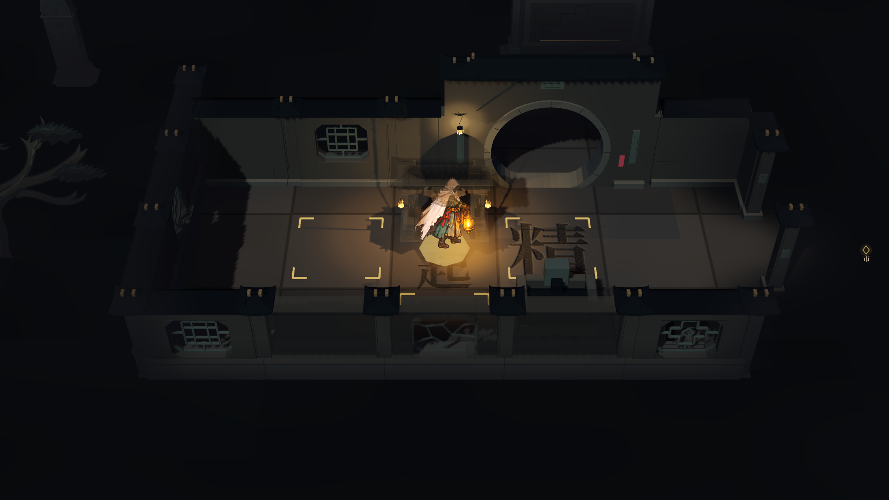
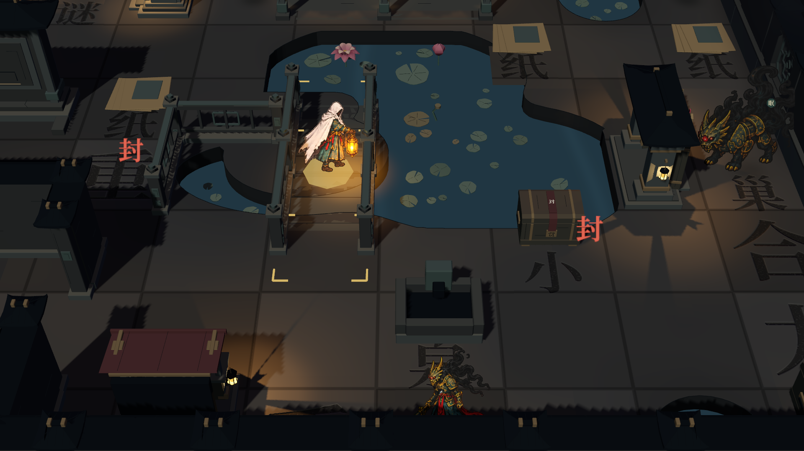
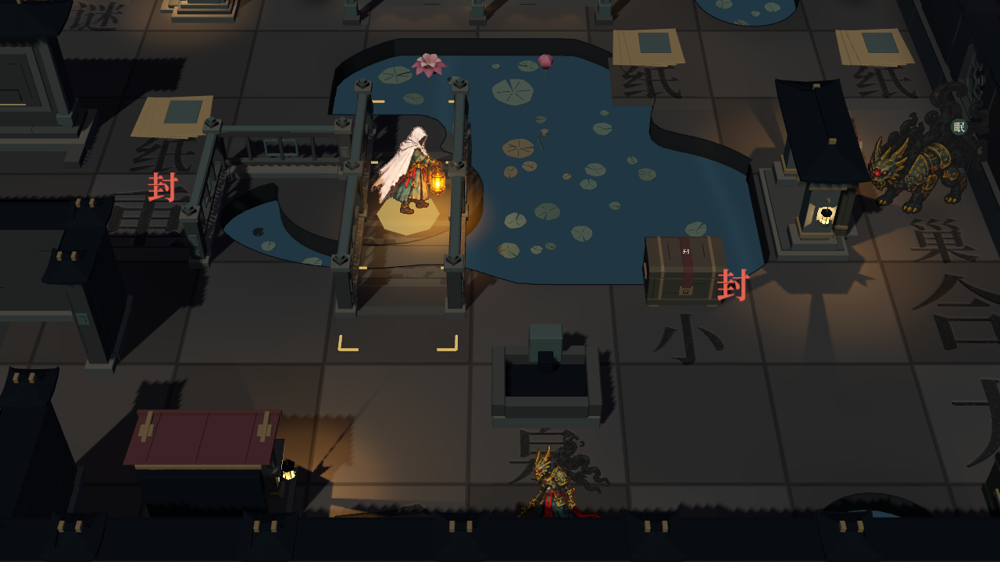
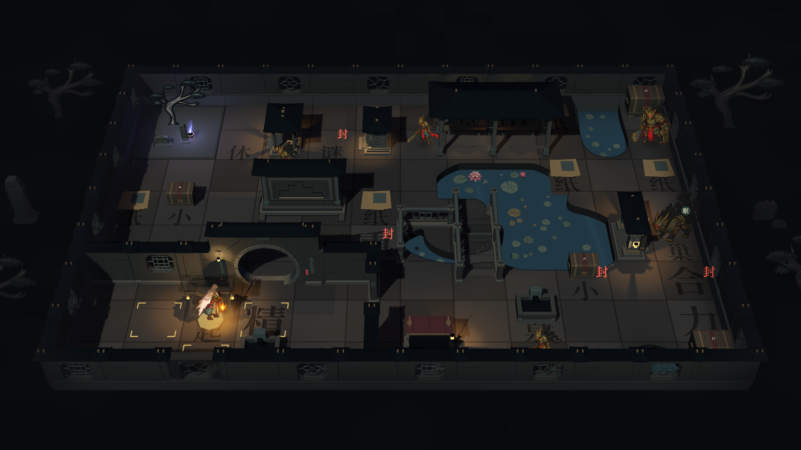
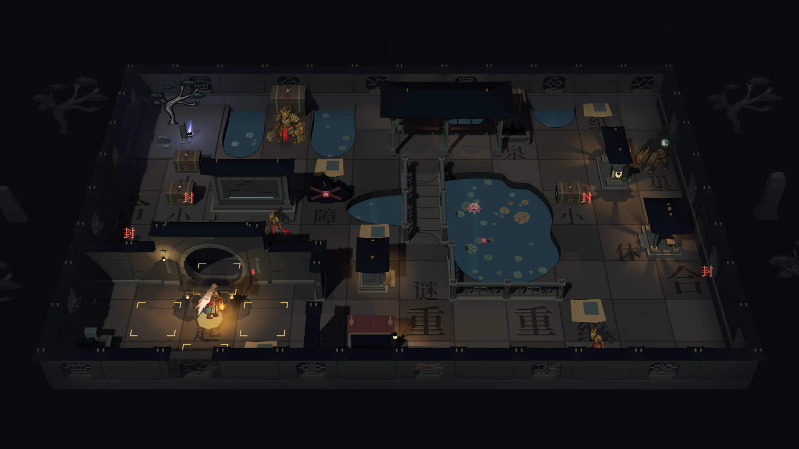
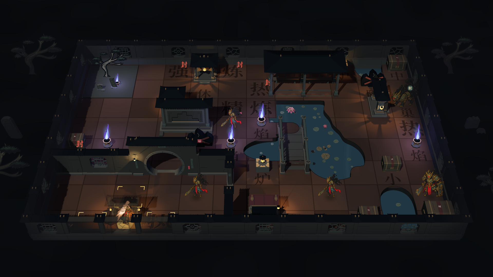

# 生成园林 · 实际远征组装

Godot 4.7.2 Forward+ / Vulkan 原生画面。运行游戏进入远征即可使用 `garden_v1`，不再局限于独立模型工作台。

## 正常开局

保留实际探索迷雾，建筑按真实入口揭示。

## 真实桥面与临池游廊

行者通过鼠标点击实际进入桥面格。桥上、普通地面与廊面使用同一行走高度，水面和小莲叶位于下方。截图以全揭示状态检查组合。

## 不同布局

第一轮保留三种结构变体，复用现有奖励、机关、守卫与首领规则。以下总览同样为全揭示调试画面；正常探索不会显示未探索内容。

运行 `res://tests/garden_map_assembly_capture.tscn` 重现七张截图，同时检查真实鼠标移动、桥面通行、廊下屋顶淡化和地形缓存。

首轮组装捕获 **16 项通过**；生成数据 **82 项通过**；实际地图 GPU 回归 **66 项通过**；远征／战斗往返 **121 项通过**。完整规则取舍和当前范围见[地图生成接入记录](../../../地图生成规则与园林接入记录.md)。
