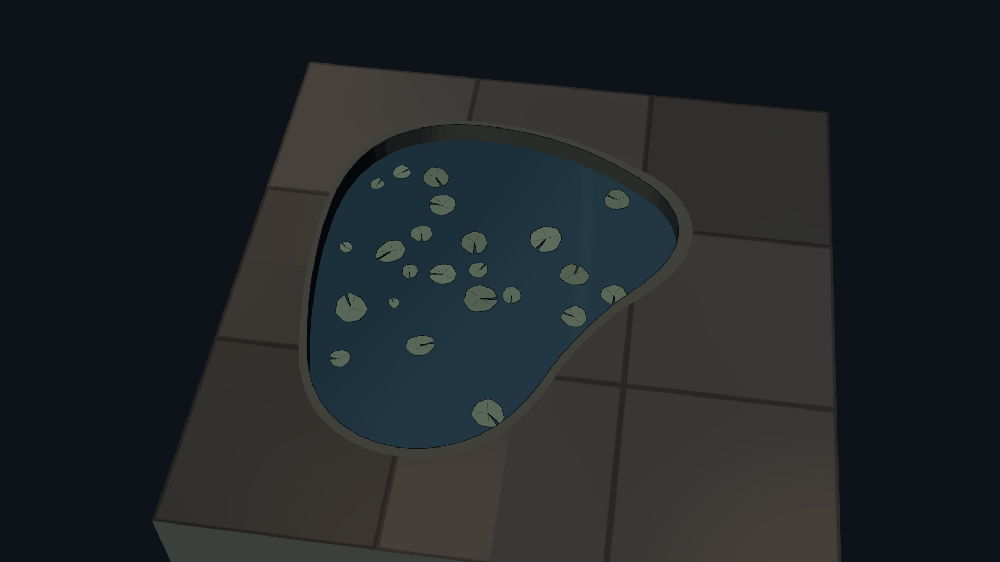
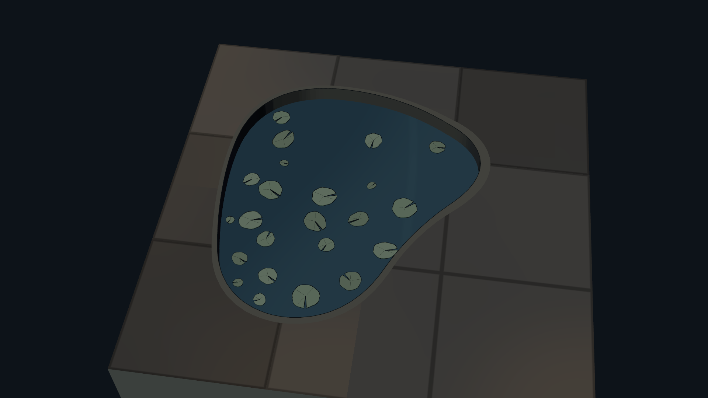
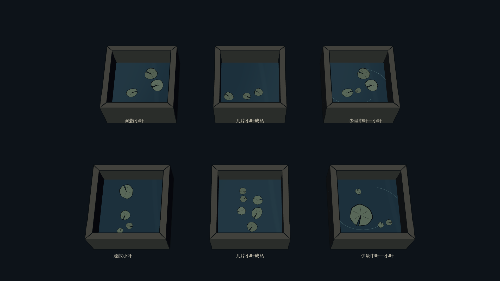
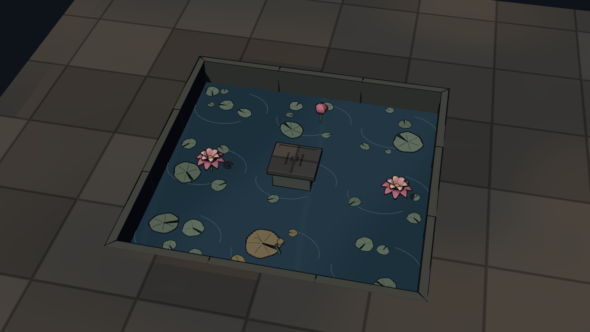
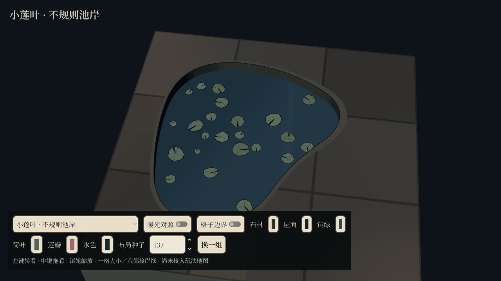

# 零散小莲叶 · Godot 原生样板

本轮将原来固定的两片叶子改为种子布局，同时提供更小、更疏散的叶片。沿用已有缺口叶形、灰绿分色与墨线，不改水面和园林风格。

## 实机效果

叶片作为独立层撒在同一片不规则水面上，大小、朝向、椭圆比例和位置均有变化。采样范围覆盖整池，叶片可以跨逻辑格，避免按格复制同一组构图。

同一参数更换种子后，得到另一组位置与大小。检查叶心和边缘均在水内，保留石地与岸沿。

独立格子提供疏散小叶、小丛和少量中叶混生。上下两排使用不同种子。前侧厚岸在这个旧深水格样板里仍保留真实遮挡。

原有含苞、盛莲、残荷与踏石格也采用变化叶片，花瓣与建筑保持既有造型。

## 操作与资产

- 运行 `res://src/tools/expedition_lotus_lab.tscn`，选择下拉末尾三项。
- 修改“布局种子”或点击“换一组”。同种子复现相同布局，不消耗游戏随机数。
- 增加 `lotus_scattered_leaves.tscn`、`lotus_small_cluster.tscn`、`lotus_tiny_leaves.tscn` 三个场景。
- 纯叶片层为 `src/map/expedition_lotus_leaf_layer.gd`，可指定大小范围、数量、分布区域、水位与水面检测函数。
- 生成时避免叶片彼此堆叠、避开石地与踏石；空间不足时少放几片。小叶采用更少的叶脉和较轻的墨线，保留清晰缺口。
- 当前仍是独立模型与预览，没有接入游戏地图。
- [完整资产说明](../../../../assets/expedition/lotus/README.md#零散小莲叶)

## 验证

Godot 4.7.2 Forward+ / Vulkan 原生运行，`res://tests/expedition_lotus_scatter_capture.tscn` **21 项通过，0 项失败**，检查同种子复现、换种子变化、大小／数量／位置变化、不规则水岸避让、踏石留空、三种预制场景实例化、1280×720 工具条与玩法随机数隔离。

截图共八张，覆盖 1920×1080 与 1280×720。新叶片生成后，原莲池场景、岸线与配色检查另有 **31 项通过，0 项失败**；最终两组运行日志均无脚本或渲染错误。
