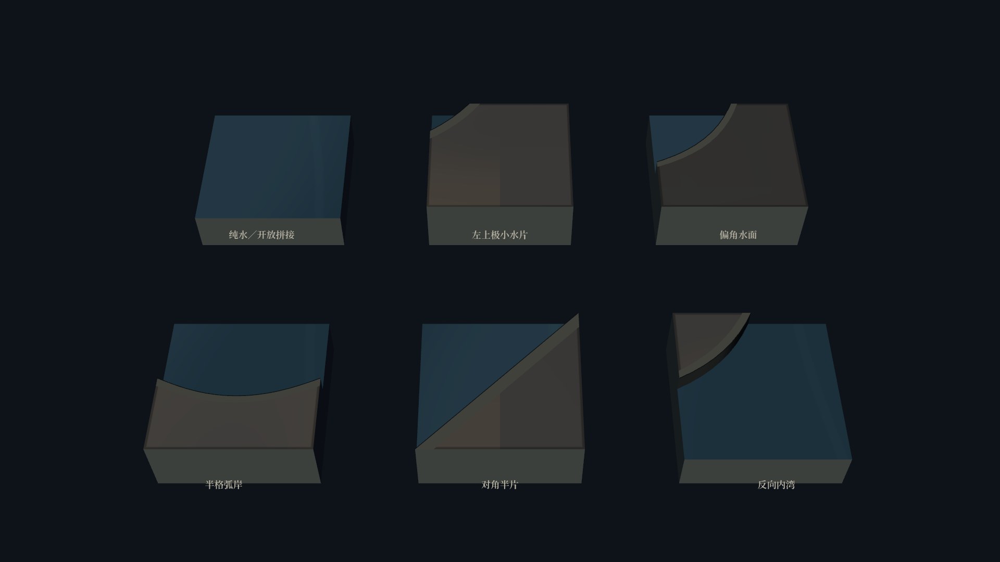
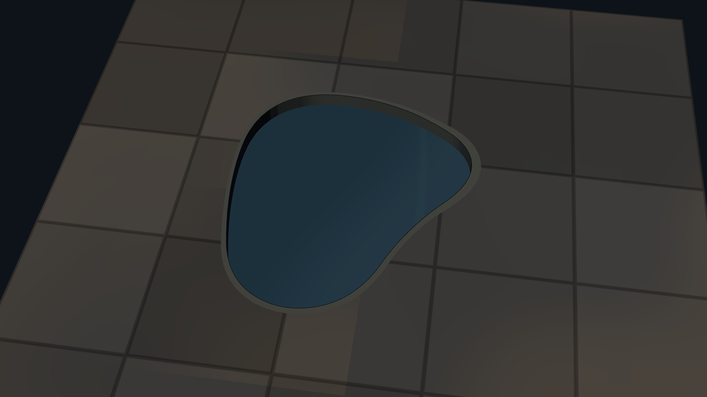
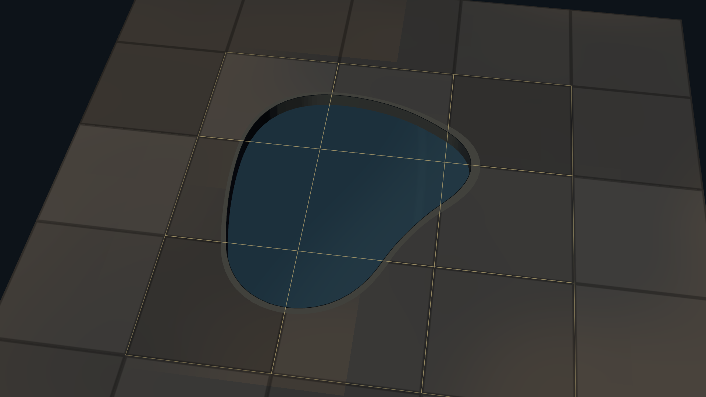
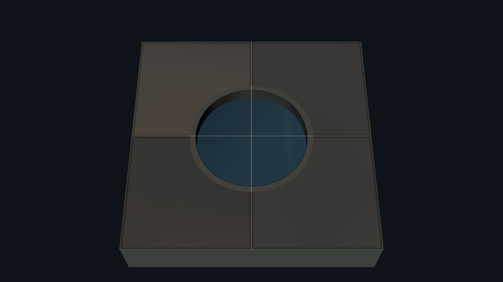
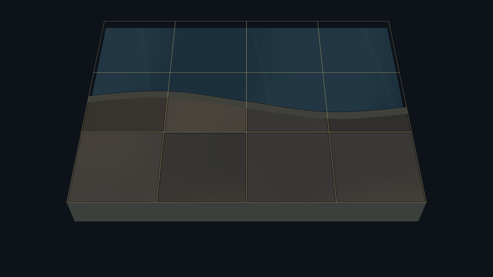
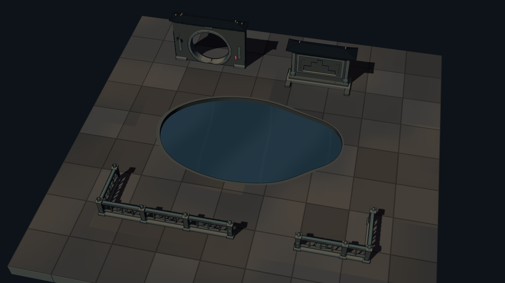

# 无莲叶与局部水面 · Godot 原生样板

本轮补充无莲叶纯水，以及格子内部的小角、半片和反向内湾。延续现有冥府园林的深色石材、轮廓墨线、平涂受光和暗青水色，保持水纹简洁。没有接入随机地图，也没有修改通行、潮水或战斗规则。

## 模块与组合

六种模块的独立剖面展示。左上小片只占格子约 4%，其他部分保留石地；半格和内湾的边界可以接到邻格。

用九个逻辑格生成同一片不规则池塘。岸线跨过格子内部，黄线只是可关闭的检查覆盖层。

四格各占一角，合成小水池。以及跨四列的半格水岸：共边没有额外岸墙，水纹按世界坐标连续。

与已有月洞门、照壁和栏杆同屏检查比例与材质。

## 尺寸与生成

- 模型制作尺寸 2×2，预制根节点缩放 0.5；每个模块占 1×1。
- 新形状的岸顶保持地面高度，水面默认低于地面 0.12 地图单位。浅水位使极小水片在斜俯视下仍可见，`water_depth` 可统一调整。
- `pond_clear` 是原莲池的去植物版本，仍使用原先 0.32 的地图水深；新旧组混合时需统一水位。
- 连续组使用共享格子顶点场，双三次插值保证边界值与切向连续；每片采样裁出互补的地面、窄岸帽与水面，再生成实际下沉岸壁。
- 分格石材纹理和调试格线对齐；共用石地着色器新增偏移参数，默认零值保留现有地图表现。
- 只有外露样板边界显示剖面，内部接缝不会生成剖面墙。所有水色仍可实时修改。
- [资产清单与使用方式](../../../../assets/expedition/lotus/README.md)

## 实机检查

运行 `res://tests/expedition_pond_shape_capture.tscn`，Godot 4.7.2 Forward+ / Vulkan 原生截图。

本轮 **30 项通过，0 项失败**：互补面积覆盖、相邻格共边与切向连续、十六种角点组合、小片与半片占比、纯水无植物、八个场景独立实例化、1280×720 工具条布局及玩法随机状态隔离。另人工检查岸壁、接缝和小角水面的视角遮挡。最终运行日志无脚本或渲染错误。

预览入口为 `res://src/tools/expedition_pond_shape_lab.tscn`，支持转看、拖看、缩放、格线与暖光对照。完整十二张截图覆盖 1920×1080、1280×720 和工具界面。
