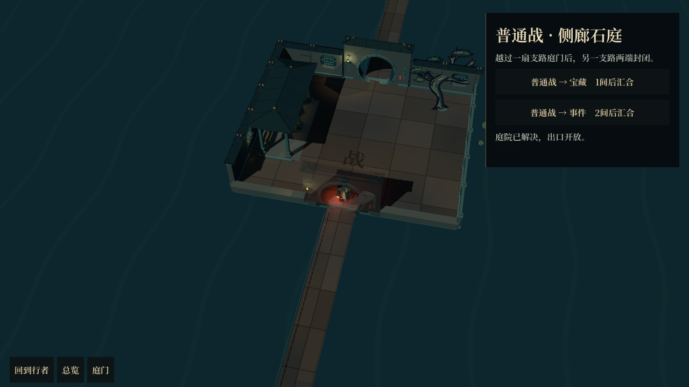

# 庭院房间模式 · 首版接入

后续已接入四种细化桥廊：石拱桥、廊桥、石柱桥、连廊，并同步桥面高度与拾取。新庭院水位改为−0.45，岸台及荷叶一起适配。桥栏已经由简化连接件更新为连续构件，见[桥廊细化记录](../2026-10-17-bridge-kit/README.md)。下文的“首版接线”与截图保留当时状态。

工作分支：`codex/courtyard-room-map`。目录：`huoziluandou-room-map`，不是原来保留未提交合并的 `huoziluandou`。

## 入口与操作

在此目录打开 `project.godot`，F5 后选择「开始新冒险」。有自动存档时可选「继续庭院远征」。原探索与追逐保留在「旧版远征」，自定义构筑仍使用原经典节点流程。

点击石地行走，也可从「庭门」中选择下一房并自动走过去。中键拖看、滚轮缩放；Home 回到行者，M 总览。总览叠加实际桥路与房间节点，只揭示当前之后两房的类型，更远显示问号。点击人物或 I 展开气血、金币、字袋、字匣与版面，没有常驻顶部状态条。

## 本次实际接通

- 八种样板进入运行地图：起点、普通战、事件、火堆、商店、宝藏、精英、首领。
- 每幕生成16–22房，合法路线10–13房、5–7战；三处分叉，包含不同支路长度、内容排列，以及可能出现的三岔路。先经过两场普通战，必经宝藏与首领前火堆，可避开全部精英。
- 路线围主池折回。房间端口根据进出方向适配，转向汇合庭分别决定入口、出口。桥面按通行范围合成，桥头和转角共用一份表面；桥栏沿真实边缘，不重复叠放整座短桥的端坡。
- 人物使用四向细分导航实际走路，不能踏水或从墙外绕入。进入首间支路房的门槛后锁定选择；另一支路的房间与前后连接同时禁行，标记实际封闭位置。走过的前缀可以返回，不刷新收益。
- 普通战、精英与首领接现有 `battle_screen`；战胜后进入现有立体奖励页，再返回原庭院。战斗收益与奖励领取分开结算，重复返回不重复发放。
- 事件复用三组现有事件，内容按房间种子固定；火堆可治疗、删字、给单枚实体镀金，或直接离开；商店支持买字、删字、复制、治疗；宝藏使用缓存的择字奖励。
- 字匣奖励可收入永久字袋，或摆进2×2版面。先适配15个战斗开场/经济词谱，旧追逐和机关词谱不伪装成有效加成；界面说明无对应效果的组合，字仍可回袋用于战斗。未改战斗中的同名单字与词语。
- 首领留在终庭。完成奖励后进入下一幕，第三幕结束后通关；不接旧地图的步耗、伏兵、机关或追逐。

## 保存与调试

自动存档：`user://courtyard-run.tres`，schema=1。保存实际生成的路线及位置、分支选择、已解决房间、商店库存、事件、待选奖励、字匣/版面、永久实体字及修饰、生命金币、遗物绑定、投资与随机状态。读档不重抽内容。

战斗中不保存半场盘面，重新打开游戏恢复到该战的开战前存档；战后已结算则保存到待选奖励阶段。存档失败不会改变路线结果。旧远征状态没有转换成新房间存档。

原 `run_bridge.tscn` 的输入增加 `"mode":"courtyard"` 即可驱动同一个 `RoomRunState`，不另写一套简化规则。例见 [bridge-scenario.json](bridge-scenario.json) 与 [实际输出](bridge-transcript.json)。观察提供当前房间、可去房间、已解房间、封路、分支选择、待选奖励、合法推进动作和 `inventory_actions`；战斗仍使用现有 BattleHarness。

```json
{"mode":"courtyard","seed":17,"actions":[
  {"type":"enter_room","room":"opening_1"},
  {"type":"interact"}
]}
```

## 代码分工

| 文件 | 职责 |
|---|---|
| `src/expedition/room_route_graph.gd` | 独立种子的路线图、分支与内容种子 |
| `src/expedition/garden_room_layout.gd` | 房间变体/方向、门位、桥路、实体避让与动态导航坐标 |
| `src/expedition/room_run_state.gd` | 实机与无头共用推进、遭遇、服务、收益和存档 |
| `src/expedition/room_run_save.gd` | 保留实体修饰与资源的原生存档容器 |
| `src/map/garden_room_visual.gd` | 将已有房间目录组装成运行场景 |
| `src/map/garden_room_map_view.gd` | 视口、地形、相机、射线拾取、行走和按距离装载 |
| `src/map/garden_room_map_overlay.gd` | 位于地图纹理之上的路线与房型标记 |
| `src/screens/room_map_screen.gd` | 按需行囊、房间操作与战斗/奖励跳转 |

地面、刻字材质增加世界范围参数，默认值仍为旧地图12×8；游廊落脚与射线沿用统一的高度定义。装饰和相机不消耗推进随机数。仅加载当前及附近可见房间的完整模型，远处释放细节，由总览标记表示。

## 核对结果与制作范围

[逻辑记录](logic.log)：271项定向断言，检查四个种子的实体布局与路线预算、一个随机幕的全部路线、未选分支从汇合端不可进入、结算一次性、待选奖励/库存保存恢复和进入下一幕。其间战斗用结算桩，不声称逐场实打通过。

[实机记录](runtime.log)与[runtime-errors.log](runtime-errors.log)：Godot Forward+、1280×720，实际行走后调用正式战斗页，以测试伤害结束战斗，进入正式奖励页并返回原庭院。截图来自同一流程。没有重跑全项目回归，也没有把这次运行当作帧耗基准。

当前是可玩的首版接线：三幕推进可用，三幕暂共用墨池美术；其他主题美术、精英/首领专属遗物与印章掉落、旧远征全部词谱的重设计尚未完成。不能把该版当成最终场景美术或完整性能验收。未提交、未推送。

后续细化已接入：[桥路与连廊](../2026-10-17-bridge-kit/README.md)改用石拱桥、廊桥、石柱桥与连续栏杆；[房间细化](../2026-10-17-refined-rooms/README.md)改用完整墙院／开放水榭，取消整面换矮墙，新增植床、字柜和碑座，并按实际相机对局部墙段、门与屋顶透视。下方截图保留首版接线记录，当前画面见这两份更新。

## 实机截图



[起点](01-start.png) · [遭遇](02-encounter.png) · [战斗](03-battle.png) · [奖励](04-reward.png) · [返回原庭院](05-return.png) · [总览](07-overview.png)
