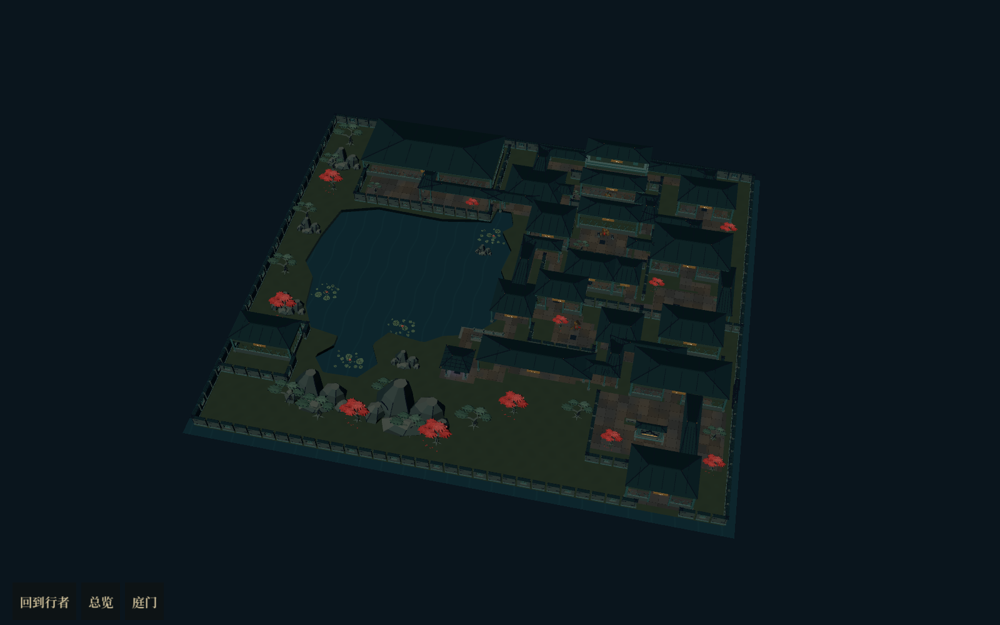
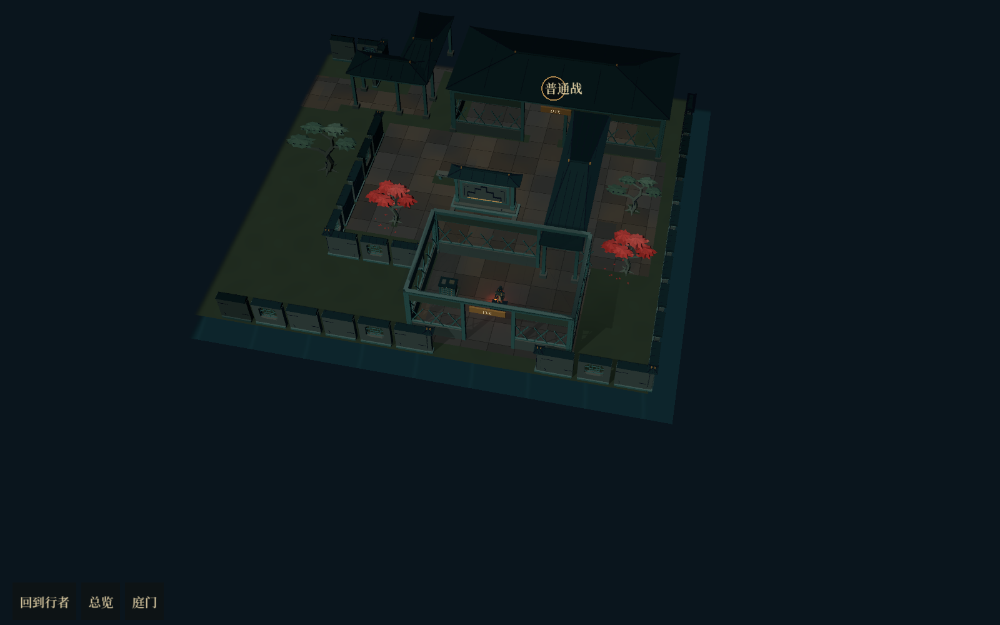

# 手工庭园：固定可玩样板

后续状态：新游戏已改为[种子随机园林](../2026-10-18-random-garden-runtime/README.md)。此页保留固定样板的制作记录与独立运行入口。

2026-10-18，`codex/courtyard-room-map`。已将[手工总平面](../2026-10-18-authored-garden/README.md)接入 Godot 的行走、节点结算及战斗／奖励界面。

## 打开方式

1. 在本分支工作目录打开 `project.godot`。F5 后的「开始新冒险」目前使用随机园林，固定样板请用下面的独立入口。
2. 直接打开 `src/tools/authored_garden_sample.tscn`，按 F6。该入口为种子 29 的可玩样板，不覆盖玩家存档。
3. 调试接口创建运行时可传 `{"seed":29,"layout":"authored_garden"}`。省略 `layout` 的底层 `reset` 仍使用原随机房间模式，便于兼容调试和回归。

继续旧存档仍保留其原有随机房间布局，不强行塞进本样板的 18 个节点。新样板的存档记录布局类型、固定拓扑和独立的内容种子，恢复后继续使用本样板。

## 实际运行画面

上图是实际三维场景的全揭示检查视图，临时关闭迷雾和屋顶遮挡淡化，以便观察建筑组团与主池。游戏正常行走保留探索遮罩；不是默认相机距离，也不是一张替代场景的图片。

- [穿厅后进入普通战](02-hall-encounter.png)
- [沿南廊到临水小亭](03-pavilion-water-tail.png)
- [宝藏奖励返回藏字水榭](04-water-pavilion-return.png)
- [可点击的庭园舆图](06-route-atlas.png)

## 已接入的范围

- 一片主池、连通水尾、北侧小水湾与厚岸壁；池形、地面扣水与通行判定共用多边形数据。
- 地面与铺地各统一成批次网格，廊、厅堂和玩法节点不再各自生成一层完整地基。
- 手工共墙、前庭、夹院、书斋前院与连续建筑组团。厅堂新增可穿行壳体，屋面按实际大小重建，不拉伸实心阁楼充当通道。
- 北侧阁楼上层只承担外观表现，实际行走仍在同一层。
- 沿池廊、水榭、门屋、照壁、亭、石柱桥、墓碑、树木、假山、荷叶、荷花和部分内设。水口桥复用原有桥路模块，亭台地面与通行高度对齐。
- 18 个可选节点，三次二选一，8 条完整路线；单次经过 12 或 13 个节点。普通战、精英、首领、事件、火堆、商店、宝藏、起点沿用原有结算。
- 弃支在入口和汇合端封闭；封印以实际首个不可通行点定位，封条宽度适配新通道，不从共用廊头把已选支路一起封住。
- 主角跟随、缩放拖看、局部屋顶遮挡、探索遮罩、总览点击和独立行囊浮层继续工作。行囊开关不参与地图镜头取景。

## 对平面图做的必要修正

1. 迎字厅到转廊的共墙留出真实开口。
2. 南廊入口缩短墙端，给转向留出净空。
3. 删除水榭侧门前多余的短墙，避免路线擦墙。
4. 北侧夹道收短横墙，保留通行宽度。
5. 听雨书屋改为直接从侧门进入镇碑夹庭，避开息灯水榭的后段通路。
6. 前庭铺地扩大为完整院地；树干、碑座、桌柜、桥栏与亭内座椅进入静态避让。
7. 去掉小亭背后与现有亭顶交叠的短廊顶，亭顶也参与遮挡处理。

这些调整保留主池、东侧组团、北侧后殿和三处分支的大关系。运行权威数据为 `assets/expedition/layouts/mochi_garden_v1.json`；概念图不作为运行坐标来源。

## 结构

| 文件 | 职责 |
| --- | --- |
| `authored_garden_plan.gd` | 固定拓扑、节点区域、共用通行网格与静态障碍 |
| `authored_garden_ground.gd` | 一次生成地形、岸壁和统一铺地 |
| `garden_passage_building.gd` | 可通行厅堂、门洞、廊与可淡化屋顶 |
| `authored_garden_visual.gd` | 整园建筑、装饰、敌人与设施、揭示和遮挡 |
| 现有 `room_run_state.gd` | 分支选择、内容种子、事件与战斗结算、存档 |

## 验证与当前边界

- 固定样板全部 8 条路线：414 项检查通过，覆盖落脚、实际通路、弃支封闭与存档恢复。
- 原随机房间模式：271 项路线检查通过。
- 奖励结算：22 项检查通过。
- 行囊交互：56 项检查通过，覆盖横屏、竖屏及镜头构图保持。
- 实际 Vulkan Forward+ 运行走过门屋→迎字厅战斗→奖励返回→转廊→南廊→小亭→短桥→宝藏奖励→水榭返回，未报告脚本或渲染错误；另核对固定样板舆图的 18 个节点点击。

本版是可玩的空间样板，当前新游戏的各幕复用这一个园林骨架，内容随种子和幕变化。尚未扩展多套空间骨架的随机组合；建筑细部、屋面接缝与内设丰富度仍可在此基础上继续制作。西南山石与听石轩先承担借景，不额外开放一条奖励路线。
