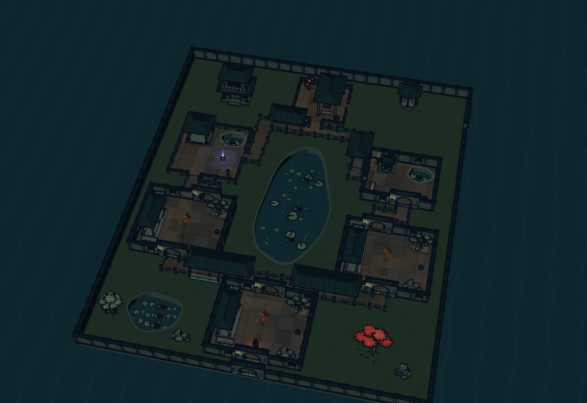
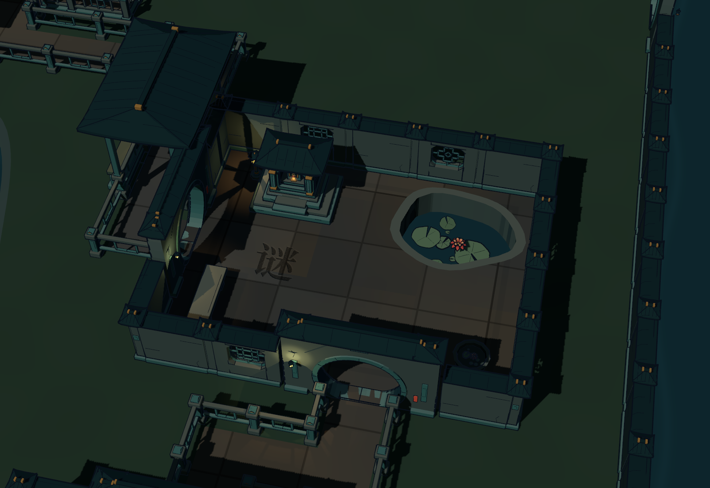
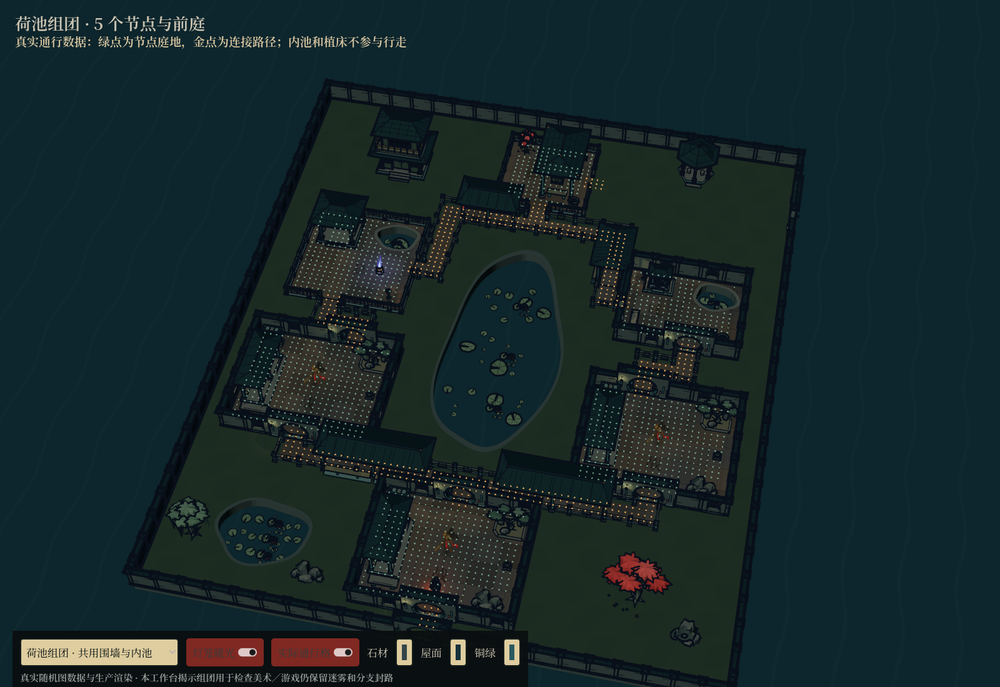
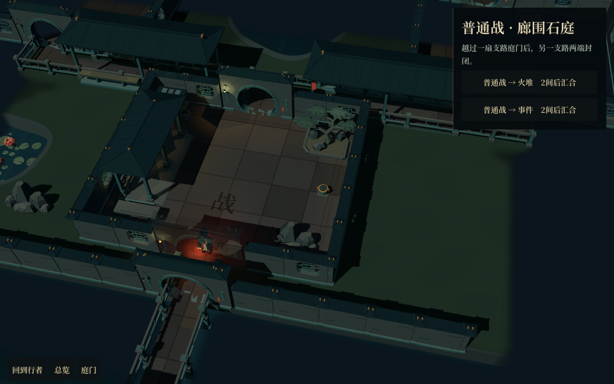
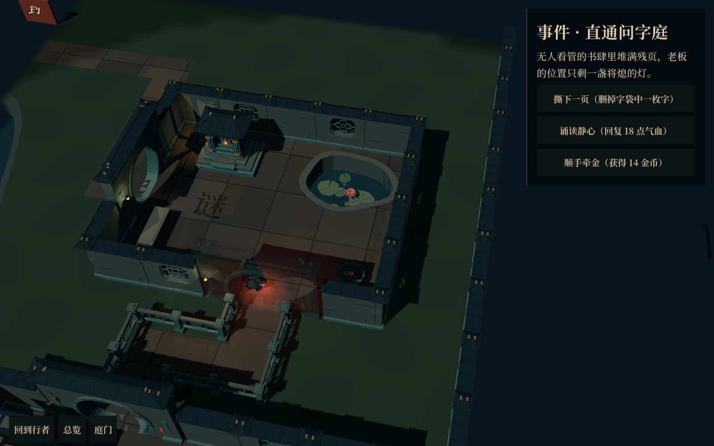
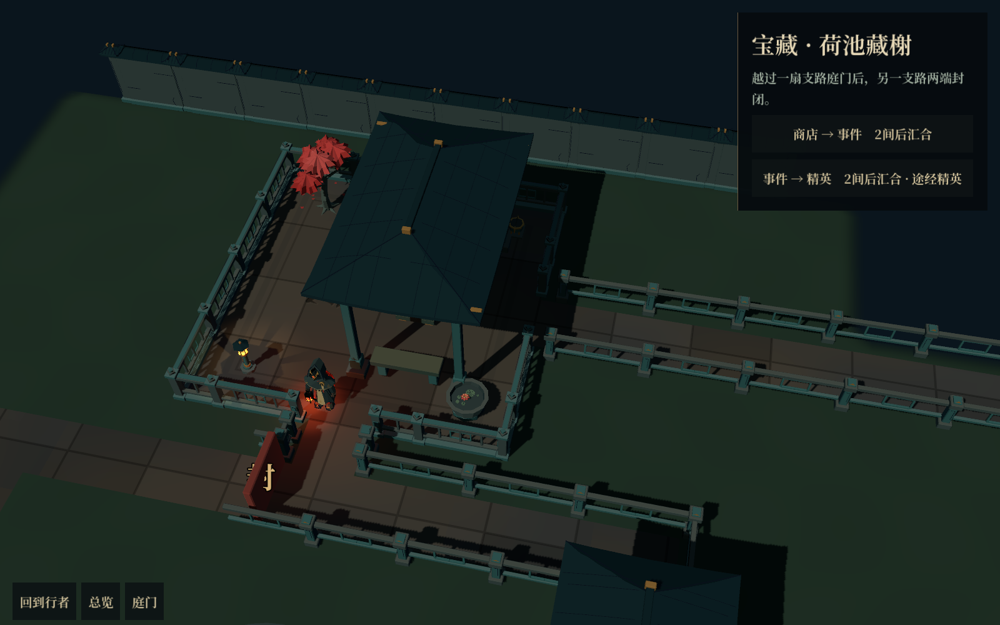

# 荷池组团：第一处分叉接入

本轮将第一处分叉替换为围池双翼布局，接入正常庭院远征；没有新增战斗、奖励或服务次数。其余两处分叉暂沿用旧布局。

- 工作目录：`D:/Projects/Games/GameProject/huoziluandou-room-map`，分支 `codex/courtyard-room-map`。
- 种子 29：前庭之后左右各两间，最后汇合到宝藏水榭。其他种子保留既有分支长度和内容。
- 共用外墙内设置主莲池、前庭小池、阁楼、六角亭、树木与假山。小庭门位错开，以短折路和带顶连廊连接。
- 上层事件／休息庭增加内池。地面真实开孔，水面下沉，池形与实际通行使用同一字段。
- 两翼仍分别归属各自路线。选择后另一翼两端封闭，共用园地不会成为绕路入口。
- 原有局部镜头、迷雾、节点结算和存档继续使用。新旧存档使用布局版本 3，保留节点 ID、内容种子和玩法进度。

## 看效果

`01` 是生产渲染器与实际随机布局的全揭示工作台截图，用来观察整体密度；`04`—`06` 是正常地图界面中的迷雾、行走与结算往返截图。

## 复现

在此工作目录运行主场景即可进入新版庭院，完成前两场战斗后到达首个组团。独立观察场景为 `res://src/tools/garden_cluster_lab.tscn`，默认展示种子 29；可切换整体与内池局部，勾选实际通行格，无需先进行战斗。

检查场景：`garden_cluster_test.tscn` 检查五个种子的池形、院门、路线所有权及两翼推进／保存恢复；`garden_cluster_runtime_capture.tscn` 经过真实主场景，使用正常行走接口到达事件庭与汇合庭，检查水面点击、迷雾、投影拾取和奖励返回。

已通过整幕路线 271 项、房间内设通行 107 项、桥面与廊路 32 项、组团几何及存档 90 项检查。实机记录见本目录 `runtime.log`；截图由 Godot 原生渲染生成，没有另行绘制贴图式概念图。

本轮限制：共用景观园地暂不可自由穿行，非节点建筑仅作对景；首个组团暂为固定的围池双翼骨架，节点内容、长度和池岸扰动由种子变化。后续可继续压合独立庭墙、增加贴池岸廊和其他组团骨架。
