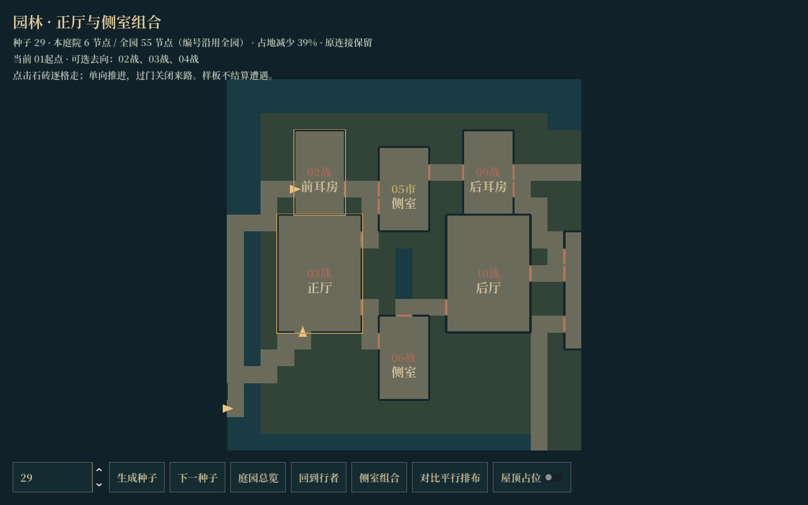
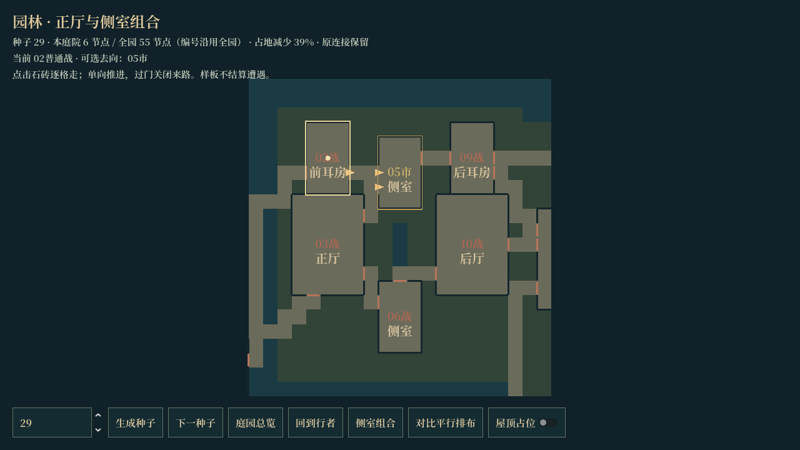
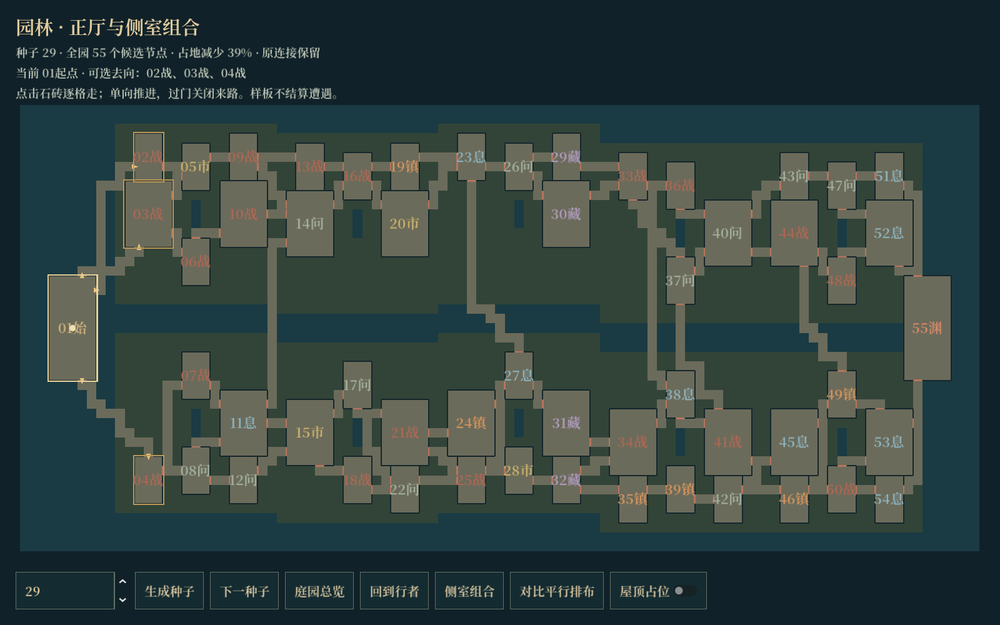
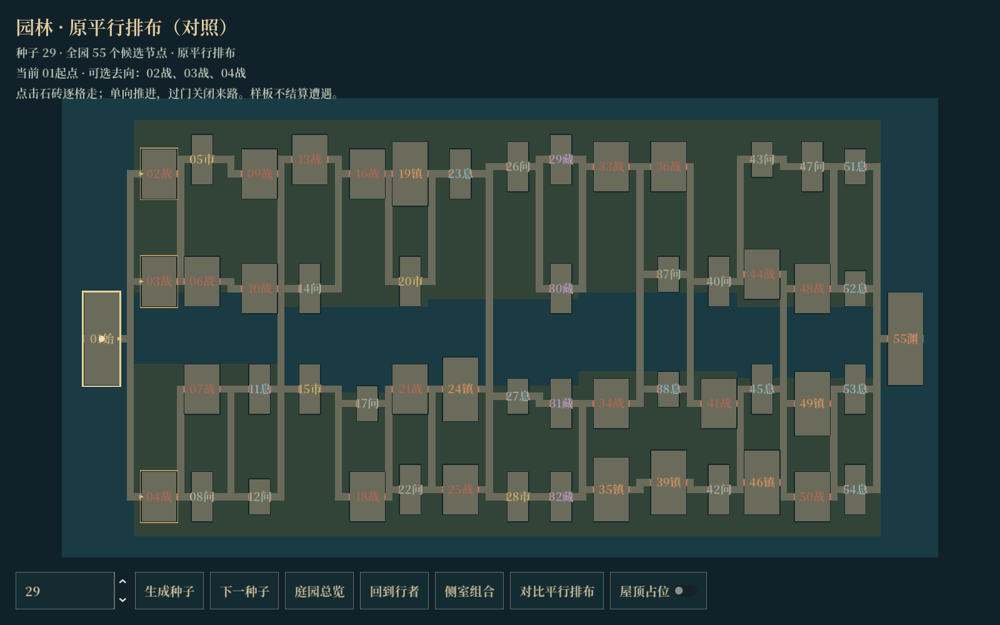

# 正厅、侧室与耳房的紧凑组合

本轮按“压缩空间占地”处理。原来 55 节点的内容和连接列表保留，空间改为十组院落；每组三至六个停靠点组合成正厅、前后耳房、侧室和后厅。本目录的工具仍是占地验证样板，不结算战斗和奖励；该布局现已接入正式节点流程，见 [正式接线说明](../2026-10-18-garden-connected/README.md)，完整试玩入口为 `src/tools/compact_garden_sample.tscn`。

55 是全园候选节点数；一次从起点到首领经过 17 个节点，不是把 55 个全部扫完。「侧室组合」仅显示一个庭院，标题单独统计本庭院节点数；房间编号沿用全园编号，因此不连续。

## 试玩与对照

在 Godot 打开 `src/tools/garden_blockout_sample.tscn`，按 F6。

- 默认显示紧凑组团，可输入种子或切到下一种子。
- 「庭园总览」查看完整 55 节点，「侧室组合」放大选中节点所属院落；未选时显示第一组。
- 「对比平行排布」以同一个种子切回原图，便于比较空间与连接。
- 点击地砖四向逐格走，拖看、缩放和回正保留。节点按有向图推进，不能返回已走房间或补走同层另一支路。
- 当前房间和下一步可选房间用金色轮廓标识；金色门槛箭头标明方向，朱砂色门扇代表关闭。可在同一房间内调整位置，离开房间过门后关闭来路。

## 本次空间变化

- 正厅和后厅形成组团主体；耳房贴在主体侧面，实际共墙，房间之间不额外留一圈长廊。
- 侧室围住内庭，部分节点改从侧向门洞接入；院中保留小池与植物占地。
- 道路按每条原连接选择实际门位，使用四向寻路避开其他房间和池塘。
- 连接同一房间的接近走廊允许形成共用前庭；无共同端点的道路保留间隔，避免凭空接出新十字路。
- 相邻房间不因贴在一起就自动开门；只有原图存在连接且完成布线的墙段才留门洞。
- 每个房间区分入口与出口，两类门位使用不同立面；侧室可穿行，不再要求从入口原路退出来。
- 共墙按单位墙段去重，门洞和导航共用数据。屋顶占位收在各自落脚范围内，避免共墙处重叠。

共用前庭只合并接近走廊，不改变节点有向关系。下一房间的出口在进入前保持关闭，无法通过它跳过中间决策。返回与弃路限制均落在实际门洞；可见门扇和寻路使用同一份推进状态，不在走廊中间添加不可见阻挡。正式战斗结算尚未接入本样板。

## 当前验证

`compact-seeds.json`：64 个种子 × 三幕，共 192 个紧凑布局，1555 项检查通过。覆盖院落重叠、道路穿过无关房间、门桥通行、莲池侵占、全节点可达、原图未被修改、节点及原连接保留、共墙不意外开门、保存恢复及确定性。

`forward-checks.json`：16 个种子 × 三幕，共 48 张图。逐一验证原有向连接、分离的入口与出口、过门关来路、不能回访及跳过节点，以及每次只经过 17 个节点的完整推进路线。实际渲染检查另见 `desktop-blockout.json`，包括局部/全图计数、点击前进及返回拒绝；不作为安卓性能结论。

与同种子的原平行排布相比，整图包围面积减少 **30.4%～47.8%，中位数约 40.0%**。这个数字指布局包围面积，不是模型面数或运行帧率。三维区块加载仍沿用占地样板的轻量实现，精细资产尚未放入。

## 截图

种子 29 的六房组团：

进入前耳房后，起点和另一支路关闭，仅开放下一节点；门扇和箭头随推进状态更新：

同种子紧凑全图：

同种子平行排布对照：

其他种子见 `seed-17-*`、`seed-67-*`；运行截图由 Godot 实际生成，平面总览与三维门墙使用同一份占地数据。

## 代码与检查入口

- `src/expedition/garden_blockout_plan.gd`：原逻辑图、地砖、共墙、门洞、导航及序列化。
- `src/expedition/garden_compact_assembly.gd`：组团占地与原连接重新布线。
- `src/expedition/garden_forward_travel.gd`：单向节点推进、门状态和逐格寻路。
- `tests/garden_compact_test.tscn`：批量种子与连接保持检查。
- `tests/garden_forward_test.tscn`：有向连接、弃路与不可回头检查。
- `tests/garden_blockout_runtime.tscn`：实际点击投影、走格、总览与分区装配检查。

生成及检查过程不使用玩家正式存档或玩法随机数。
