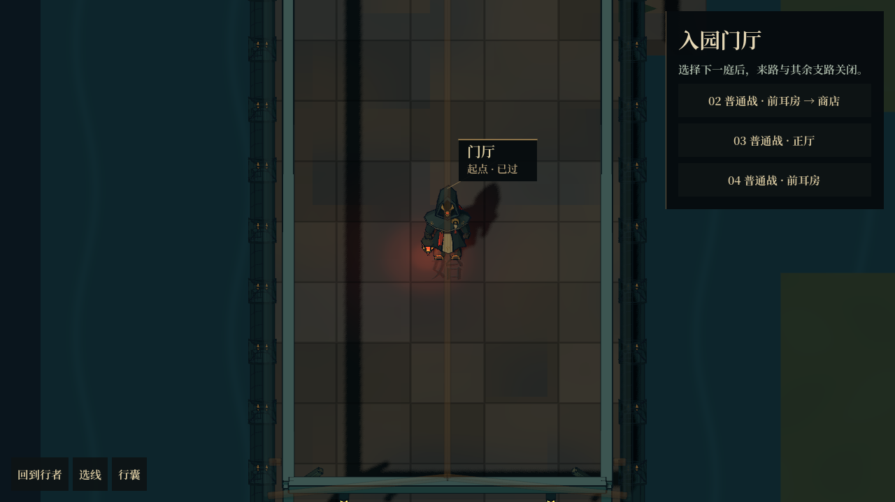
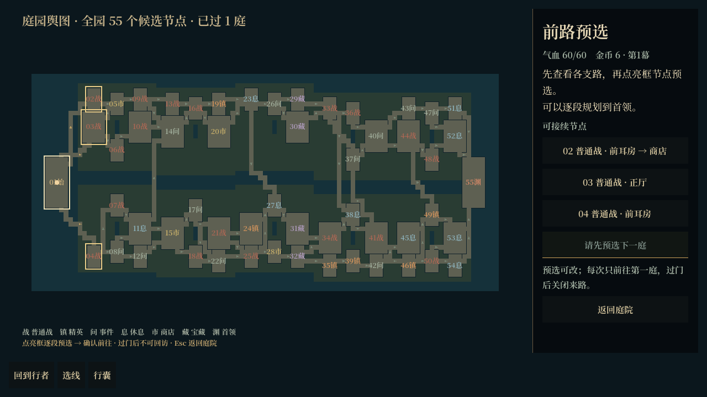
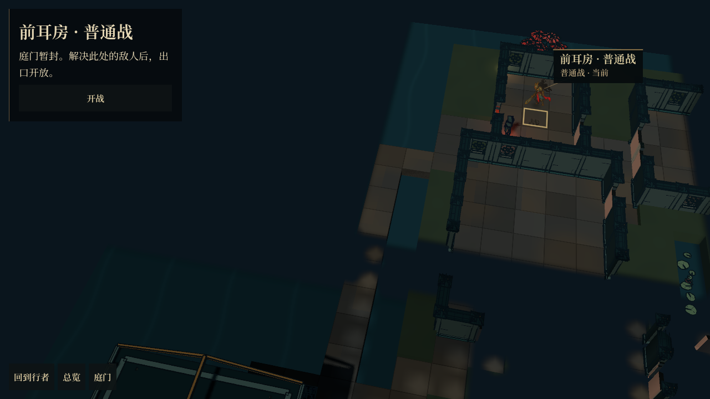
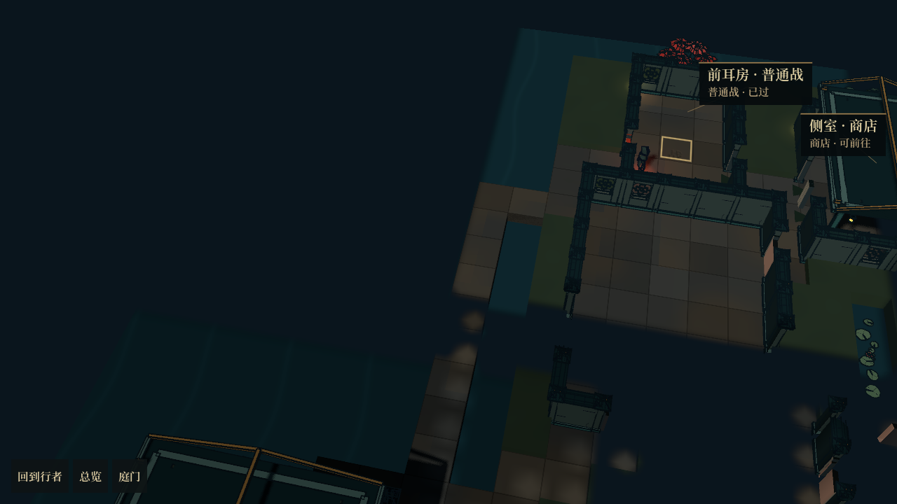

# 紧凑庭院接入正式节点流程

> 后续已修正选线流程、近景投影、人物比例及地形显示条件。当前试玩说明与截图见[选线与渲染修正](../2026-10-18-garden-route-planning/README.md)；本页记录初次节点接线。

分支：`codex/courtyard-room-map`。标题页「开始新冒险」使用新布局；每幕 55 个候选节点，选择一条路线经过 17 个节点。旧存档保留原有布局，新存档保存整张布局、节点内容种子、已过节点、放弃支路和途中位置，不在读档时重新抽地图或事件。

## 试玩

- 正式入口：运行主场景，选择「开始新冒险」。
- 固定种子试玩：F6 运行 `src/tools/compact_garden_sample.tscn`，默认种子 29，接入实际战斗与结算。该预览进程关闭自动存档，重开冒险也不覆盖正式存档。
- 「总览」显示全部节点类型、房间占地和路线方向；金框为下一步可选节点。近景保留拖看、缩放、逐格行走和持灯角色。
- 点击角色打开行囊；事件和服务面板在人物另一侧展开，保持相机位置。战斗和领奖结束返回同一个地图实例。

## 接线范围

- 原布局的节点 ID、共墙、门洞、庭院池塘和有向连接进入 `RoomRunState`。进入下一房间后不能回到已过节点，也不能补走失去可达性的支路；未来仍可汇合的节点保留。
- 门的绘制和逐格寻路共用 `GardenForwardTravel`；遭遇未处理时关闭出口，奖励、事件、商店或休息结算后开放下一步。
- 普通战、精英、首领、宝藏奖励、事件目录、商店库存、休息与字匣管理复用已有协议。开局普通战保留原有较缓的敌人安排。
- 沿用已有窗墙、角色、屋顶、灯、怪松、红枫和莲池素材。屋顶淡化时同时停止投影，避免屋顶消失后地面仍被整片阴影遮住。可见柱脚占据对应角砖，门位不受影响。
- 地形和窗墙按区域合并，显示附近区域，缓存上限 49 区；拖看会加载镜头附近的区域。设施分帧实例化，共用屋顶预先缓存，领奖返回不执行整园构建或屋顶烘焙。后台预载完成后统一回收加载请求，未曾走近的素材也会进入缓存。
- AI 的 `run_bridge` 中，`mode: courtyard` 默认使用新地图；观察数据包含全部节点类型、连接、下一步去向和单向规则。旧布局仍可通过显式 `layout` 参数调用。

这是节点接线和已有素材装配，尚未进行整园美术精修。

## 验证记录

- `run-checks.json`：三个种子、各三幕，覆盖所有节点类型、途中保存恢复、奖励只领取一次、弃路、首领和跨幕；另检查正式开局默认布局。
- `runtime-checks.json`：Godot 实机检查地图点选、逐格行走、战斗、领奖、原实例返回、相机保持、拖看加载、行囊与窗口尺寸变化；另验证第二幕首次战斗领奖仍复用已构建的新幕地图。截图使用实际游戏界面生成。
- 原房间路线和奖励回归分别通过 271 项与 22 项检查。
- 桌面记录中的恢复耗时指界面恢复逻辑，不等同于完整帧耗时；没有安卓实机性能数据。

## 实机截图

## 主要代码

- `src/expedition/garden_compact_run_plan.gd`：布局与正式房间数据适配。
- `src/expedition/room_run_state.gd`：单向推进、遭遇、结算与保存恢复。
- `src/map/garden_compact_visual.gd`：区域地形、共墙和设施装配。
- `src/map/garden_route_overview.gd`：整园路线信息与点选。
- `tests/garden_compact_run_test.tscn`、`tests/garden_compact_runtime.tscn`：逻辑及实机回归入口。
