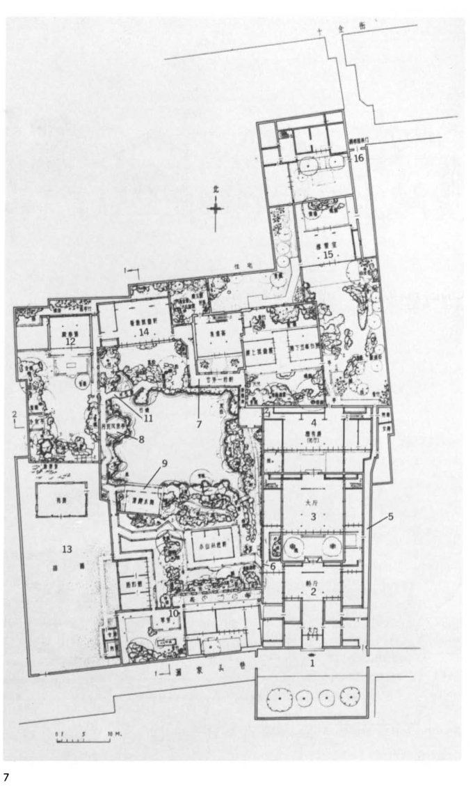
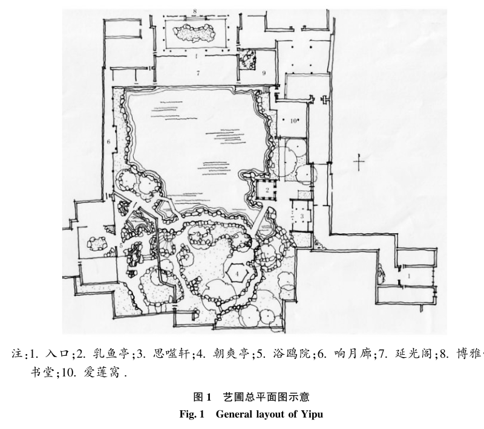

# 中式园林平面参考与地图设计纠偏

日期：2026-10-18。本轮只查阅图纸、整理判断，没有修改地图生成代码。

后续手工推敲见[庭园总平面样板 01](../2026-10-18-authored-garden/README.md)，含空间平面、节点叠加和交互预览；尚未接入随机生成器。

下面区分资料中能确认的空间关系，以及针对本项目的转译建议。参考图是原始出版物的平面图摘录，不是新绘制的游戏设计，也不是可直接使用的美术资产。

## 1. 网师园：建筑组团与主池共同构成园子

- 出处：Alfreda Murck、Wen Fong，*A Chinese Garden Court*，大都会艺术博物馆，1980，印刷页 11，图 7（PDF 第 13 页）。原书注明平面引自刘敦桢《苏州古典园林》，1979。
- [博物馆出版物页面](https://www.metmuseum.org/met-publications/a-chinese-garden-court)
- [博物馆提供的完整 PDF](https://cdn.sanity.io/files/cctd4ker/production/ae1582f686531ad1a320d6e5ddf1c812dfa21552.pdf#page=13)

读图重点：图右侧宅院呈连续进深，厅堂与庭院交替；园景区围绕一片主池组织，建筑、廊、山石贴着池岸或院界布置。西侧殿春簃小院嵌在整体中，不靠长段外部道路独立悬置。主池的开敞与宅院的紧凑同时存在。

对项目的启发：需要设计相互咬合的建筑组团和大小不同的空地，不应让每个玩法节点都对应一个四边独立围墙的矩形小院。

## 2. 艺圃：简练的主景与明确的边界关系

- 出处：张蕾，《尺度适宜，师法自然——艺圃造园艺术初探》，《林业调查规划》2017，42(1)，151–155。图 1 位于印刷页 152（期刊整期 PDF 第 156 页）。DOI：10.3969/j.issn.1671-3168.2017.01.033。
- [期刊提供的整期 PDF，第 156 页](https://www.yunnanforestry.cn/uploadDir/pdf/20230425/1682409847630.pdf#page=156)
- [苏州市园林和绿化管理局：艺圃](https://ylj.suzhou.gov.cn/szsylj/sjyc/201905/40478a4c651f48088b8888dd8d9141f0.shtml)

读图重点：主池北侧由延光阁等建筑形成较完整的界面，南侧是山石与林木；西南浴鸥小院的水与主池相通。响月廊连接小院与水榭，东侧入口经狭长空间抵达池边。主水面、次水面、建筑和山石有明确的主从与疏密关系。

对项目的启发：水应承担组织场地的作用。主池的水湾、水口及临水建筑，比在布置完房间后的空隙里补几个大小相近的小池更有空间依据。短直廊、曲折山径和开敞池岸可以共存，不必把所有路都折弯。

## 3. 留园石林小院：视线与通行分别组织

- 出处：李佳慧、吴国源、蔡楠，《透园观石：留园石林小院园林空间营建逻辑》，《风景园林》2026，33(5)，135–142。DOI：10.3724/j.fjyl.LA20250496。
- [论文全文及图纸](https://www.geores.com.cn/la/CN/abstract/article/1673-1530/78696)
- [图 2：留园不同时期平面图](https://www.geores.com.cn/la/article/2026/1673-1530/78696/2026-5-7-2.jpg)
- [图 7：四种观石方式](https://www.geores.com.cn/la/article/2026/1673-1530/78696/2026-5-7-7.jpg)
- [图 13：空间构成与院落流线](https://www.geores.com.cn/la/article/2026/1673-1530/78696/2026-5-7-13.jpg)

论文分析了建筑、回廊、隔院与夹缝空间怎样围绕峰石组织，以及隔窗观看、沿廊观看、入院近观和室内静观的区别。部分小院提供景致，并非必经通道；历史与当代游线也不同。此处依据全文与图题整理，未将网页中的原图另行转载。

对项目的启发：能看见的地方未必直接可达。对岸目标、漏窗后的院落、门洞中的建筑可以提前建立联系，实际路线再经廊、堂、桥绕行。分支选择不必表现为两根分开很远的平行道路。

## 当前地图具体误区

1. **把玩法节点等同于独立院落。** 每个节点先造完整小院，产生重复围墙、院外余地和长连接段。
2. **连接线决定了场景。** 先按图论边连路，再装栏杆与桥，没有回答沿什么岸、贴哪面墙、穿过哪座建筑。
3. **水面是剩余空间的装饰。** 缺少主池与水口，建筑与水的位置互不制约。
4. **疏密变化不足。** 缩短房间间距只能减小面积，不能形成厅堂密集区与池岸开敞区的对比。
5. **把路线曲折误解成折线数量。** 园林的变化还来自穿堂、夹道、转身见水、隔窗相望和不同尺度的空间；U 形或环池本身并不是错误。

## 对本项目的下一步建议

先画一份可读的手工总平面：确定主水面、建筑密集区、山石边界与两三处关键对景，再落下入口、厅堂、侧院、临水廊和水榭。随后叠加游戏的事件、战斗、商店等节点与分支门禁，检查所需的择路和汇合能否自然容纳其中。

同一组建筑可以承载多个玩法节点；节点也可以落在厅、廊、桥头或池边平台，不必全部另造封闭院落。随机化先从经过设计的组团之间的门位、通路开放状态、节点内容及局部岸线变化入手。具体数量、尺度和约束应在总平面样板确认后确定，不能仅凭这些参考图推导固定比例。

以上是面向游戏的设计建议，不是把历史园林的自由游览规则直接照搬，也不代表所有中国园林都使用同一套布局。
