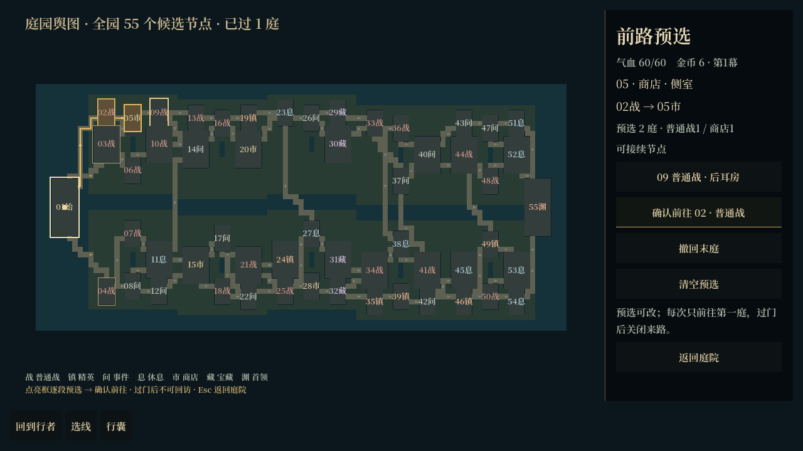
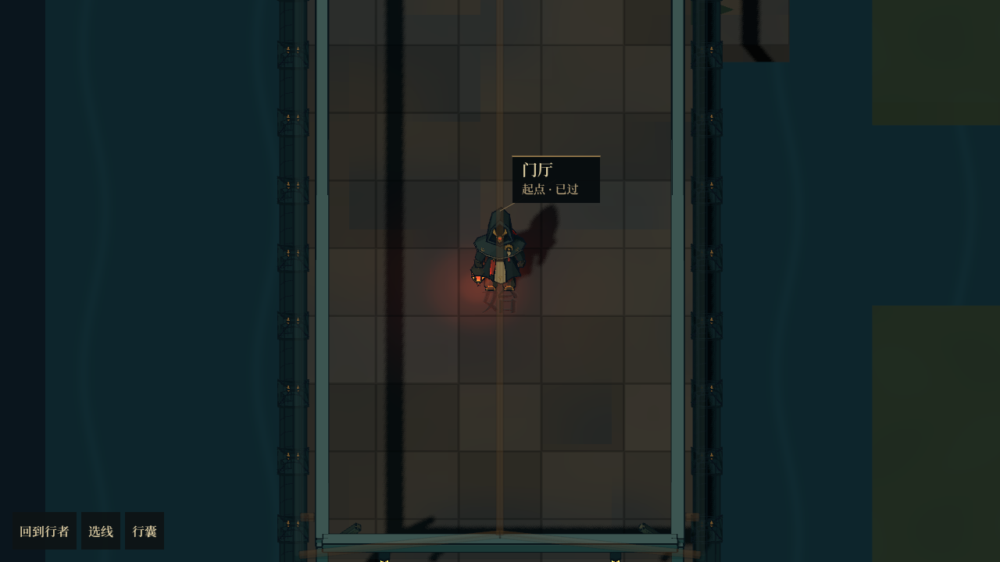
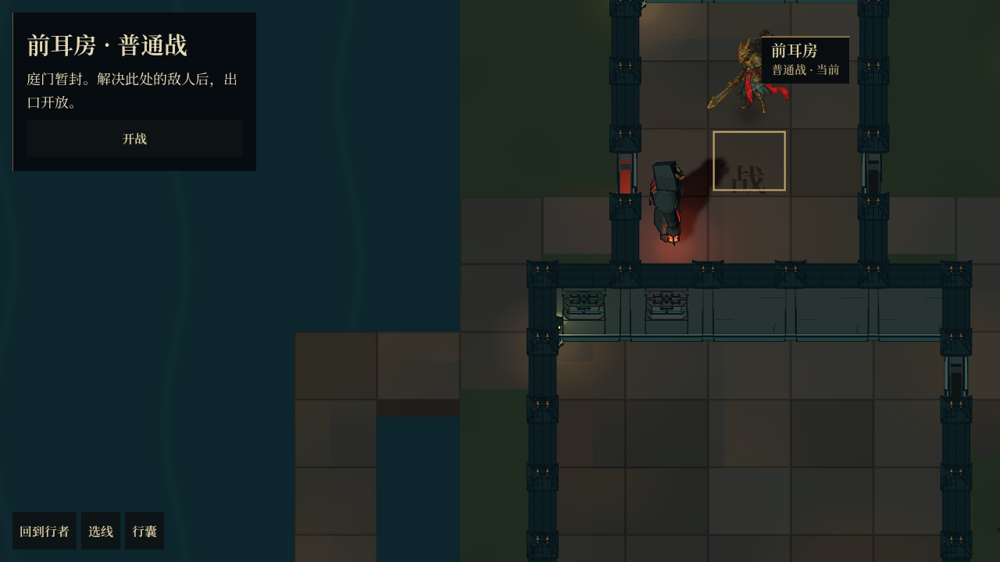
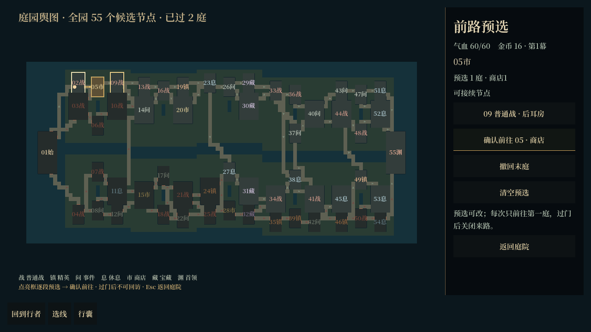

# 庭院选线与渲染修正

当前分支：`codex/courtyard-room-map`，工作目录 `huoziluandou-room-map`。正式新冒险与 F6 样板共用实现。F6 运行 `src/tools/compact_garden_sample.tscn`，默认种子 29；预览会话不会覆盖正式存档。

## 流程

1. 开局及节点完成后，先展开全园选线图。全部 55 个候选节点的类型与连接公开，已放弃的支路暗化。
2. 点击亮框节点预选，再点击接续节点，可以一直规划到首领。金线标出计划，侧栏统计沿途战斗、事件和服务数量。
3. 点击「确认前往」，角色才逐格走向计划的第一庭。抵达后停下来处理战斗、事件或服务，不会自动执行剩余计划。
4. 领奖返回保留剩余计划，并再次打开选线。预选可撤回或清空，点击另一条当前支路可换线。计划随存档保存，预选不改变门、封路、位置或玩法随机数。

「返回庭院」或 Esc 关闭选线图；「选线」或 M 再次展开。庭院内部仍能点砖行走；点另一房间或尚未出发的通路，会打开选线，不会直接替玩家放弃支路。过门后不能往回走。

## 表现修正

- 新版选线地图不再使用探索迷雾或已探索暗化；保留夜景光照。旧布局的探索规则不变。
- 地面与岸壁按区域合并后全部常驻，墙、设施和角色细节继续在镜头附近加载。各层不再采用不同揭示条件，避免黑地上露出断墙、浮灯。
- 近景改为固定 55° 俯角、无水平偏转的平行投影；倍率不随房间大小改变，开面板不改变机位。
- 持灯角色由原来的 0.25 倍改为 0.40 倍。近景取消持久的选路侧栏，节点标签只显示简短房间角色和状态；选线图使用独立版面。

沿用现有素材，本轮没有进行整园美术精修。

## 验证

- `planning-checks.json`：路线预选到首领、撤回与换线、非法跳点、保存恢复、预选不推进玩法、确认只消耗第一段，以及禁止回走。
- `runtime-checks.json`：种子 29、67 的实际界面点选、显式确认、逐格抵达、战斗与奖励返回、计划保留、地图缓存、无迷雾、连续地面、平行投影、人物可读性、缩放及两种窗口比例。
- 旧房间路线与奖励回归分别通过 271、22 项。桌面使用 Forward+；没有安卓实机性能数据。

## 当前实机

