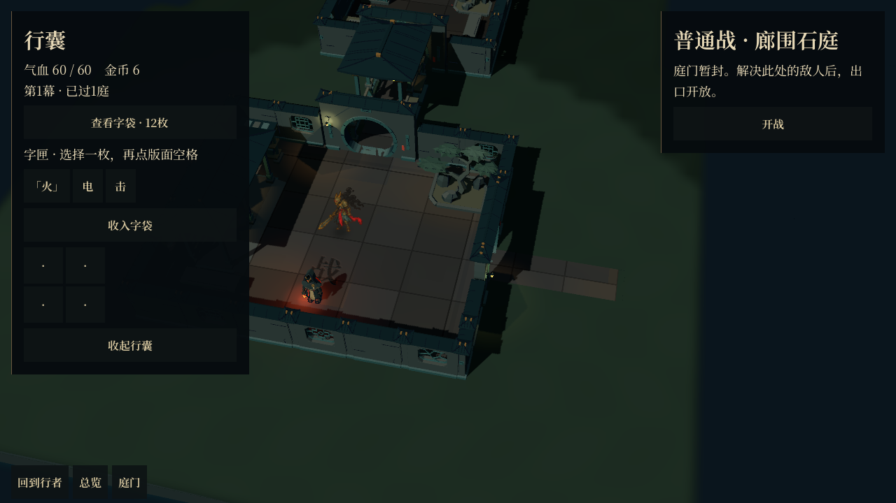

# 行囊浮层与地图构图解耦

2026-10-18，`codex/courtyard-room-map` 分支。截图为实际 Godot Forward+ 运行画面，与手工园林总平面草案无关。

原问题：行囊展开后，`room_map_screen._layout()` 从地图的镜头安全区域中扣除行囊宽度。`garden_room_map_view` 随即重新计算相机距离和瞄准偏移，导致地图缩小、横移。收起按钮只修改可见性，未同步恢复布局；内容刷新和窄屏也缺乏统一处理。

修正：

- 行囊置于独立 GUI 浮层，不参与地图安全区域计算。事件抽屉原有避让继续保留。
- 浮层拦截外部鼠标输入；点击外部只收起行囊，滚轮不会缩放地图。
- 地图增加交互阻塞状态，避免总览的 Escape、地图快捷键和拖看与行囊竞争输入。
- 主角点击、I、Escape、外部点击和收起按钮统一走同一个开关入口。
- 窄屏居中，限制高度并保留内容滚动；内容最小尺寸变化时更新面板布局。

验证：`tests/room_inventory_ui_test.tscn` 在无窗口模式及实际 Vulkan Forward+ 渲染下均通过 56 项检查，覆盖 1280×720、1920×1080、800×1000，以及打开期间切换窗口尺寸。包括镜头构图保持、实际角色点击、关闭点击不走路、滚轮拦截、总览中的 Escape 优先级、关闭后恢复交互及玩法随机数不变。

地图生成、房间与模型坐标未修改。
