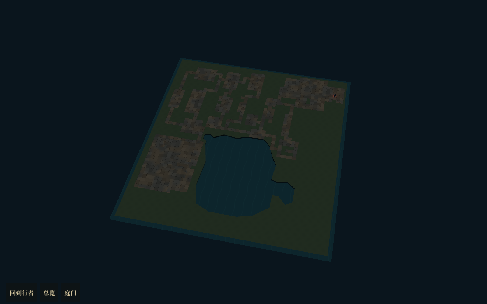
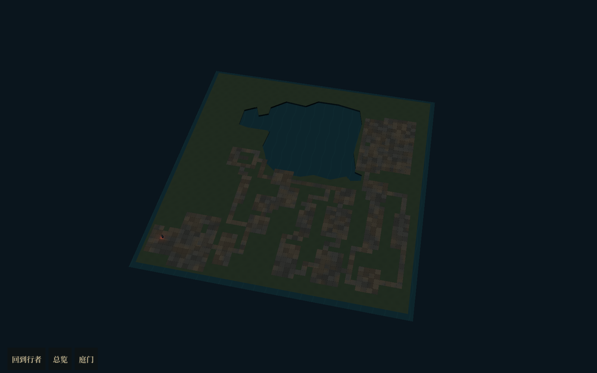
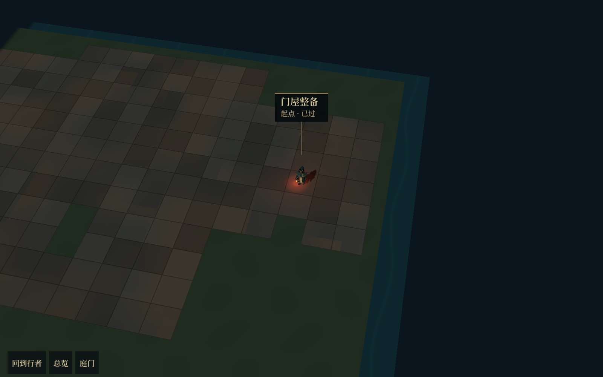
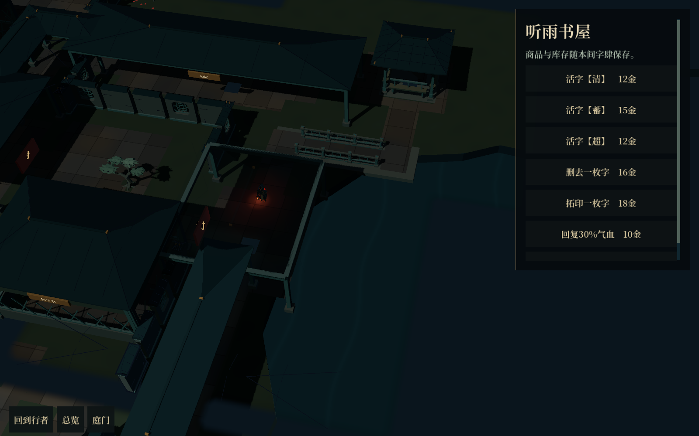
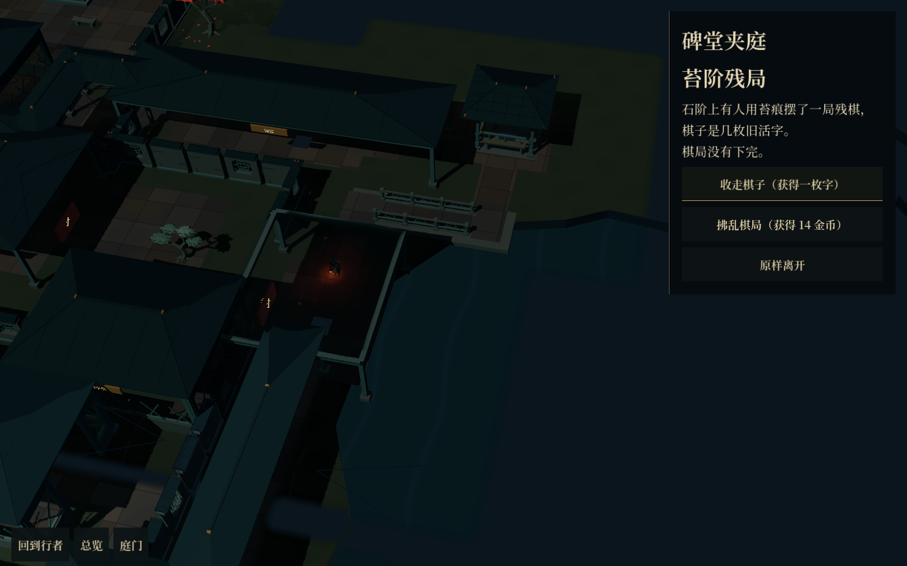
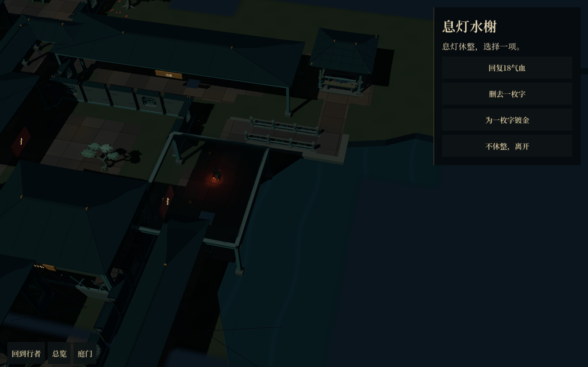
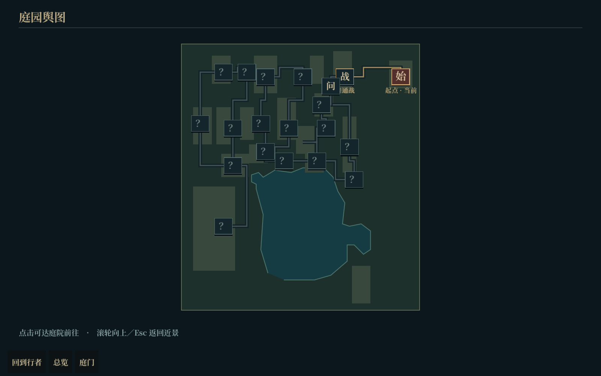
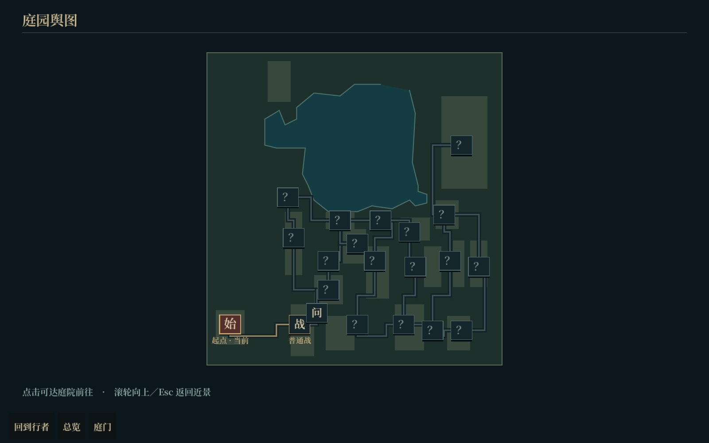

# 随机园林实机记录

新游戏已切换为随机园林。玩法和实现说明见[随机园林与节点玩法](../../design/随机园林与节点玩法_2026-10-18.md)。

这些图片均由 Godot Vulkan Forward+ 实际运行截图。`inspection` 是全揭示、无屋顶遮挡淡化的整园检查镜头，正常游玩使用局部视野与跟随镜头。

## 两个种子的整园检查

## 正常入场与节点

## 舆图

复现：运行 `tests/random_garden_runtime.tscn -- --capture`。无须走流程只检查两张整园时，追加 `--inspect-only`。
