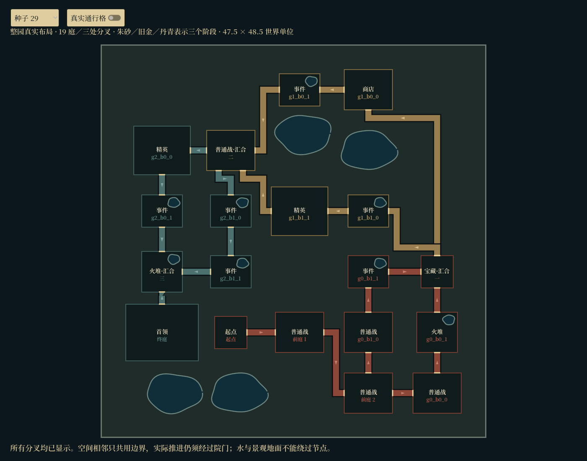
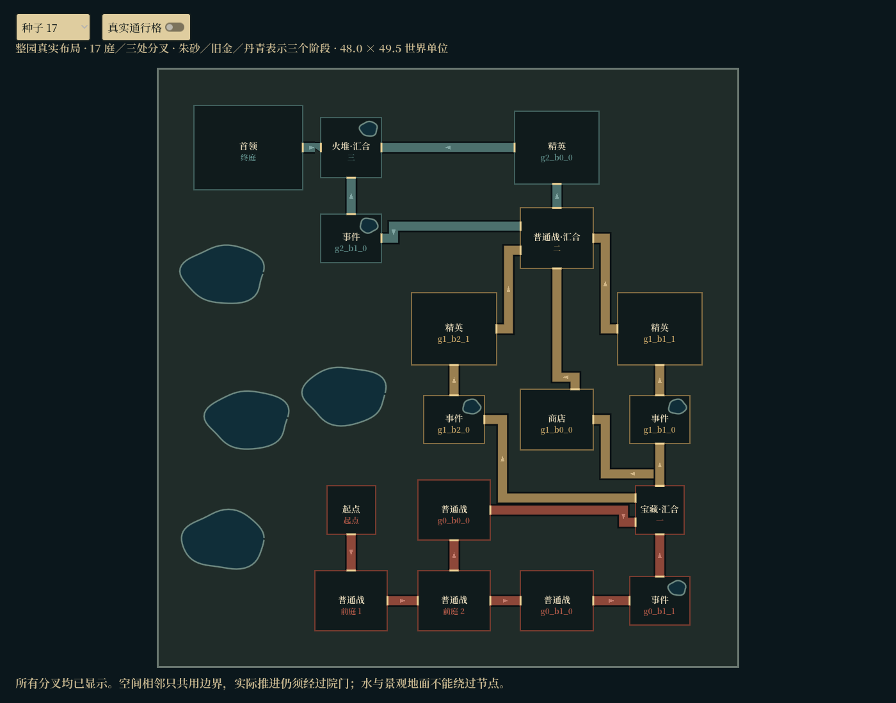
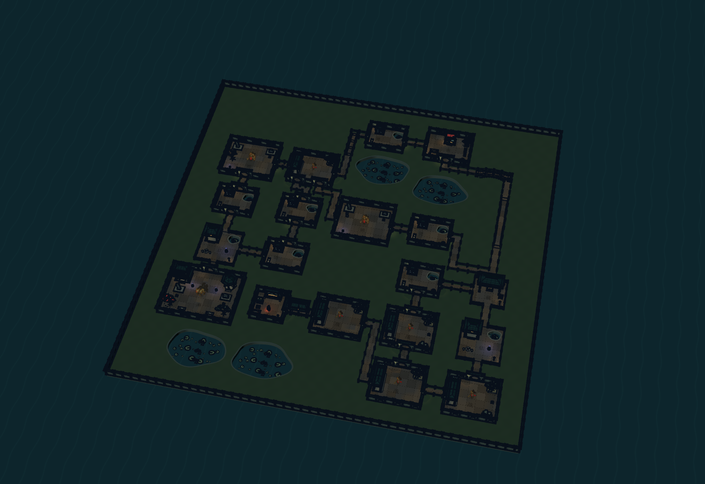
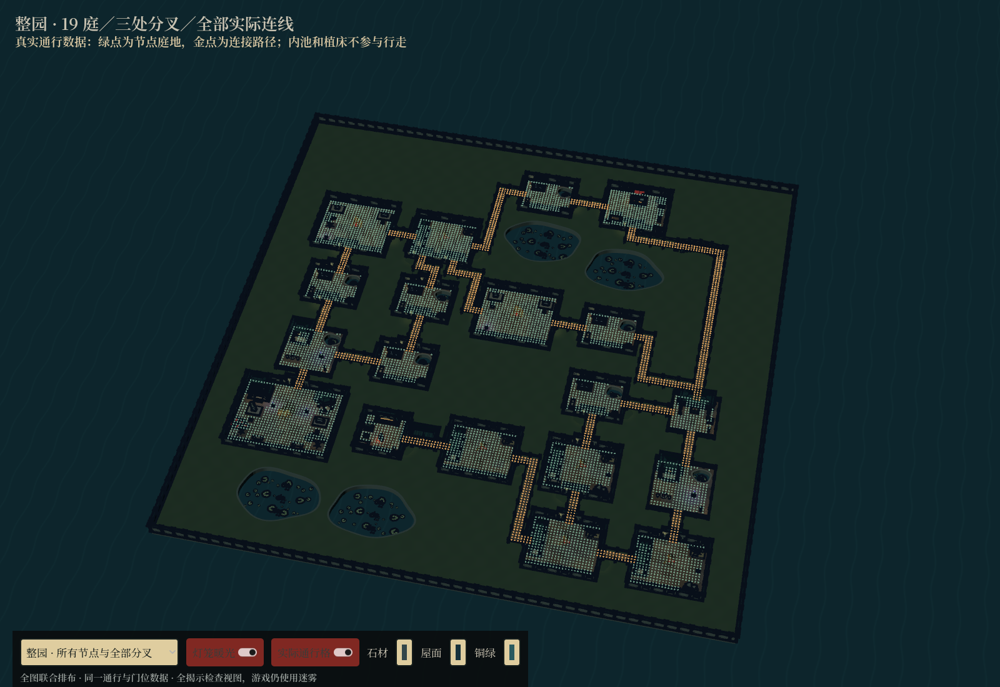
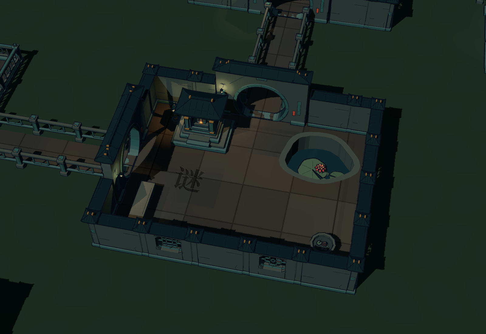
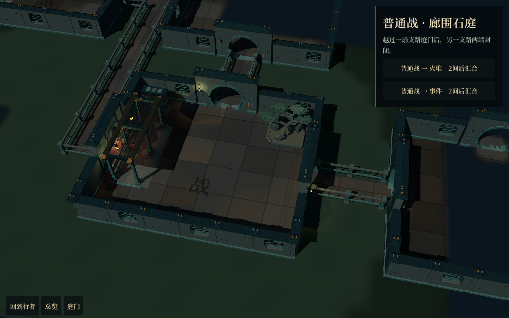
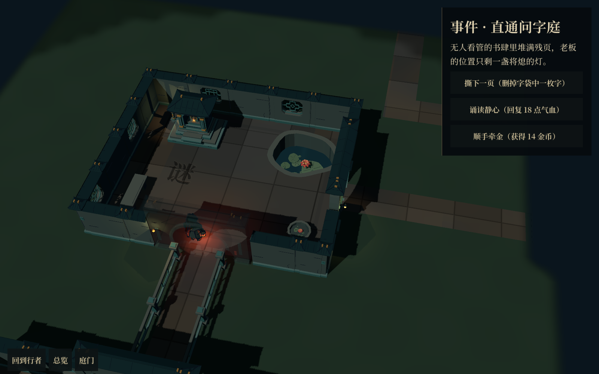
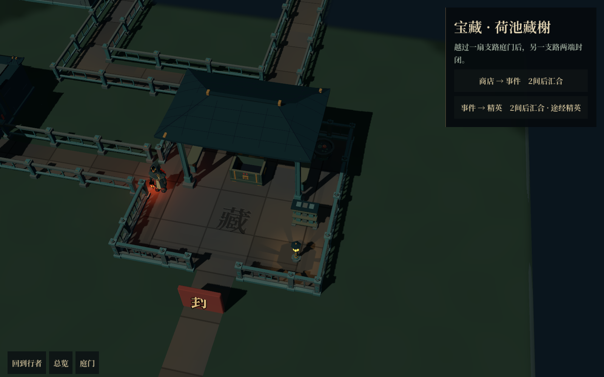

# 整园联合排布 · 可玩原型

工作目录为 `D:/Projects/Games/GameProject/huoziluandou-room-map`，分支 `codex/courtyard-room-map`。本轮已替换整张庭院图的空间生成器，覆盖三处分叉及其全部可选节点。

## 这次改变了什么

- 移除生成器中固定“向上、向右、向下”的四个世界坐标锚点。玩法连接先生成，全部房间一起参与空间布置。
- 使用套院、错位分路、较宽外庭与三路分叉等候选；在全图尺度比较实际房间占地、园地长宽、连接距离，再尝试后段折回与个别房间移动。
- 最终房门按邻接房间的位置生成。分叉可以有不同方向的出口；同侧入口和出口采用不同开口。每条边记录自己的真实门位。
- 按实际障碍与已预留通道连接道路，不能穿过无关庭院，也不能让无关路线共用走格。无法接通的候选会被丢弃，不会用一条穿模路线代替。
- 所有房间落在同一外墙围合的园地。庭内小池与填补空地的池湾使用真实地面开孔；外池避让建筑与已确定的通路。保留现有模型、光照、迷雾和局部相机。
- 起点、战斗、事件、商店、奖励、分叉封闭和节点预算沿用原控制器。布局版本升级为 4；旧存档保留内容种子、金币、结算及所选路线，行者移到当前庭院安全位置。

“不固定 U 形”表示整图不再受四个 U 形锚点驱动，并不禁止某颗种子的局部路线形成回折。当前仍保留三次分叉后汇合的玩法结构。

## 看整图

以下平面图由真实运行布局绘制，显示全部节点与通道，不是另行摆放的示意图。朱砂、旧金、丹青区分三个推进阶段；小院内的水体也来自通行数据。

| 种子 | 节点数 | 外围园地大小 |
| --- | --- | --- |
| 29 | 19 | 47.5 × 48.5 |
| 17 | 17（含三路分叉） | 48.0 × 49.5 |
| 818 | 18（含三路分叉） | 48.0 × 49.5 |

## 已有模型装配

下图为同一张运行图使用现有园林模型的全揭示检查视图；实际游戏仍保留迷雾。

## 正常地图界面

## 运行与检查

- 主场景已经使用新版生成器，不需要打开特殊地图才能游玩。
- `res://src/tools/garden_site_plan_lab.tscn`：查看全部分叉，切换三颗种子及真实通行格。
- `res://src/tools/garden_whole_map_lab.tscn`：使用现有模型查看整图与局部。
- `garden_cluster_test.tscn`：五颗种子的池形、门位、路线隔离与分支存档检查。
- `garden_site_test.tscn`：全图长宽、每扇门的可达性、玩法随机数独立及版本 3 存档迁移检查。
- `room_route_test.tscn`、`room_interior_test.tscn`、`garden_bridge_test.tscn`：完整推进、房内通行与桥廊高度回归。
- `garden_site_runtime_capture.tscn`：真实主场景中行走到事件庭、宝藏结算并返回，检查迷雾与投影拾取。

本轮回归通过：整园与存档迁移 163 项，五种子几何／隔离 241 项，完整路线 271 项，房内通行 119 项，桥廊 11 项；正常地图实机检查无失败。原生预览和实机截图的错误日志为空。

本轮重点是整图骨架和可玩接入。房间仍使用现有内设与独立围合，部分长通道、空地和墙体接合还需进一步做园林化细化；尚未声称每颗种子都已达到最终美术布局。
