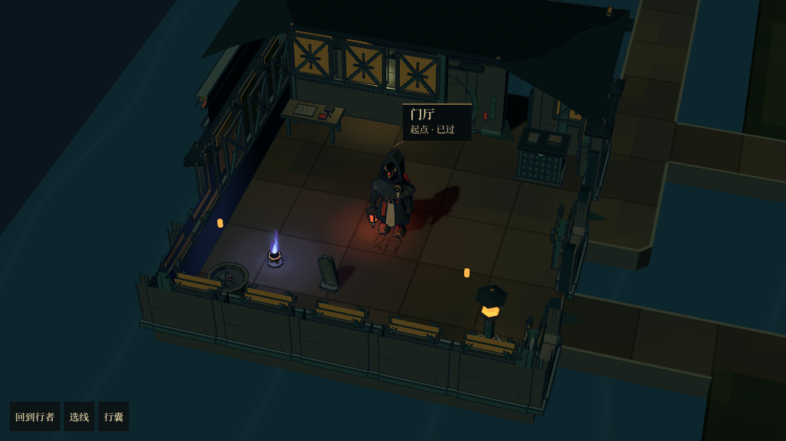
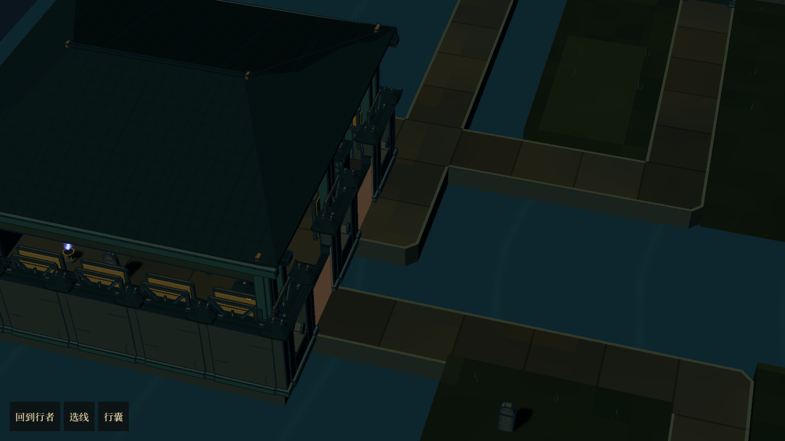
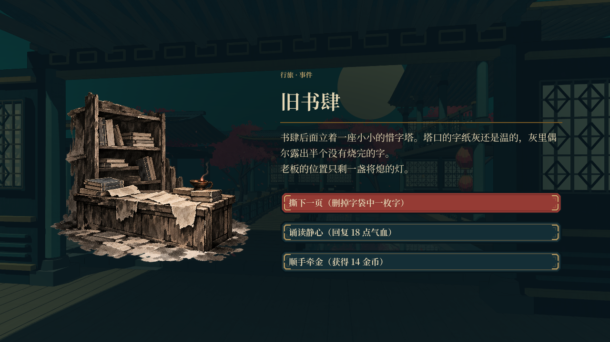

# 庭院：屋顶、陈设、通路与节点界面

分支 `codex/courtyard-room-map`，目录 `huoziluandou-room-map`。已快进同步远程主线 `2745557`，本地未提交的改动保留，没有新建合并提交。远程新增的 3 个提交为追逐概率与模拟工具更新，不包含新的服务界面。

## 本轮变化

- 镜头采用固定 42° 俯角、24° 水平偏角、20° 视场角的透视，保留轻微空间视差和稳定角色大小。
- 当前房间按屋脊方向让开近侧屋面，保留另一侧屋坡及檐口。修正长屋顶旋转后瓦面刻线没有一起旋转的错误；屋面的三角拓扑不再额外描线，保留脊线、檐口和明确的瓦面刻线。前景高墙局部降低至矮墙高度，让人物与陈设可见；离开后恢复。相邻建筑遮住人物时仍作局部让位。
- 复用书案、字柜、字架、石桌、石凳、香炉、莲缸和铜灯。大房间补充中部墙边陈设，模型实际占用的砖位加入寻路阻挡，门洞保持通行。树、亭、假山和阁楼只放在有足够空间的种植区，减少每间房都叠放大景物的情况。
- 路面采用连续铺装与外沿收边，外露凸角小幅倒角；内部不再生成逐砖侧壁。A* 得到道路后，优先用能通过相同净空检查的直段与 L 形替代多余折线，保持节点连接和四向步行。新生成地图使用较少折点，已有存档中的道路不强制重排。
- 事件使用完整插画与选项页，商店使用原有字肆陈列台，休息使用三项整备卡，宝藏使用完整奖励台。各界面读取庭院已保存的事件、库存与待选阶段，结算由 `RoomRunState` 执行；打开不重抽，关掉已付款的选字窗口不重复扣费。

## 卡顿处理

- 草、苔藓和小石块保留合并网格，取消其逐轮廓计算；墓碑使用共享烘焙网格。
- 墙体装配和房间陈设分帧处理；共享模型及屋顶规格在加载阶段准备，第一屏附近房间在加载结束前装好。
- 只给确实需要让位的屋顶建立特殊材质；镜头与人物静止时跳过重复遮挡更新，小陈设关闭实时投影。
- 新增 `src/tools/bake_compact_garden.tscn`，离线生成当前紧凑庭院所需的模型缓存；本轮已生成 33 项，缓存版本为 15。修改模型或缓存版本后可重跑该工具。装饰位置的轻量记录保留到本幕结束，重新加载附近模型时复用原来的位置。

## 验证与限制

- 12 个种子、各三幕，共 36 张布局，307 项检查通过，保留全部 55 个节点、类型及连接，没有新增房间之间的意外门路。
- 三个种子的完整三幕流程通过，覆盖单向通行、战斗与奖励、事件及服务、保存恢复和跨幕。
- 完整节点界面 29 项实机检查通过，包括商品扣费、复制待选关闭后恢复、事件删字、休息修饰、宝藏入匣及返回同一地图。
- 屋顶模块检查横向、纵向和方形三种开间，1908 项刻线位置检查通过，旋转后的线条没有超出屋面占地。
- 旧远征全量长测只完成了地图一致性、伏兵约束及部分移动机关检查后主动停止，未计入本轮通过项。
- `runtime-checks.json` 记录桌面两种子的帧时间分布、内存、绘制调用及恢复时间。包含加载活动的帧时间不能当作纯 GPU 时间，也不能代替安卓真机性能；尚无安卓实机结果。
- 当前桌面实机行走帧时间中位数约 16.7ms，95 分位为 17.5～20.2ms，最高约 35ms；存在少量切区尖峰，尚不能称为所有场景稳定无卡顿。初次装配约 7～8 秒，节点界面返回约 6.6～6.7ms，二者不是同一项耗时。

## 实机画面

F6 运行 `src/tools/compact_garden_sample.tscn` 试玩。默认种子 29，该预览会话不覆盖正式存档。
