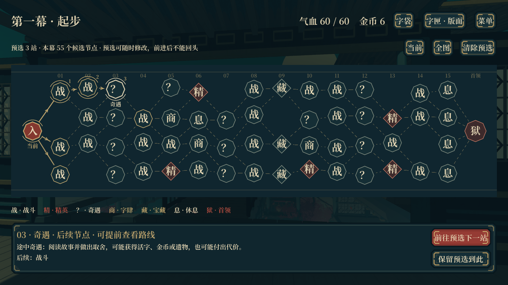
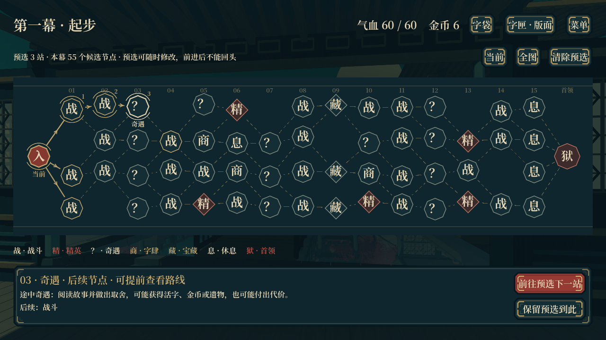
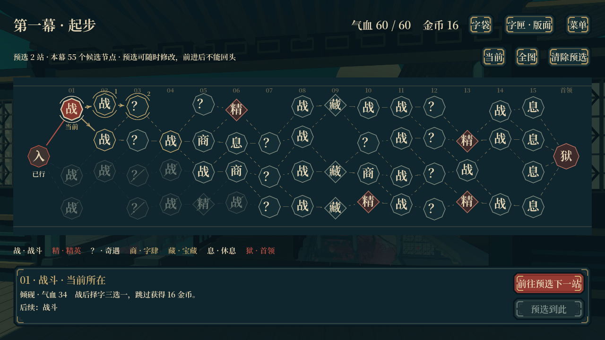

# 横向分叉节点图

主入口已切换为二维节点图，保留最早行旅界面的深青、旧金、朱印与字体。背景使用静态庭院图，地图没有 3D 视口、建筑装配、行走相机或探索迷雾。

## 推进与信息

- 每幕 55 个候选节点：15 列各 3～4 个节点，加起点与首领。实际选择一条路线前进 16 站，另含起点。
- 始终从左往右；全部类型和连线公开。选择下一站并确认后进入对应页面，不能返回、补走同列或领取另一条路线的奖励。
- 可以逐段预选路线；金线显示计划，确认只执行下一站。计划可改、可清除，随存档保存。
- 点击任何节点查看类型、状态、后续连接；战斗节点预览具体敌人、气血和奖励。已过与放弃节点区分显示。
- 全图、当前位置、拖动与滚轮用于浏览。浏览位置在进入节点和返回时保留，打开字匣不改变地图位置。
- 每条路线包含 3～5 次奇遇；其余含普通战、精英选择、商店、休息、宝藏与幕末首领。

## 结算接线

复用既有冒险控制器及完整事件、商店、休息、奖励页面，不重新实现故事效果。支持连续事件、删字选择、灯谜、射覆、璇玑字盘，以及事件附带的战斗和宝藏。

战后奖励择一枚字收入字匣，满 6 枚时收入字袋；跳过给 16 金币。商店刷新花费 5 金币，保存刷新后的库存并保留尚未购买的服务。精英先发一件遗物；第一、二幕首领回复 30% 最大气血并提供遗物二选一。遗物候选随存档保存，读档不重复发放或回血。宝藏显示领取说明，需要绑定的遗物继续使用选字浮层。

普通战与精英沿用同步后的三幕前／中／深区怪物池；数值读取现有 Excel 导入资源，不额外增加生命倍率。事件战斗同样使用新怪物目录。

## 存档、入口与保留内容

标题的开始、继续、自定义构筑使用二维节点图。继续旧存档时保留其节点关系、已选分支、字袋实体、字匣、版面、遗物、事件与待领奖状态，仅迁移显示，不重抽新地图。新一幕使用新版节点生成器。

AI 驱动保持 `mode: "courtyard"` 兼容入口，未指定布局时采用 `layout: "node_graph"`。`observe()` 包含整幕节点及连接、放弃状态、当前候选和预选路线；`enter_room` 直接进入下一节点，不再寻找实体道路。

3D 资产与程序化模型保留；旧地图屏幕保存在 `src/screens/room_map_3d_screen.gd`，不作为当前主入口。经典八节点界面和旧远征入口仍保留，历史 3D 展示工具本轮不继续维护。

远程已同步至 `b77038b`，包括新版怪物、完整战斗 Excel 配置、音乐、遗物、奖励与商店改动。本轮实现提交至 `codex/courtyard-room-map` 分支。

## 实机预览

1920×1080：

1280×720：

推进后保留经过路线，无法再取其他支路：

[横屏宽比例](node-map-landscape.png) · [事件](event.png) · [字肆](shop.png) · [休息](rest.png) · [宝藏](treasure.png)

## 验证

- `node_route_test.tscn`：186 项通过。40 个种子验证候选数量、向前连通、无交叉、每条路线事件数；覆盖预选、禁止回头、跳过奖励、商店刷新、首领遗物、跨幕、二维存档及旧存档迁移。
- `node_route_runtime.tscn`：21 项通过；包含真实战斗入口、战后择字、事件删字、字肆刷新、休息和宝藏，节点返回复用同一二维地图实例。截图来自 Compatibility 渲染器实机运行。
- 合并回归通过：战斗配置 6 项、效果协议 52 项、事件系统 629 项、经济镀金 213 项、怪物机制 52 项、经典遗物 15 项、奖励重复结算 22 项、词效回归 417 项。
- 推送前补检：战斗界面 58 项、字网图谱 34 项、标题菜单 16 项、词条解释 29 项、Buff 与解释布局 16 项通过。修复配置覆盖丢失词条边界说明、Buff 实际高度超过预留区域和词条浮层未避让状态栏的问题。
- 检查 1280×720、1920×1080、1600×720；未进行安卓实机性能验收。

运行：`godot --path . res://tests/node_route_runtime.tscn -- --capture`。常规游玩使用项目主场景或标题的“开始新冒险”。
