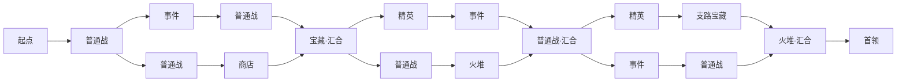

# 园林房间远征 · 设计草案 v1.1

2026-10-17。用途：确定新的大循环、房间规格和生成结构，供下一轮实现。本文和附图是设计稿，尚未替换实际游戏地图。

已确认：**分叉择路、汇合推进，保留园林中的实际行走，选择一条分支后放弃另一条。** 现有朱砂、丹青、旧金、深色石地与冥府园林素材继续使用。首版不安排首领追击、机关解谜和逐格耗时。

本次补充：正式生成采用**受控随机**。十八房、三次二选一仅为调试与美术拼接样板；正式每局的分叉数量、支路长度、汇合位置、房型组合和园林布局均按种子变化，不能只给同一张路线换贴图或镜像。

## 1. 参考结论

| 参考 | 已查明的结构 | 本项目采用的部分 |
|---|---|---|
| 《暗黑地牢 1》 | 实体房间由走廊相连，通常按四向连接；房间/走廊内容可通过探索、侦察揭示 | 房间、院墙、门和走廊形成真实空间；内容跟随房间；探索时保留遮挡和氛围 |
| 《杀戮尖塔 1》 | 分叉路线限制后续可访问的节点；普通战、精英、事件、休息、商店、宝藏、首领形成不同收益与风险 | 先选择风险与补给，再经过节点成长；分支不能全部搜刮；每幕以固定首领房结束 |

《暗黑地牢 1》的露营依赖柴火，可在已清理房间进行，并非固定火堆节点。本方案的固定火堆来自本作需求和《杀戮尖塔》的休息节点；首版不复制压力、饥饿、火把补给等额外资源系统。

参考：[DD1 地图](https://darkestdungeon.wiki.gg/wiki/Map)、[DD1 侦察](https://darkestdungeon.wiki.gg/wiki/Scouting)、[DD1 露营](https://darkestdungeon.wiki.gg/wiki/Camping)、[STS1 地图生成](https://slaythespire.wiki.gg/wiki/Map_Generation)、[STS1 官方介绍](https://store.steampowered.com/app/646570/Slay_the_Spire/?l=schinese)。下文数量、尺寸和机制均为本项目的设计建议。

## 2. 一局怎样推进

保留三幕。每幕是一片完整园林，包含若干组分支院落和终庭，数量与连通方式按种子变化。玩家从起点小房间出发，完成房间内容，在门前看清下一段的类型，选路，走过石径或桥廊，进入下一房间。首领留在终庭，击败后结算，主动从出口进入下一幕。

- 房间内部和已开放的连接中可以实际行走，点击交互物或下一扇门自动寻路。内部继续采用四向导航，取消每走一格推进大循环时间的规则。
- 走路、拖镜和原地停留不影响敌人、不刷新奖励，也不产生资源。生命、牌组、遗物和金币承担成长与消耗。
- 普通战和精英房不能穿房逃课：进入战斗触发区即开战，前进出口在战斗与奖励处理完后打开。
- 事件、火堆、宝藏、商店走到交互点后展开详情；完成或明确选择略过/离开，才能继续前进。商店不通过开关面板刷新库存。
- 首领不追逐；不再使用惊动、缓冲、被追上的位置减益，以及开宝箱惊醒首领的惩罚。首领战本身的敌人数据和战斗能力保留。
- 已走过的房间允许回看，已取得奖励、用掉的火堆、处理过的事件不会重置。击败首领不会重新开放未选分支。

### 选路何时生效

悬浮或走近门时预览下一房和后一房的类型，同时显示分支的房间数、已知设施与是否必经精英等关键提示。**跨过分支门槛才提交选择**；提交后，未选分支在分叉端和对应汇合端都关闭门扉，保留可见的封印或闭门轮廓。两端都禁行，防止从汇合房绕回未选路线。较长支路可以继续保留远处场景迷雾，但不能把被迫面对的精英藏到提交选择之后才告知。

已选的门与走廊仍可返回。返回不会撤销选择。不同门可以看到对岸房屋或漏窗，但可见不等于可通行；关闭的门和水岸必须清楚表达边界。

## 3. 调试用的十八房样板

以下用于验证房间拼接、选路状态、奖励往返与基本节奏，不作为正式每局固定剧本。可交互预览目前展示的就是此固定样板，不代表已接入随机生成。

| 房间类型 | 整图数量 | 任一路线实际经历 | 内容与用途 |
|---|---:|---:|---|
| 起点 | 1 | 1 | 小型门房，整备、看路线；没有强制战斗 |
| 普通怪物 | 6 | 3–5 | 主要构筑奖励与金币来源；前两场用较易的敌人池 |
| 精英 | 2 | 0–2 | 可自选的较强战斗，使用独立奖励预算 |
| 事件 | 3 | 0–3 | 残碑、问字龛、池边祭台等不同载体；复用既有事件选择 |
| 火堆 | 2 | 1–2 | 息灯亭或鬼火庭；保留回血、删字、修饰等既有休整能力 |
| 宝藏 | 2 | 1–2 | 主线保底一处，另有一处支路宝藏；领取一次 |
| 商店 | 1 | 0–1 | 前两场普通战后有一条明确通向商店的路线，玩家可选择放弃 |
| 首领 | 1 | 1 | 终庭固定守关；前一房为必经火堆 |

**合计十八房，每条路线十二房，六场战斗（含首领），八种分支组合。** 零精英路线也能通关，双精英路线提供更高构筑上限。事件数的最小值是零：三次都选择非事件侧即可达到。

三次选择分别是：

1. **事件＋普通战 / 普通战＋商店**：先获得不同的整备资源，不提前强迫精英。
2. **精英＋事件 / 普通战＋火堆**：构筑回报与回血之间取舍。
3. **精英＋宝藏 / 事件＋普通战**：决定是否在必经的最终火堆前再冒一次风险。

战斗、宝藏和精英奖励沿用一个预算口径，避免同时调用旧远征和新房间结算而发两次奖励。走廊首版只负责移动，不复制旧地图上的大量散字、奖励和伏兵。金币/字/遗物的具体数量在跑通六战样板后调整。

## 3A. 正式生成：小幅变化，保留节奏保底

### 数量由固定值改为范围

| 项目 | 第一版生成目标 |
|---|---|
| 整图房间 | 16–22间，平均接近18间 |
| 每条合法路线 | 10–13间房，包含起点与首领 |
| 战斗 | 每条路线5–7场，包含首领；普通战与精英比例变化 |
| 有效路线选择 | 每条路线2–4次；大多数二岔，整幕最多一处三岔 |
| 固定保底 | 起点、终庭、首领前火堆；每条路线至少一处宝藏；至少存在一条零精英路线 |
| 商店与中途火堆 | 至少存在可选择到达的路线，所在阶段和对应搭配不固定 |

这些是生成筛选条件，不是逐节点抛硬币。不能为了凑范围造出只有一条路线、三间连续商店、前期被迫精英或所有补给都在未选支路的图。

### 四类小片段拼出不同路线图

| 片段 | 结构 | 对玩家的影响 |
|---|---|---|
| 短分叉 | 一房 / 一房，较快汇合 | 两种即时收益或遭遇之间选择 |
| 双房分叉 | 两房 / 两房 | 比较一整段房型组合；具体组合每局重排 |
| 不等长分叉 | 一房 / 两房，或两房 / 三房 | 在多打一次、多获得成长与直接前进之间选择 |
| 偶发三岔 | 三条支路，分别一至两房 | 多出第三种整备或挑战机会，不要求每局出现 |

每局从这些片段中选择和组合，调整分叉间的公共房数量以及汇合房的类型；相邻片段避免重复同一结构。不再固定“第一处分叉必有商店、第一汇合必是宝藏、后两次都有精英”。必经宝藏可以位于不同阶段；除首领前火堆外，其他汇合房不绑定同一个类型。

例如同样走到第二进：一局可能立即在“精英 / 事件＋普通战”间选择，下一局则先共同经过事件，随后在“普通战＋火堆 / 普通战＋商店”间选择。上一局记住的转弯方向和房型顺序不能替代当局判断。

长短支路的取舍来自**房间与遭遇数量**：多战有额外构筑机会，额外服务有整备价值。首版不消耗行走步数，因此不能把“少走几块地砖”本身当作短路的战略奖励。

### 空间变化也会影响实际走向

- 庭院组的摆放次序、朝向和主池长轴变化，起点与终庭可位于不同岸侧；三进园林是构图组织方式，不再等同固定三次分叉。
- 同类房间使用少量兼容模板：入口可在不同侧，院子可为临水庭、夹墙院或水榭；门的位置必须与真实道路一起重接。
- 主池可偏向一岸、分出较长支汊，或用两个相连的水湾组织庭院。桥位和曲廊随可达通路生成。
- 镜像、移树和改荷叶只算装饰变化；生成多样性检查必须同时比较路线边、支路长度与房型序列。

### 随机必须满足的约束

1. 第一处精英出现前，每条能到它的路线均至少经历两场普通战；前两场使用较易敌人池。
2. 每条合法路线都有基本成长与首领前休整，多精英路线保留更高回报；不把所有好处固定塞进同一侧，也不把中途火堆固定与最安全支路绑定。
3. 同一分叉的不同选项应在房型、战斗风险、额外机会或长度上有实质差异；两条完全等价且只有装饰不同的路不计作有效选择。
4. 分支以“分叉口—对应汇合口”的局部区域登记。封门依据分支ID与对应出口执行，不按整张地图的左路/右路统一封锁。
5. 先枚举该小图的所有合法路线，核对房数、战斗数、精英时机、宝藏与休整保底，再制作空间布局。单条好路线通过不代表整张图通过。
6. 空间摆放失败时先重试端口与局部院落位置，尽量保留已通过的路线图。保底也使用多组验证过的片段组合，避免很多种子最终都退回同一张十八房样板。
7. 同一种子、同一版本重开时完整复现路线和房型；镜头和装饰不能消耗路线随机数。不引入未保存的跨局历史来暗中改变相同种子的生成结果。

## 4. 房间尺寸

八类房间已用现有素材做成[可运行房间样板](../art-concepts/2026-10-17-room-templates/README.md)，含[实景总览](../art-concepts/2026-10-17-room-templates/index.html)。制作场景为`src/tools/expedition_room_template_lab.tscn`；普通战/宝藏的四门变体、事件直通与火堆双门变体均有对应布局数据。它们先作为生成器可选模板，尚未接入正式房间路线运行。

一格指当前地图的一个世界地面单位，**不是节点数量，也不是战斗字盘格**。表中为院内地面宽×深，墙体、屋檐和附属物另占空间；不能把模型强行缩到表格内。

| 类型 | 标准院内尺寸 | 布置方式 | 推荐门数 |
|---|---|---|---:|
| 起点小房间 | 4×4 | 后墙门房、侧面整备案，前方留出口 | 1 |
| 事件 | 5×4 | 小龛或残碑偏侧，保留中间行走带 | 2 |
| 火堆 | 5×5 | 鬼火偏中、息灯亭或树靠边，入口正对空地 | 2–3 |
| 宝藏 | 4×4 | 小院角或水中石台，箱子与入口之间留交互位置 | 2–3 |
| 商店 | 6×5 | 青铜字摊靠后/靠墙，面前留至少两格整备区 | 2 |
| 普通战 | 6×5 | 石庭、看守碑或巡守模型；中央约3×3保持空出 | 2–4 |
| 精英 | 7×6 | 较宽的镇守庭，两侧碑群/树，中间保留路线 | 2 |
| 首领 | 9×7 | 后方门阙、前方仪式庭，首领与入口有清楚距离 | 1入＋通关后1出 |

连接规格：石径宽1.0–1.25格，现有石桥约0.85格宽；窄门净空不小于0.9格。主要庭门可加宽，但必须实测现有门洞净空再选模块。普通连接长约2–8格，跨池或转段的连接约8–20格；每组分支选定路线的走廊累计不超过40格，整幕不超过130格。最长单段以自动行走约4–5秒为目标，超出时缩短路径或调整房位，避免玩家逐格点击空路。

每个模型模板登记实体范围、屋檐范围、交互站位、通行带和门口接点。墙基外留约0.4–0.6格组装余量；屋檐按实际包围盒额外避让。汇合兼分叉的房间最多四个主门，输入门和输出门在周边按连续的两组布置，避免走廊在院外交叉。

## 5. 园林怎样组成

附[布局示意](courtyard-room-route-v1/layout.svg)、[可交互路线示意](courtyard-room-route-v1/preview.html)。图中18间房使用上表的实际比例，按约60×60世界单位的设计画布排布，方向会折回；这是空间容量样板，不意味着以后固定生成60×60的大棋盘。

**一座主池、一个支池、三组院落围水，终庭与起点隔景相望。** 主路先沿池南岸分叉，再经东岸水榭，最后折回北岸与终庭。路线逻辑上的“向前”由连接和门决定，不要求地理上始终向北。

房间节点可以是露天庭院、廊下小庭或水榭，不要求每节点独立盖一幢房屋。同一分支中的两房优先组成共用基台、院墙相接的连续小院，中间仍用真实的门与墙隔开；大段跨水连接留在院落组之间，避免做成十八座孤岛。

- 主池的形状先形成一块连续水面，再加少量湾口与支汊；把宽水道留给长桥，浅岸留给花池和矮栏。不能把每间房都包成独立方池。
- 目标有效园林面积中约45%–60%可为水面；不把画布外部空白算入比例。房间与道路先保留，水域不能吞掉合法入口和站位。
- 院落有贴岸小庭、水中石台和被围墙围合的旱庭三种关系。三个相邻房间不连续套用同一外形，至少交替一次临水/围合。
- 围墙来自院落边界和真实通道，连续接到庭门、廊端或另一段墙；不随机散放孤墙。外围用连续岸壁/围墙/远景遮蔽，不能暗示还有可走出口。
- 廊桥的连接在同一通行层完成；首版不做上下跨越的立交，也不让两条走廊平面相交却逻辑不相通。
- 莲叶、莲花、残荷只依附真实水域生成，疏密按水湾变化，桥头和可交互入口旁保持清楚。

完整终庭可以先在远处显出轮廓；未到达的房内内容仍藏在迷雾里。路线预览与场景视野分开：前者告诉玩家可选类型，后者控制实际模型和光线显示，不能用浓雾遮掉玩家必须比较的分支信息。

## 6. 资产复用及需要适配的模块

| 当前资产 | 新用途 | 接入约束 |
|---|---|---|
| 石地、连续池岸、水材质 | 全园地形、房间地台、主池/支池 | 地形使用动态世界范围，不再固定12×8 |
| 石桥、栏杆、游廊 | 桥段、廊段、廊桥转角 | 长桥只在整段两端加接地坡；中段按端点合并地板、共用柱和栏杆，不能把完整短桥连同坡面重复叠放 |
| 月洞门、围墙、漏窗 | 房门、院墙、分支封门 | 门与墙使用同一接点；未选支路两端统一关闭，并影响导航 |
| 息灯亭、字摊、问字龛 | 火堆房、商店房、事件房主物件 | 地面入口与模型实体分开，实际模型范围参与避让 |
| 宝箱、普通敌人、精英、首领门阙 | 对应房间的主物件 | 奖励状态一次性，清理后改变轮廓/结构 |
| 怪松、四种墓碑、铜灯、红绸 | 院角、夹景、墙外背景 | 装饰让出人物、门洞和交互站位，不占主通行带 |
| 莲花、散叶、水面小物 | 主池景观 | 按真实水面裁切，不恢复规则的方形小池 |

新增内容以适配为主：门扉开闭状态、长廊/桥的中段与转角、少量端头收口。整套建筑无需重做。普通地面继续y=0、廊桥上表面y=0.07、水面约y=−0.18；坡面、人物落脚、点击沿用刚建立的共同高度定义。

画风保持深丹青环境、旧金细节、朱砂封印，屋顶压暗。鬼火用于火堆/阴性机关，提灯保留暖金。不要以新增大面积紫光或绿色泛光代替材质配色。

## 7. 生成顺序

1. **先生成路线图**：按3A节的范围选择分叉片段、公共房数量与汇合位置，连接起点、最终火堆和首领；检查所有合法路线的房数、战斗数、补给和精英时机。
2. **分配内容**：类型、敌人池、事件与奖励种子。早期两场普通战后才出现第一处精英；商店至少有一条在两战后可达的路线。
3. **选择房间模板和摆放范围**：依尺寸、门数、临水面和屋檐范围排布院落组；输入门与输出门分组。放不下时移动/旋转整组，最后才扩展画布。
4. **对接门与走廊**：通过带占地余量的正交寻路连接端口，优先0–2次转折；不经过第三方房间，不跨越无关走廊。路由失败先换端口，再调房间，不能假画一条接不通的桥。
5. **生成地形和水**：从房间与通路保留区形成干地/地台，叠加主池与支池连续轮廓；桥覆盖水域，岸线不能切掉门口。共同接缝只生产一份表面和共享边构件。
6. **沿真实边界组装墙、廊和桥**：检查实体、屋檐、接地点、台阶高度；让主体关系先成立，再安排装饰。
7. **放景观和视野**：种植、莲花、铜灯、远景构件使用独立装饰随机流；视野只控制显示，不改变路线结构。
8. **双重验收**：路线图可走不代表场景可走；必须再在最终导航网格验证每一扇门和交互站位、封门后不可绕入另一支路。样板检查8条路线，随机图检查其实际生成的全部合法路线。

受控随机是首个正式可玩版本的一部分。固定样板用于稳定验证资产与流程，随后接入3A节的片段组合和受约束房型分配；镜像和装饰变化只是空间生成的附加层。

## 8. 与现有系统的迁移

当前`MapGen`、`Expedition`、地图视口和多个shader都依赖固定12×8格、整数k及逐步追逐。**不能把MapGen.W/H直接改大后继续使用同一套推进规则。**

建议新增房间路线模式，保持旧远征可回归：

- `RoomRouteGraph`：房间ID、类型、前后边、阶段、分支组；不存模型。
- `GardenRoomLayout`：动态世界范围、房间模板、门接点、实际通路、水形与遮挡；不存奖励领取状态。
- `RoomRunState`：当前房间、已解决房间、奖励领取、分支选择、服务库存、待战斗/待奖励状态；统一驱动UI与无头试玩。
- `RoomEncounterAdapter`：把战斗房转成现有`MapNodeData`，接入战斗、开场词谱与战后奖励；不得让旧`enter_cell()`同时再触发一次事件。
- 地图视口显示动态布局；保留现有相机、拾取、淡化、材质和模型制作工具。迷雾shader改用世界范围/遮罩尺寸参数，清理硬编码12×8。

房间ID与导航格坐标是两种数据。房间状态不能再用`row*12+col`当主键。保存至少包含地图schema版本、种子、生成后的布局快照和已选分支；战斗返回后回到原房间，不能重新抽事件或重开宝箱。

房间`kind`使用独立类型；只有战斗房需要转换为现有BATTLE/ELITE/BOSS。起点、宝藏等新类型不要插进既有`MapNodeData.Type`枚举中间，避免资源中保存的整数类型整体错位。

### 必须一起处理的内容失效

这里只讨论**远征版面的词谱和印章**，不自动修改战斗里同名的单字/词语。

- 追逐类：停息、急停、冷却、反超、反转、超能力，以及印章更漏失去原触发对象。
- 机关/逐步移动类：加速、急速、流速、清流、防火、防爆、停电、放电、爆破、电流过载等不能继续按旧地图说明投放。
- 伏兵专用：防护、回防、反击需要单独迁移；新战斗房不能假装全是伏兵以保留旧触发。
- 揭示类：开灯、左右、夜灯建议改为路线侦察，扩展可预览的后续房间深度，仍保留物件迷雾规则；具体数值另行讨论。
- 远征墨水原主要用于冲开墨障；首版没有这类开销，不能继续给无用途的回墨奖励。充能、充放电的回墨部分与收回的省步部分要纳入迁移。
- 字袋、字匣、版面和战斗/经济类词谱继续。取消步耗后，建议把版面重排集中到起点、火堆和商店等安全房；不要只取消取字耗时却无意识地改变全部整备成本。此项为待讨论建议。

首个可玩样板只向新模式投放已适配的远征词谱/印章，其余保留数据与战斗本体，不显示成“有说明但永远不触发”的效果。具体重设计另列一轮，避免这次同时重做全部词语平衡。

### AI与调试

现有`BattleHarness/agent_bridge`可以复用；当前`RunHarness/run_bridge`主要按旧幕内节点序列推进，不能据此声称已经支持新园林。新UI和调试桥应共同调用`RoomRunState`，提供观察与合法动作：`current_room`、`next_rooms`、`branch_choices`、`resolved`、`pending_reward`、`enter_room`、`choose_branch`、`interact`、`claim_reward`、`leave_service`。无头模式可以省略行走动画，结果必须与实机一致。

## 9. 首版制作边界和验收

制作顺序为：固定十八房样板验证资产和状态往返 → 接入四类片段的受控随机 → 完整跑通随机的一幕 → 推广到其他主题和三幕。首个正式可玩版本应包含路线随机，不把它延后到全部美术完成以后。旧地图与固定样板保留为调试模式，战斗系统和已经细化的模型继续使用。

验收最少覆盖：

1. 固定样板的八种组合均经过十二房、六战；随机图的所有路线满足10–13房、5–7战等范围，必经至少一个宝藏和首领前火堆；未选分支从两个方向都无法进入。
2. 每条实体通路与逻辑边一致；无路外穿墙、踏水捷径、假交叉、门洞被柱子堵住或房间/屋檐穿插。
3. 奖励、商店库存、火堆次数与事件结果跨战斗往返/保存恢复不重置；首领留在终庭。
4. 石地、廊桥和坡面无共面闪烁，人物落脚与射线点击一致；缩放和拖看后仍正确。
5. 下一段类型在选择前可比较；迷雾隐藏未知内容，同时门、岸线和封印能清楚表达边界。
6. 大地图采用分块地形与按庭院加载，近景只保留当前与相邻院落完整细节；远景减少轮廓计算和局部灯。不要把60×60每格都实例化一套物件。
7. 记录1280×720及1920×1080下的实测帧耗，比较现有同机基线后确定预算；设计稿不预先宣称性能通过。
8. 对多组连续种子统计分叉数、支路长度、汇合位置与房型序列；去掉房间ID、镜像和装饰差异后仍有实际结构变化。同种子完整复现，不能以加载失败后统一退回固定图冒充随机。

## 10. 首版接入进度（2026-10-17）

八类样板已经进入独立房间运行模式，接通受控随机路线、真实桥路行走、分支两端封闭、战斗与择字奖励返回、事件/火堆/商店/宝藏、三幕状态推进、自动保存与同一套无头接口。详细范围、入口、代码职责及实机截图见[首版接入记录](../art-concepts/2026-10-17-room-runtime/README.md)。本稿此前的尺寸与固定布局图仍是设计依据，不代表运行版固定十八房；旧远征仍可独立进入。现阶段共用墨池素材，其他主题和全部旧词谱迁移仍未完成。

## 11. 分支与工作区

- 新分支：`codex/courtyard-room-map`。
- 独立目录：`D:/Projects/Games/GameProject/huoziluandou-room-map`。
- 基于已获取的`origin/main`（902b793），复制当前工作区的代码与素材作为未提交基线；关键地图与调色文件逐一核对内容一致。
- 原目录`huoziluandou`仍在`main`，原有未提交合并继续保留；本轮不提交、不推送，不改变现有运行地图。
- 已确认的核心是分叉推进。十八房/十二房/六战为固定调试样板；正式生成的建议范围见3A节。房间尺寸和版面整备位置继续作为待验证的建议。
