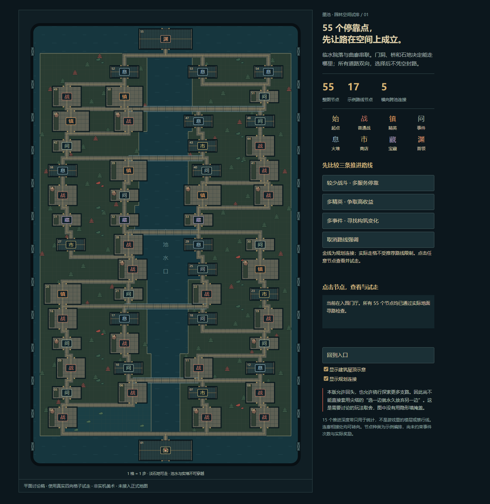

# 55 节点园林空间试排

> **历史稿，已被替代。** 本目录旧 HTML 的自由回走是实现错误，与“不能往回走”的既定要求冲突，不能作为玩法依据。当前入口为 `src/tools/garden_blockout_sample.tscn`，参见 [紧凑组团与单向推进说明](../../art-concepts/2026-10-18-garden-compact/README.md)。下文仅记录旧稿占地与当时的检查结果，不代表现行规则。

这是讨论用的可交互平面稿，不是最终美术，也没有替换正式地图。暂停中的模型与性能工作不在本轮继续。

- 打开 [交互平面稿](preview.html)：比较三条推荐路线，点击节点沿真实地面四向试走，切换屋顶示意；可原路回头。
- [完整平面截图](preview.png)、[多精英路线](risk-route.png)、[较少战斗路线](quiet-route.png)。
- [布局与碰撞数据](layout.json)、[结构检查](validation.json)、[浏览器检查](browser-checks.json)。

## 空间如何安排

场地暂用 66×108 个地砖单位，起点在南，首领在北。两岸由成组厅庭、夹院和廊下停靠点组成，中间保留有收放的水口，五处横向连接跨池。小莲池与植栽嵌入两岸院地，避免每个节点都是单独漂在水上的小岛。

全图 55 个停靠点：起点 1、普通战 19、精英 6、事件 13、火堆 8、商店 4、宝藏 3、首领 1。推进示例每条经过 17 个节点；用于比较的向前图有 108 条起终路径。108 仅统计规划图，不是双向地面上所有可行路线的数量。

节点不全部做成独立建筑。商店、休息和少量事件放在有顶空间，普通战多安排在庭地，事件也能在廊下或临水小龛发生。此处先用矩形占地表示，屋顶、廊顶和围合造型留待路线确认后处理。

这版仍按推进深度排列，占地偏规则；它证明节点规模和通行边界可以同时落到地面，并不代表园林的疏密、建筑比例和视线组织已定稿。

## 怎么避免“明明有路却不能走”

1. 所有浅石地都参与四向寻路，落在地砖中心；不会在看起来完整的石径上偷偷加禁行条件。
2. 房间的门洞与通行边共用位置；窗墙和完整墙身对应实际阻挡。连廊交点允许转向，不能看起来是十字路却只允许直行。
3. 无石路的区域由池水或带可见石沿的植栽、假山池围合。若后续做成可踏入的草地，就必须同步开放通行。
4. 选择一条路后，不在另一条路入口或汇合处凭空生成封印；当前试排没有动态封路。
5. 每一个交互区的入口应有视线可读的节点标识。最终接入时，守在门口的敌人与进院触发范围需要一致，不能从院角直接绕过必经遭遇。

## 仍需确认的玩法取舍

**双向自然行走允许玩家回来探索其他支路。** 这版明确保留这个行为，因此不是严格的尖塔式弃路实现。只有把此点说清楚，空间验证才有意义。

可以沿两个方向继续讨论：

- **园林探索优先**：允许回头，节点只结算一次；战斗和资源消耗决定值得多走哪条支路，击败首领后过幕。接近允许回溯的房间探索，不承诺“每局必定只走 17 点”。需要检查可直接访问的免费恢复或事件是否让扫图成为唯一正确策略。
- **严格择路优先**：需要统一、明确的单向机制。可以把少量水门或渡口放在大分区交界，跨区后不能返回，并在跨越前预告；区内仍自由走。单靠三处分区门无法复刻每层都弃路的尖塔结构，不能把它包装为完全等价。

不建议为了强行实现严格弃路，在每个岔口都加会突然关闭的门。也暂不增加时间条、追兵或疲劳值来替空间问题兜底；这些都是新的玩法成本，应另行讨论。

## 本版验证

- 55 个节点占地不重叠，71 条规划连接均可在地面找到四向路径。
- 全部节点可达；寻路遵守图中实体墙，只在实际门洞跨越边界。
- 首领到起点存在 174 步的返回路径，表明没有用隐藏单向规则作弊。
- 浏览器验证路线切换、节点点击、逐格动画、屋顶显隐；1400×1440 与 844×390 均无水平溢出。
- 不含正式战斗、奖励、事件结算或手机性能验证。

重新生成设计文件：`node docs/design/garden-55-spatial-study/build.cjs`。浏览器截图使用同目录 `capture.cjs`，需要本地 Chrome 调试端口 9337 打开预览。
