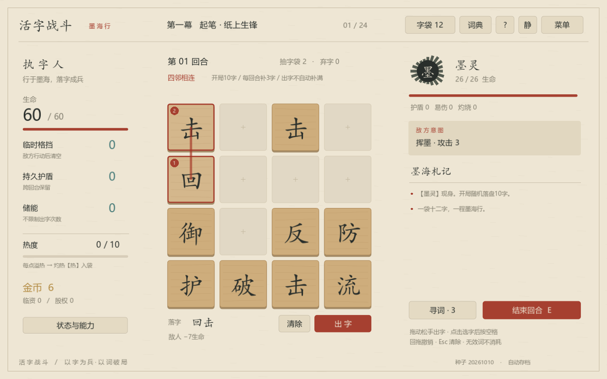
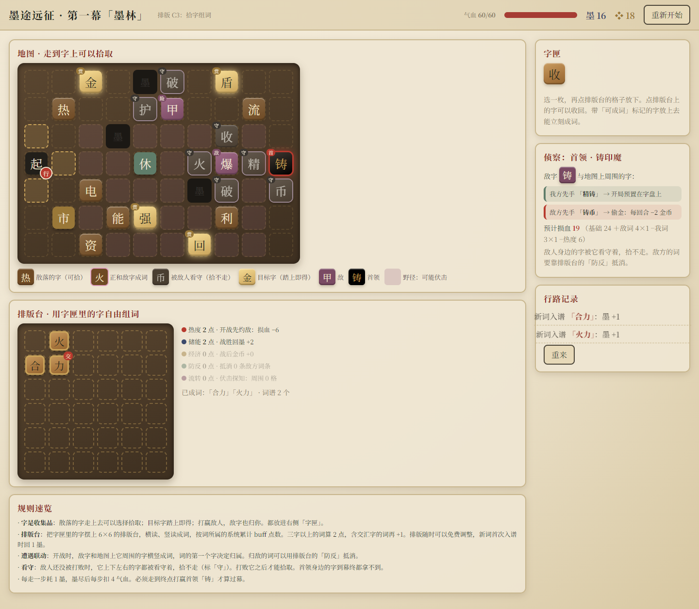

# 开发日志｜从组词战斗，到墨途远征

这段时间，我们换了一个玩法方向。

起因是和队友的一次交流。他提出了一套4×4字盘上的组词战斗：把相邻的汉字连成词，再用词的效果进行战斗。聊下来，我觉得这套玩法更有意思，也更符合我们对“涌现”的期待，于是决定转向，接着他的方案往下做。

## 先从4×4战斗做起

*队友策划案中的字盘示意。*

这套玩法里，玩家拿到的是一枚枚字。字放在4×4的盘面上，只能沿上下左右连接，可以转弯。组成词后触发效果，参与组词的字也会被消耗。

比如图上的“反、击、破”，中间的“击”既能用于“反击”，也能用于“击破”。先用了其中一个，另一个就暂时连不出来了。用哪个，要看这一回合需要什么。

再加入补字和改变位置的效果，盘面就会不断发生变化。“回流”可以补字，旋转、反转等操作可以调整字的位置，原来连不上的词可能就能连上。玩家要一边出词，一边考虑剩下的字还能做什么。

这也是当时吸引我们的地方。词的效果是提前设计好的，但具体能打出什么、先打哪个、后面还能接什么，会受到字的位置和当前资源影响。“涌现”在这里有了一个比较具体的落点。

热度也是其中一组关系。“加速”能让后续出词额外补字，同时增加热度；热度太高会产生灼热字，影响之后的字袋循环。而“火爆”又能消耗热度造成伤害。继续补字、降温，还是把热度用掉，要根据当时能组成的词来决定。

*按照策划案做出的其中一版Godot战斗界面。*

战斗做出来后，界面和操作也改了几轮。我们试过不同的布局和风格，调整了词效预览、已选路径和敌方意图的位置，后来又补了字块材质和攻击反馈。这部分主要是让玩家更容易看懂自己这一手会发生什么。

## 接下来，做战斗之外的玩法

有了组词战斗，接下来就要考虑一整局怎么进行。

策划里已经有战后奖励、商店和字袋成长。拿到新字，会增加新的组词可能；复制某个字，可以让它更容易出现；字袋变大，也可能让原来想要的字更难抽到。

我们在这个基础上继续尝试大循环。Godot里做过分支路线，也试过分阶段挑战。后来又开始考虑，能不能让地图本身也和汉字产生更多联系：玩家去一个地方，是因为那里有自己想要的字，得到字以后，再改变自己的组合。

*保存下来的地图方案列表，页面按新到旧排列。*

最开始试了几个方向，包括把地图做成大字盘、沿字网前进、收字排版，以及让地形或部首影响战斗。之后又沿着排版继续尝试：提前摆好战斗字盘、用词决定下一站，或者一边走路一边铺字。

其中，“铺字成路”继续做成了C2。玩家在地图上移动，也把字放在路上；每走一步消耗“墨”，沿途有目标字、补给和敌人。

*C2：走路和铺字在同一张地图上进行。*

这一版把走路和组词放得很近：想去哪里，会影响字摆在哪里；想组成什么词，也会影响怎么走。到了C3，我们把地图和排版台分开，让摆字有了更多调整空间。

## 现在的C3：在地图找字，再自由排词

C3保留了探索地图。玩家消耗墨移动，沿途收集汉字，遇到敌人、商店和休整点。得到的字放进字匣，再拿到独立的6×6排版台上使用。

*C3原型：上方探索拾字，下方调整排版。*

排版台可以自由调整，横向或纵向组成词后获得相应加成。图里用“火、合、力”三个字排出了“火力”和“合力”，两个词共用一枚“力”。首次组成新词还会返还墨，可以用来继续探索。

这样，地图上的收获能直接用到排版里。缺一枚字时，可以去找它；拿到新字以后，也可以重新安排已有的字，不必受之前走过的路线限制。

敌人也参与组词。比如首领是“铸”，旁边的“精”和它组成“精铸”，下方的“币”和它组成“铸币”，词的起始字决定归属。后来又加了看守规则：敌人没被打败时，紧邻它的字不能拾取。想拿这些字，就得先处理这场遭遇。

目前我们先沿着C3继续试。它把找字、收字和排词连了起来，也给玩家留下了调整组合的空间。不过，这一版还在验证地图和排版，遭遇暂时用模拟损血结算，尚未接入已有的4×4战斗。

接下来要做的，是把这两部分接起来，看看探索中得到的字和排出的组合，能不能在战斗里发挥作用。

#TapTapGameJam #开发日志 #活字工厂 #墨途远征
