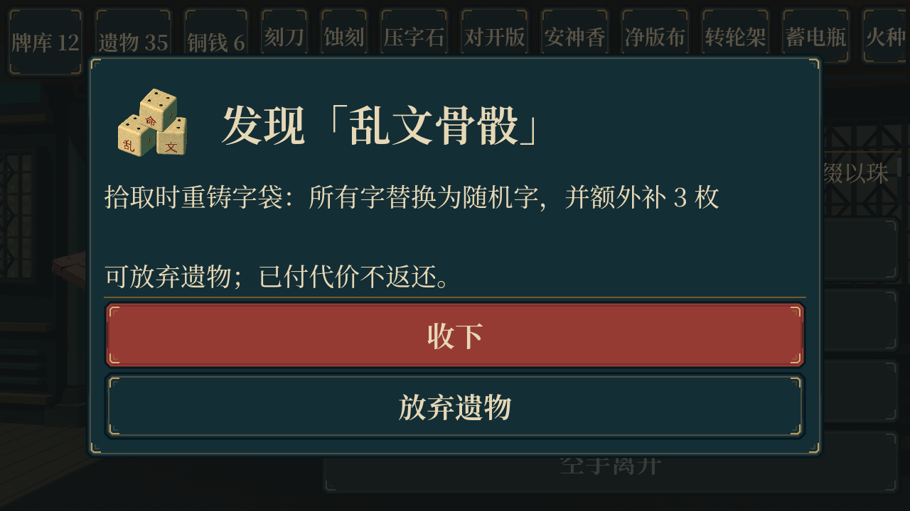
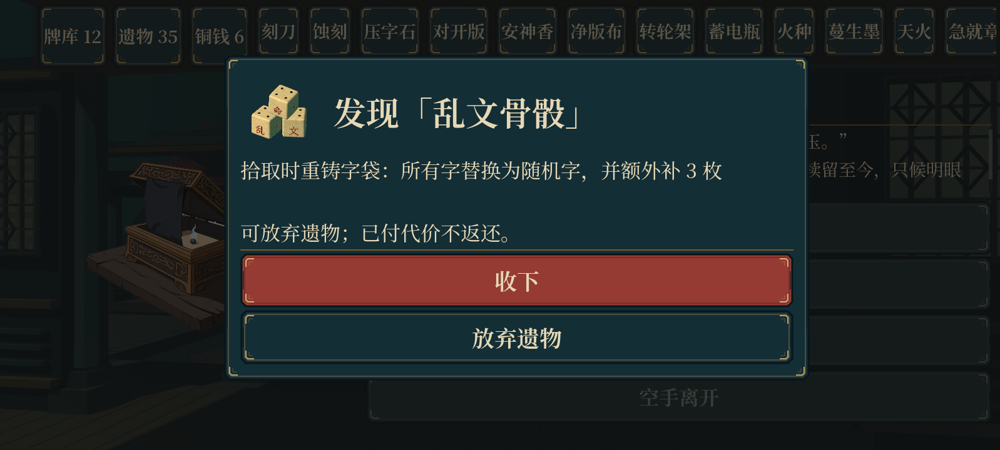

# 事件结算审计（2026-10-20）

检查当前横向节点主流程中的 37 个事件，重点核对当前气血、最大气血、随机遗物的拾取时机，以及存档和重复回调。基于远程 main 的 bdbe9ee，保留行囊、成就、统一结算，以及最新的遗物审查修复。

## 已修复

| 问题 | 原行为 | 修复后的行为 |
|---|---|---|
| 墨池浮灯 | “失去 4 气血，回复 20”，数据也是先扣当前气血再治疗，未付最大气血 | 明确改为最大气血 −4，再回复 20。20/60 变为 40/56；满血 60/60 则为 56/56 |
| 随机事件遗物 | 抽到即 `add_relic`，立即执行重铸等拾取效果 | 固定抽取结果，先展示名称、图标和完整效果；玩家收下后才执行拾取，可放弃 |
| 事件战斗奖励 | 胜利后直接发放随机遗物 | 胜利后进入同一个待领取阶段，可预览、领取或放弃 |
| 二维宝藏节点 | 抵达时就发放，所谓“收下”只是确认已执行的结果 | 抵达只确定候选，确认后才入手；放弃不触发拾取 |
| 事件读档 | 旧的删字待选数据没有新领取标志；界面快照可能抢先进入经典模式分支 | 运行态恢复时统一使用可选领取；庭院界面始终以当前控制器为准 |
| 绑定与重复结算 | 直接发放只能采用默认绑定，无法在事件里选择 | 领取后走既有选字流程并保存；节点阶段与弹窗守卫防止重复领取 |
| 致死代价 | 新的待领取阶段需要避免让零气血角色继续领奖 | 代价致死直接进入统一失败结算，不出现遗物领取弹窗 |
| 误触与安全区 | 点击可关闭弹窗的背景可能直接拒绝遗物；弹窗按全窗口排版 | 领奖弹窗背景只拦截输入，按钮或返回键才放弃；布局避让安全区 |

## 行为边界

- 随机遗物的抽取池保持原设计，【乱文骨骰】仍可出现；它的重铸只在明确收下时触发。
- 【乱文骨骰】专属事件已经明确写明“字袋全部重铸”，选择该选项仍直接执行，保留玩家主动重构牌组的玩法。
- 随机结果在第一次结算时确定并存档。反复刷新、读档或返回界面不会重抽，也不会再次收取代价。
- 抽到遗物后放弃，只放弃遗物；已支付的气血、最大气血、铜钱或删字代价，以及其他已结算效果不会撤销。否则可以免费探查随机结果再回退。
- 旧版本已经发放过遗物的宝藏存档按已发放状态处理，不重复发奖；已经发生过的重铸不能据此恢复旧牌组。
- 其他已有最大气血效果（齐人攫金、涤除、删诗、偿债）未发现把 `max_hp` 错写为普通伤害的同类配置；齐人攫金、涤除的受伤状态另有专项断言。

## 接口与存档

`EventEffects.resolve/resume` 增加可选的 `offer_relics` 参数。运行态统一传 `true`；解析器返回 `relic_offers`，不立即执行随机遗物拾取。直调解析器的旧行为保留，便于兼容已有调用。

新增 `event_relic` 阶段，以及 `event_relic_take` / `event_relic_skip` 两个合法动作。`observe` 暴露候选 ID；存档增加 `pending_event_relics`。缺少该字段的旧存档使用空队列，旧删字待选数据在恢复结算时也采用新领取流程。

领取后共用现有遗物绑定、镀金、复制、许愿等交互；绑定完成后补存快照。二维宝藏继续兼容 `treasure_ack` 作为明确领取，新增 `treasure_skip`。

旧三维地图的事件抽屉兼容新增领取阶段，避免旧入口出现无可操作选项；本轮不改动三维美术。

领取时保留远程新增的待选字 / 许愿队列，先保存领取状态，再打开选择。普通绑定沿用默认兜底，界面允许重新选择；一次性拾取效果遵循远程的本局次数限制。

## 验证

- 专项：61 项，涵盖受伤 / 满血 / 低血量、临时气血、领前与领后牌组实体、放弃、重复点击、旧待选存档、事件战斗奖励、宝藏、绑定、待选字队列和致死结算。
- 最新遗物审查回归：144 项，保留隐藏遗物、一次性拾取、补选字 / 许愿和战斗效果修复。
- 事件系统：631 项；事件交互：43 项；事件插画与原选项结算：525 项。
- 路线状态：196 项；地图往返与宝藏：29 项。地图的可用高度断言按新公共行囊下方的内容区域计算。
- 成就运行态：30 项；成就钩子：22 项。
- 手机布局模拟：11 档、297 项，包含新增遗物弹窗。另检查 1280×720 与 2664×1200 比例的桌面 Forward+ 渲染。

记录与截图见 [QA 汇总](qa/event-reward-audit-2026-10-20/verification.json)。部分独立测试进程退出时仍有既有的资源占用 / ObjectDB 清理告警，原始日志保留；本轮没有安卓真机验证。

