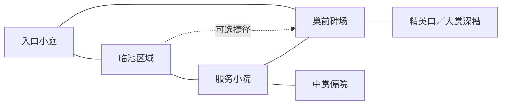

# 地图生成与园林建筑布局方案 v0.1

2026-10-17。基于 `MapGen`、远征规则与已完成的园林、池岸、莲叶资产整理的方向稿。用户授权调整部分地图规则后，已组装 `garden_v1` 可玩首版，实际取舍与验证见[接入记录](地图生成规则与园林接入记录.md)。本文其余新增尺寸、数量与评分为完整方向建议，不代表所有片段机制均已实现。

## 1. 生成出来应该是什么

目标是可以探索和追逐的冥府园林：沿石径穿过门洞、临池游廊、字摊和碑场，从不同方向绕回熟悉地点；高收益藏在深入后必须原路退出的角落。

采用“场景片段＋回环路网＋约束摆放”。片段定义建筑、地景与通路的关系，允许变化尺寸、朝向、破损和内容位置。整张地图不固定成几间方房，也不要求每次出现所有模型。

首轮继续使用 **12×8、四向逐格移动、固定镜头朝向**。先做墨池，其他主题共用生成结构、设施接口和玩法校验，再逐步替换主题地景。

必须保留的体验：

- 主探索区能绕行，首领追逐时有路线选择。
- 大赏凹槽是有意设计的陷入风险，不能被随机开口消掉。
- 建筑占地、门洞、桥面与实际能走的位置一致。
- 地图字、散字、守卫、预测路线比装饰更容易识别。
- 开局只看见身边一部分，沿用当前迷雾与信标规则。

## 2. 当前代码提供的基础与限制

| 当前行为 | 生成方案如何处理 |
|---|---|
| 96 格，先保留奖励凹槽，再撒约 15%–20% 墨渍并修补连通 | 保留阻挡密度的量级；改成先规划场景与回环，再分配水体、建筑基座和凹槽墙 |
| 主区排除割点，平均邻接度至少 2.7，内容绕路上限 5 | 第一轮作为基线约束，继续排除奖励凹槽之外的唯一咽喉 |
| 大赏 1–2、中赏 1–2、小赏 2–3；休息与商店各 1–2；谜事件通常 1 | 不通过新增建筑增加奖励次数；场景提供同一批内容的落位位置 |
| 首领基础醒来时间 10–14 步，惊动后缓冲 4 步 | 先保留节奏，不为容纳漂亮建筑自动延长时间 |
| 伏兵 3–6 组，领地封住 1–2 个内容；关键地点不能被封死 | 在真实路网、节点和建筑落位之后再安排，继续做避让与可达检查 |
| 视野基于格子路径；当前寻路主要读取 `ink` 的可走掩码 | 第一版仍使用格子通行，避免引入单独一套物理／导航通路 |
| 园林模型目前只有模型尺寸和连接标记，未接入地图 | 增加生成用摆放定义，分别描述实体占地、可走区、入口和遮挡 |

原型对照测试依赖旧种子生成相同地图。新生成方案应增加版本，不直接改写 `gen_proto` 的原型输出。

## 3. 整体布局：四个主片段，加少量可选角落

下面是片段关系示意，表示通路关系，不是每局固定的上下左右位置。每条连线最终展开为实际格子路径。



四个主片段形成可绕行的探索主体；旁路可以替代图中的对角捷径。奖励凹槽另接在主体边缘。

| 片段 | 建议范围 | 场景与内容 |
|---|---|---|
| 入口小庭 | 约 3×2 格 | 起点、少量石灯和残碑；有条件时用月洞门框住其中一个出口，另一方向仍可离开 |
| 临池区域 | 约 4×3 至 4×4 格 | 不规则池岸为主要地景，可选石桥、短游廊、岸栏；沿池边连接两个方向 |
| 服务小院 | 约 3×3 格 | 字摊或息灯亭面向小块空地，附近允许少量散字；可以与临池片段共享一段地面 |
| 巢前碑场 | 约 3×2 至 3×3 格 | 巢穴门阙、疏密有别的墓碑群；接入回环，首领从这里进入主区 |
| 奖励角落 | 现有深 1／深 2 凹槽 | 中赏偏院、大赏深槽；用残墙、照壁和碑体强化深处感，精英占大赏槽内侧一格 |

范围是候选包围范围，不代表其中每格都有建筑，也不代表所有片段必须严格分离。共享通行空地可以节约面积；建筑实体、奖励格和通行预留不能相互覆盖。

起点与巢穴先满足现有远近关系，再做美术朝向选择。不能因为固定镜头喜欢巢穴在画面上方，就每局都把巢穴放在同一角。

## 4. 生成顺序

### 第一步：选择构图骨架

从少量经过制作的结构类型中选择一个，再对锚点位置做受限变化：

1. **绕池型**：池塘偏中部，主路绕池连接服务区；桥是可选短路。
2. **双院型**：两块较开阔的庭地，用门口和侧路连接；一侧带小池。
3. **沿渠型**：短水渠把地景拉开，桥和绕行岸路共同连接两岸。

首轮这三类足够。它们提供区域关系和端口，具体格子、奖励、残损和装饰继续随机，不直接复制整张完成地图。

### 第二步：铺出通路并锁定关键空间

先把主片段端口接成回环，给关键地点保留落位区。回环不要求一圈等宽走廊，可以经过开阔石地、桥和院门。

- 主区尽量两格宽，在门、桥附近允许收窄为一格。
- 一格宽处必须有另一条绕路，不能成为主区唯一连接。
- 起点附近至少两个可走方向；起点一圈不放伏兵、墨障或紧贴的高大建筑。
- 巢穴接入主体回环；大赏与巢穴不能挤在同一个危险入口。
- 深度为 1／2 的奖励凹槽在这一步保留，不能等装饰完成后再挤位置。

主区的无割点检查是硬约束。绕行距离再按当前规则检查，不能用一条绕半张地图的通路冒充有效旁路。

### 第三步：放结构建筑与池塘

依次尝试影响路径的桥／门／游廊、实体照壁、池岸与边界构件。每次落位同时登记占地和通路，检查失败就换朝向或换候选位置。

池岸轮廓在预留范围内变化，不能随后侵占已经锁定的通路。可以增加小池、偏角和内湾，但受整图阻挡预算约束，不给每处空地都加一片水。

每个建筑或片段按同一套流程选择候选：

1. 根据所需端口、岸边长度和预留范围枚举锚点，以及允许的 90° 朝向。
2. 变换实体轮廓、入口格、屋檐和铭字区，检查支撑、重叠、行走带与连接条件。
3. 临时写入占地和通路，复查连通及绕行；不合格就完整撤回本次候选。
4. 对剩余候选比较功能距离、朝向、留白和遮挡，再在评分较好的少量候选中按结构种子选择。
5. 一次性登记建筑与保留区，后续内容和装饰只能使用剩余空间。

桥与水道、门与短墙这类互相依赖的部分作为同一个候选一起检查。使用约束较强的桥／门优先于普通照壁，避免先塞满简单物件，最后只剩无法接路的位置。

### 第四步：放功能内容

以实际路径距离安排起点、巢穴、休、市、谜、赏、敌和机关。优先使用片段预设的功能插槽，没有合适插槽时换片段候选，不能把整栋建筑缩小塞进不合适的一格。

- 休息与商店仍按当前距离带分布，避免都挤在同一处。
- 在建筑前留一个能站人的交互格，地面字落在这个格内；建筑实体退到后方或侧方。
- 第一版保留“走到功能格触发”，不同时引入邻格交互的新规则。
- 一个游廊是场景构件，本身不额外提供一次休息；只有登记了【休】的格子才有对应功能。
- 多格建筑只绑定一个功能入口，其他覆盖格不会重复触发奖励。
- 数量统计以实际放下的节点为准，不能把目标配额误记成完成配额。

### 第五步：安排风险与散字

继续沿用伏兵领地、守卫范围、奖励封印和主题机关的规则，改为在新布局上筛选候选点。

- 伏兵领地不盖住起点、引导点、休、市、关键门口和凹槽入口等禁区；保持当前需要的最少组数。
- 守卫可守住散字与侧路，但不把全部准备资源放在不可避开的第一场战斗后。
- 潮／闸关闭、墨障未清除时，关键地点仍可到达。
- 水流方向对应实际连续通路，结束位置不能落进水中、柱脚或墙体。
- 风险类型不能由装饰组合唯一暴露；例如某种墓碑排列不固定代表伏兵。

### 第六步：补装饰与远景

在实体占地、通路净空、功能字和危险标记全部确定后，再生成墓碑、怪松、灯、鬼火、莲叶和少量红绸。

装饰失败可以少放，不能反过来移动已确定的内容或改变追逐路径。

### 第七步：校验、评分与输出

先做廉价几何与可达检查，再跑节奏模拟，最后对合格候选做构图评分。功能不合格直接重做结构，不通过多加资源或延迟首领醒来掩盖问题。

## 5. 各类资产的落位规则

| 资产 | 落位逻辑 | 通行与交互要求 |
|---|---|---|
| 月洞门 | 庭地边缘或短墙缺口；与墙体关系一起放 | 门洞前后各留可走格；左右墙体端口与前后通行口分开定义；不能作为主区唯一通路 |
| 照壁 | 入口庭地后侧、偏院背面、巢前侧缘 | 实体占地不可走；前方留空地；不得横穿两个可走格之间的行走线 |
| 双间游廊 | 靠池长边、庭地一侧，沿两格左右的通行段展开 | 内部可以走；柱脚、后栏与外侧的连接经过检查；行者不能穿凳子或横过后栏 |
| 平拱石桥 | 横跨窄渠，桥头接干地 | 当前长度约 2.13 格，优先跨 1 格宽水道并搭接两岸；桥面 y=0，主区还要有绕行路 |
| 栏杆 | 岸边、桥侧、台地外缘的有序边界段 | 不围满整池；桥头、通道开口处必须断开；相邻段共用柱 |
| 围墙／漏窗墙 | 地图外沿、片段背面、不可走的结构带 | 先有逻辑阻挡，再沿阻挡与通行区的界面落墙；不能在两个本来互通的空地之间随意加墙 |
| 残墙／断栏 | 已有边界段的状态变化 | 只有确实能走的缺口才表现为可通行破口；不能给不可走水岸制造假通路 |
| 息灯亭／字摊／问字龛 | 服务片段或偏院内的功能插槽 | 功能入口与地面字清楚，建筑实体从站立格后退；使用状态沿用当前规则 |
| 墓碑四种 | 形成 2–5 枚的小群，群间留空 | 高碑靠片段后侧，矮碑和残碑可在侧边；大碑脚实际占地不能被当作普通空地 |
| 怪松 | 后侧、岸角、外围景深层 | 树根落在可支撑的地面，树冠纳入遮挡范围；前景只少量出现，并可淡化 |
| 灯与鬼火 | 入口、桥头、功能区边缘少量点亮 | 未探索时不泄露具体地点；不能把整图均匀照亮；鬼火和暖色灯光保持既有区别 |
| 莲叶／小叶丛 | 按连通水域生成，局部聚集与疏散混合 | 检查叶心和外缘；桥面、岸沿、题字石、潮水机关动作区留空；不逐格复制同一布局 |

第一轮建议上限：月洞门 0–1、游廊 0–1、石桥 0–1、照壁 0–2。至少选到两类合适的园林构件，再结合现有功能设施形成主景；结构类型决定出现倾向，不强求每局凑齐。

每个约 7×5 格的常见镜头范围内，优先保留一处主景与一处次景。数字属于构图软约束，功能设施必须存在时应降低周边装饰，而不是移走关键设施。

## 6. 半格水面怎样兼容整格移动

逻辑仍然只走格心，不能仅用“这个格心是不是石地”决定池岸是否合格。

为每条允许的四向移动边保留一条**格心到格心的行走带**，首轮净空半径建议 0.25 地图单位，同时给每个可站立格心保留落脚区域。生成的水面、柱脚、照壁和树根不得切入这条带。

由此得到四种情况：

1. **整片深水格**：不能落脚，不进入通行图。
2. **一角少量水的石地格**：保留格心与所连接方向的行走带，可以正常进入。
3. **半片水切到行走带**：调整岸线，或在拓扑阶段将该格设为不可走并另铺道路；不能留到渲染时偷偷截路。
4. **桥覆盖水格**：底层仍是水，桥面提供 y=0 的行走面，允许在桥轴向连到两岸；不允许沿桥侧穿过栏杆。

池岸场的“共边一致”解决网格拼缝；行走带约束解决角色能否沿实际画面走过去，两者都要满足。

桥和游廊的侧向若需要禁止通行，第一版通过周边不可走格和受限模板实现。暂不新增一套“两个可走格之间还单独有墙”的规则；任何实体碰到一条本来允许的移动边，候选就不合格。这样继续使用当前四向格子寻路，避免点击、首领追逐、滑行和视野各算一套通路。

可达标识贴在实际落脚区域；局部水面不产生额外的半格移动。桥上仍以桥面位置拾取与标记，不能把桥下水面当成点击落点。

## 7. 补充一份生成用建筑定义

现有 `footprint` 和 `Socket` 主要服务建模与模块拼接，不足以表达通行。例如月洞门当前左右连接点用于接墙，前后才是行者穿门方向。

每个可参与生成的建筑增加以下数据，不能仅按模型包围盒判定占地：

| 字段 | 含义 |
|---|---|
| `asset_id`、主题标签 | 稳定资源标识与可用主题 |
| 允许朝向、固定比例 | 以 90° 旋转为主，沿用真实格子比例；不随机拉伸建筑 |
| `solid_cells`、实体轮廓 | 墙体、柱脚、柜台等真正占据的位置 |
| `walk_cells`、通行端口 | 可以站立或经过的格子及允许连接方向 |
| `interaction_cell` | 一个功能入口格；无功能建筑可以为空 |
| 铭字保留区 | 门口／亭前地面字的空间，不给装饰占用 |
| 净空与屋檐范围 | 底座外扩、屋顶伸出和相邻建筑避让 |
| `reveal_cells`、遮挡体 | 揭示建筑需要哪些入口格已探索，以及哪些部件需要淡化 |
| 可附着插槽 | 接墙、栏杆、灯和少量次级物件的位置 |

接入前需要校正的模型问题：月洞门补前后通行口并检查底部门洞净空；游廊若作为通路，将当前略抬起的模型地板校准到统一行走高度。不能直接沿用工作台中看起来合适的摆放偏移。

一个片段预制定义由这些建筑定义和相对关系构成，例如“临池短廊”包含水域预留、两端通行口、游廊候选位置、岸栏候选段与一个可选功能插槽；不是必须带所有装饰的一整张固定场景。

## 8. 数据与现有项目的衔接

建议新增一个带版本的布局结果，继续保留当前 `node/glyph/mech/obst/pocket/terr` 等远征字段。

```text
generation_version
terrain_base[k]       石地／水／结构基座
walk_mask[k]          实际格子通行
walking_surfaces      桥面、廊面及通行端口
regions[]            片段类型、格子集合、连接关系
structures[]         建筑标识、位置、朝向、占地、功能入口
shore_field          共用水岸顶点场与局部净空约束
decor_patches[]      墓碑群、怪松、灯、莲叶等表现数据
generation_report    候选次数、失败原因、路径与构图指标
```

底层地形和可走性需要分开：水上桥是“底层水、桥面可走”，石地上的实心照壁是“底层石地、实体不可走”。若继续用 `ink` 兼容当前寻路，应由 `walk_mask` 派生兼容掩码，渲染器则读取 `terrain_base`；不能再把所有不可走格都直接画成墨池。

坐标转换继续集中处理：当前 `MapGen.rc(k)` 返回行、列，世界位置为 `(列+0.5, y, 行+0.5)`。建筑制作单位 2 对应游戏 1 格，接入时统一适配；避免池岸、建筑和寻路各自约定原点。

建议职责：

- `MapGen` 入口选择生成版本，并保留旧原型生成。
- 园林布局生成模块负责片段、拓扑、建筑位置与岸线约束，输出纯数据，不创建 3D 节点。
- 内容放置模块消费最终可走图，安排当前节点、机关、守卫与伏兵。
- 美术布置模块安排不影响通行的装饰与灯光。
- `ExpeditionTerrain` 根据底层地形、桥与岸线生成连续网格。
- `ExpeditionMapArt` 实例化资产并绑定功能状态。
- `ExpeditionMapView` 负责拾取、迷雾、镜头和遮挡，不在刷新时临时决定建筑放哪儿。

只改变叶片、灯色或装饰密度，不应移动商店、改变奖励或重排战斗。

## 9. 迷雾、遮挡与外围地景

多格建筑记录唯一建筑实例及其入口揭示条件。入口未探索时整件隐藏，不能因屋檐伸进视野就提前显示建筑内的内容。长墙、栏杆和普通装饰按小段归属格处理，已探索但不在视野内时暗化。

整片水面继续读取连续迷雾遮罩；莲叶按落点记录归属格，跨格边缘也受遮罩控制，不能一看见池角就亮出整池叶片。灯光与鬼火同样遵循揭示状态。

固定镜头下，高照壁、密树冠和长屋檐优先放在片段后侧。建筑遮住行者、临近可操作目标或关键地面字时，按遮挡部件淡化；地面字和通行标记保留。装饰根基不得放到角色实际经过的位置。

外围延续地图内的池岸与结构方向，生成少量远碑、断墙和怪松，形成前中远层次。外围不可交互，避免画出像出口却无法进入的完整大路，也不固定摆满左右两列相同墓碑。

## 10. 校验、节奏与失败回退

### 硬约束

- 起点、巢穴和规定内容实际落位且可到达。
- 主区无意外割点，奖励凹槽深度与唯一入口成立。
- 潮／闸全关闭、墨障视为阻挡时，保留规则要求的绕路；继续检查伏兵领地当墙后关键地点可达。
- 所有允许移动边的行走带有真实可站立表面，没有墙、柱或水切断。
- 桥头落在有效地面，桥侧栏杆不与允许移动边冲突。
- 角色格、设施入口、散字、机关和危险标识不被实体占地覆盖。
- 岸线共边一致、没有裂缝，装饰有支撑；可用与已使用状态保留对应功能格。
- 同种子、生成版本与配置生成相同结果。

### 节奏与构图

保留现有初见模拟获取内容约 45%–75% 的区间作为第一轮筛选参考，补看熟图路线、服务点距离、起身后的绕行机会。它是平衡启发式，不当作真人体验保证。

现有模拟的【流】会滑到路线尽头，而实际远征基础最多滑 3 格、【流速】最多 5 格。接入新生成器的节奏评分前，应统一这部分步进，否则沿渠图会被错误评分。

构图评分优先考虑：一处清楚的水景／庭地中心、建筑前方留白、功能字可读、主次密度变化、不同种子之间的轮廓差异。先排硬约束，再在合格候选中选较好的构图，不让美术分数补偿不可通行问题。

### 随机流与回退

结构、内容、装饰与植被使用分开的稳定随机流，由根种子、版本和阶段标识派生；不消耗战斗或奖励使用的运行随机数。需要重建旧局时，种子必须连同生成版本和相关配置一起记录。

候选生成建议先限制为 32 次：廉价可达／几何检查通过后才做模拟。可选建筑放不下先换朝向或减少同类数量；装饰失败直接少放；池岸越界则在允许范围内回退。不能偷偷削掉必须存在的服务点或伏兵组数。

仍失败时采用同版本、预先验证过的基础布局，再做受限内容与装饰变化。输出明确的失败阶段与回退原因，不向远征返回空地图。

## 11. 制作顺序与首轮交付

1. 补建筑摆放定义，人工做一张可玩的 12×8 布局，验证月洞门、桥、游廊与站立／点击位置。
2. 做绕池、双院、沿渠三种结构骨架，先只生成结构与空路；在调试视图中显示占地、通行口和路径。
3. 接入现有配额与远征规则，安排节点、机关、守卫和伏兵，并做节奏筛选。
4. 接入不规则岸线、边界拼接、墓碑群、小叶与外围装饰；表现参数使用独立随机流。
5. 检查多格迷雾、地面字、遮挡淡化、缩放拾取以及战斗往返。

首轮验收建议：三种骨架各挑多张种子做总览，按四主题累计约 200 个种子检查规则与失败分布；墨池另做 1280×720、1920×1080 实机检查。重点覆盖单格桥、门洞、密集服务区、大赏深槽、涨潮封路、伏兵封印和首领追逐。

这样后续增加建筑，主要补一份摆放定义和适用片段，不必再在地图视图中增加一套按格号取模的随机摆法。

## 核对来源

- [现有地图生成与模拟](../src/expedition/map_gen.gd)
- [远征移动、机关与追逐](../src/expedition/expedition.gd)
- [运行地图与当前装饰摆放](../src/map/expedition_map_view.gd)
- [连续地形](../src/map/expedition_terrain.gd)
- [美术适配器](../src/map/expedition_map_art.gd)
- [园林资产尺寸与连接方式](../assets/expedition/garden/README.md)
- [池岸与莲叶生成](../assets/expedition/lotus/README.md)
