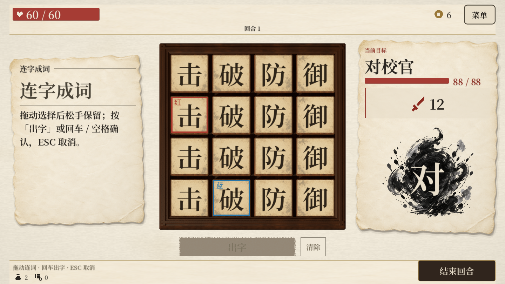
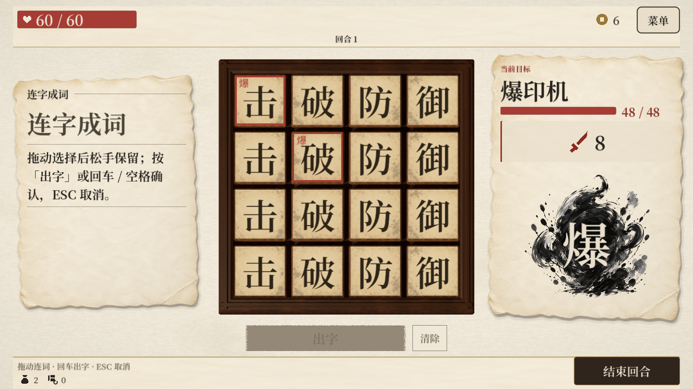
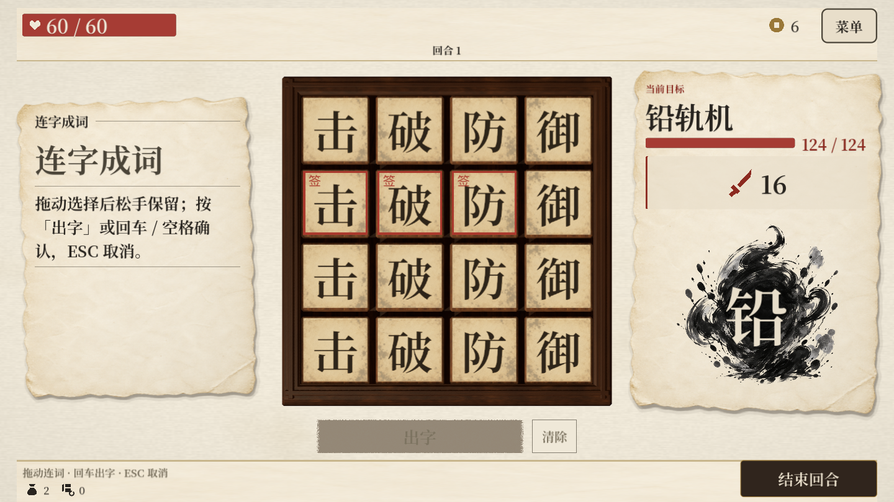

# 20种怪物接入、数值基线与冲突核查

> 后续调整：探索版面与词谱已移除，扩版奖励、词谱收益与原来的整幕随机怪池已被替换。当前规则以[版面移除与怪物成长投放](远征版面移除与怪物成长_2026-10-17.md)为准；本页保留对应轮次的记录。

> 后续规则已更新：首领胜利后立即封层，不能继续探索；数值与流程以[封层与难度调整](远征首领封层与难度调整_2026-10-17.md)为准。下文保留当时的设计记录。

日期：2026-10-17。依据：`docs/怪物初稿_20种.md`。基于 main `2b84f5d` 的本地修改，尚未提交或推送。

## 交付范围

20种精选怪物均有独立资源、行动循环、任务条件与动态意图；标准三幕节点、墨途远征均可遇到。9种旧敌资源保留兼容测试和旧内容。没有替怪物制作新画像；使用已有的墨灵/大字表现。

初稿的生命、初始普通盾、基础伤害、奖励值保持原值。机制奖励是普通受伤：先扣盾，再扣生命；不使用玩家攻击增幅，不触发精分重定向。不等于无视护盾。奖励先击杀怪物时，中止其后续攻击。

## 投放与数值定位

| 幕 | 普通池 | 精英池 | 首领 |
|---|---|---|---|
| 一 | 纸壳兵、连针蜂、倾砚、折页蛾、留白童、墨蚀蠹 | 保留旧铁画 | 对校官88生命 |
| 二 | 饕餮、炉腹兽、余电獾、赊墨商、双面简、铸巢蛾、爆印机 | 拓印师、钤印官、轮印师、漏电水蛭 | 铅轨机124生命 |
| 三 | 复用二幕普通池 | 复用二幕精英池 | 万词编纂者168生命 |

初稿没有一幕精英、三幕普通/精英，以上是本轮明确补位方案，未虚构额外怪物或隐式加生命、伤害倍率。标准节点的普通池分配到1、2、4号战斗节点，6号岔路从精英池选一只。候选池不代表多敌同场。远征使用幕数、地图种子、遭遇格号稳定选敌；反复预览不改变抽选结果或推进随机数。

一幕首场只在纸壳兵/连针蜂中选，二战倾砚/折页蛾，机制战留白童/墨蚀蠹；二、三幕按对应池分配。远征普通战仍可遇到本幕所有普通怪。复用三幕怪物是内容缺口的临时方案，不能解释为第三幕战斗已调平。

## 静态伤害压力

下表为一个完整循环的基础攻击总量÷敌人行动次数；包含不攻击的预备动作，未扣玩家防御。范围下限按完成任务/低热度，上限按失败/高热度；不包含污染刺痛、字循环受损、补盾延长战斗、精分、永久减伤、首领追击位置惩罚。它用于对比动作预算，**不是实战DPS、胜率或通关保证**。

| 怪物 | HP/初盾 | 基础伤害/行动 | 主要额外压力或回报 |
|---|---:|---:|---|
| 纸壳兵 |32/8|3.00|每2行动补盾至8，拆盾窗口明确 |
| 连针蜂 |34/0|6.33|3×3与10单击的防御差异 |
| 倾砚 |34/0|3.50|2次空间动作不攻击，可能帮玩家连词 |
| 折页蛾 |32/0|6.00–7.50|成词解签额外3机制伤 |
| 留白童 |36/0|7.00|留白奖3伤，否则加4盾 |
| 墨蚀蠹 |38/0|3.00|每2行动注最多2蚀；本怪在盘上限3 |
| 饕餮 |52/0|6.67–7.67|吞字得4盾、腹中最多3实体 |
| 炉腹兽 |44/0|7.00–11.00|每次攻击后升2热；高热每击+4 |
| 余电獾 |48/0|5.33–6.67|先得6盾，净消费任务可拆6 |
| 赊墨商 |48/0|4.67–6.00|先得8盾，正价支付任务可拆8 |
| 双面简 |50/0|5.33–7.00|完整解7伤并奖5机制伤；部分解9 |
| 铸巢蛾 |52/0|5.33–6.67|先得6盾，真实入盘再成词可拆6 |
| 爆印机 |48/0|4.00|补盾至6；坐标摧毁影响循环 |
| 拓印师 |62/0|6.67–10.00|拓也可能改为盾/注字；最高攻击固定10 |
| 钤印官 |60/0|6.00–8.67|朱批8+区域占格×2，最高16 |
| 轮印师 |66/0|6.00–8.00|8盾；同原实体两次组词奖8机制伤 |
| 漏电水蛭 |52/0|9.00|无蓄势空窗；穿透生命才偷能并补盾 |
| 对校官 |88/0|一阶6.67–8.00；二阶8.00–9.33|每循环补盾6/8；两签成词共奖6 |
| 铅轨机 |124/0|一阶7.33–9.33；二阶8.67–11.33|每循环盾8/10；全撤离攻击后拆8 |
| 万词编纂者 |168/0|一阶11.33–14.00；二阶13.67–16.33|两次任务失败额外各补6/8盾 |

### 数值策划判断与后续调参顺序

- 普通怪的纯伤害预算通常低于精英；倾砚、爆印机和墨蚀蠹用空间/污染压力换取攻击空窗，不能只按直接伤害认定偏弱。
- 漏电水蛭虽然只有52生命，但9伤/行动且没有蓄势，再叠偷能与盾，可能比62–66生命的其他精英更难。优先试玩“完整防御构筑”“靠储能启动的构筑”；若明显过强，先尝试首击8→7或吸能得盾倍率2→1，暂不在没有试玩数据时调整。
- 终幕首领仅半血前/后两阶段。二阶段基础压力最高16.33/行动，且每轮两次失败共加16盾，有伤害不足→任务失败→战斗延长的反馈。优先确认成熟构筑是否能完成“主动同词两次”；若普遍无法完成，优先放宽重复题或收卷7×3→6×3，避免同时降低全部数值。
- 炉腹兽热8门槛会被火爆反制：8热时40伤可将其44生命打至4，这是初稿刻意的资源奖励，不加额外抗性抵消它。火爆需要真实凑词，不能据此认定所有构筑都能秒杀。
- 首领生命相对旧资源为78→88、112→124、150→168；同时去掉原远征额外的持久盾8/12/16、开场盾6/8/10和力量0/1/2。不能把增加生命和保留旧词条一起叠加，否则初稿示例失真。
- 本轮验证确定性规则、边界和UI；未运行有代表性的真人构筑试玩，没有输出虚构胜率。“已接入”不代表最终平衡定稿。

## 已解决的冲突与统一口径

| 冲突 | 本轮处理 |
|---|---|
| 远征把敌人换成主题名，普通生命逐幕×1.25/1.5 | 精选怪物保留自己的名称、字形、生命；移除隐式倍率，遭遇日志使用实际怪名 |
| 首领旧护甲/护盾/力量叠加初稿机制 | 精选首领不用旧叠层。追击造成的位置减益保留并继续显示 |
| 朱笔“少一条旧词条”失效 | 精选首领当前生命与上限各−6，已有开场伤害仍保留；旧首领仍少一词条 |
| 破甲/破防旧开场收益失效 | 精选首领：破甲抵首次普通补盾8；破防抵消一次实际补盾。破甲已完全抵消时保留破防供下一次补盾；词谱说明同步更新 |
| 御/反面对多段 | 御只减下次伤害2；反在完整攻击行动后结算一次；永久防御力每段生效 |
| 原实体与字形混淆 | 身份引用判定，临时复制不可替代；同一融合实体同一词内只计一次；合击实际结算的不同词可各计一次 |
| 蓝签移动后与红签共用判定 | 红签不能靠纯移动解，蓝签允许；成词解除才给3奖励，先单打/移动解除后不补领奖励 |
| 双面简同词消耗两目标，被误判成部分离盘 | 完整解优先并锁存；只离盘一枚为9，无合法题固定9；翻签时无题不会被基础补字改成新题 |
| 空格/坐标与原实体混用 | 留白和朱批看占用格；爆印看坐标上的当前字；铅轨看原实体是否仍在原行；补进新字不算旧实体残留 |
| 补至8或6写成每次加8/6 | 纸壳兵、爆印机使用max(0,目标盾−当前普通盾)，满额不再叠 |
| 储能净消费按回合末资源差值算 | 记录实际支付与对应退款；普通回能不抵消消费；旧阶段消费的后续退款不反扣新阶段；偷能不冒充消费 |
| 零费、失败与取消误发收讫 | 只在统一支付成功且折后费用>0后登记，临时资金/合资储能/金币都有效 |
| 铸巢蛾将基础补字/重连/临时字算新入盘 | 任务在基础补字后开窗；重连归还明确不计；对真实补字/回收登记。使用前就要已入盘，不能本词效果放回后追认此前使用 |
| 轮印/万词被连击、重复等效果重演刷题 | 只在成功提交或合击实际结算时记一次，不以效果执行次数计数；跨玩家阶段清空 |
| 吞字变永久删除、战后重复归还 | 腹中独立保存实例，最多3；返袋顶只一次；战斗结束归还。吞取目标预告后被玩家回收则本次不换吞另一枚 |
| 指定蚀误用随机污染注字 | 独立指定蚀入口、刺痛污染、本怪在盘数量上限3；兼容防护、护、加收；不进永久袋 |
| 爆印绕过固定字/防爆 | 固定字跳过；真实己方实体入弃字，防爆改回袋每枚+1持久盾，敌字/临时字清除 |
| 漏电按标称伤害而非实际HP损失吸能 | 比较完整攻击前后玩家生命，全挡、精分、心力阻止实际扣血时不偷；普通盾最高8，不扣回已有更高盾 |
| 半血固定写44/62/84 | 按当前生命上限50%实时计算，朱笔等上限变化后仍正确；出招时确定阶段，该次伤害不因奖励跨线追溯改变 |
| 任务只在说明里看不到目标 | 字盘显示红/蓝签、爆格、印区、中央旋转区；已解签移除。悬停/点击意图可看坐标和当前任务进度，攻击数值动态刷新 |
| 伏兵/首领先手推进招式，任务仍停留旧招 | 开场先手完成后为实际下一招重新开窗；开局遗物重力先完成，再标记任务 |
| 查看意图消耗随机数/修改怪物资源 | 意图复制后计算，无随机抽选；保持资源原值；额外表现不消耗战斗随机数 |

### 初稿自身的表达边界

1. 初稿同时出现“相同字形”和“原实体”，本轮严格分开。融合把多个字形装进一个实体，非实体额外使用层也不等于多枚原实体；爆印按运行时真实实体逐枚归还，不按字形数量造回收收益。
2. 纸壳兵“补盾至8”与其他怪的“获得6/8盾”不同；后者允许普通盾累加，任务拆盾只移除约定上限，不清持久盾。
3. 铅轨机任务看留在原行，成词后额外使用留盘不算撤离；折页/对校看成功使用，额外使用留盘也能完成。两个规则不是共享一套“使用=离盘”。
4. 万词的“阶段”是本次玩家出字阶段；与首领半血阶段是两个概念。不同词题与重复词题各自清空统计，不累积整场历史。
5. 预备动作和高收益任务不保证始终有合法目标；无题不凭空产生奖励，双面简按初稿回退，其他缺题只用基础行动。

## 验证与复现

使用本机 Godot 4.7.2。怪物专用生成器只更新敌人与关卡，不重建任何玩家字、词、遗物。

```bash
# 首次新增脚本后导入
Godot --headless --editor --path . --import
# 只重建20种怪物和3幕节点
Godot --headless --path . --script res://src/tools/build_monsters.gd
# 怪物边界与投放
Godot --headless --path . res://tests/monster_regression.tscn
# 真界面标记、预告一致性
Godot --headless --path . res://tests/monster_ui_test.tscn
# 原生截图验证（输出到/private/tmp/huozi-monster-*.png）
Godot --path . res://tests/monster_ui_test.tscn -- --capture
```

原有UI测试改用明确的墨灵夹具，避免把地图首怪数值变化误报成点击/血条回归；远征测试同步检查新首领基线与兼容规则。未删除失败测试或放宽行为断言。

最终实测结果见 `docs/怪物测试结果_2026-10-17.md`。

## 原生界面核验






