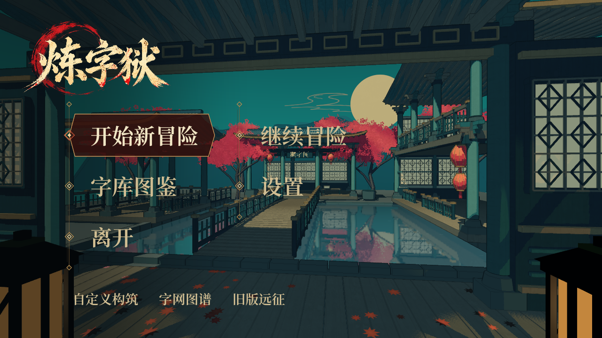
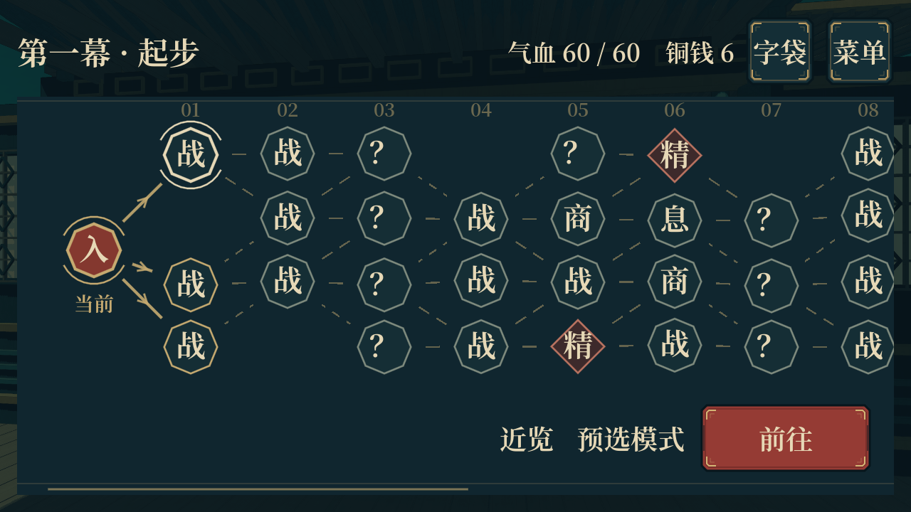
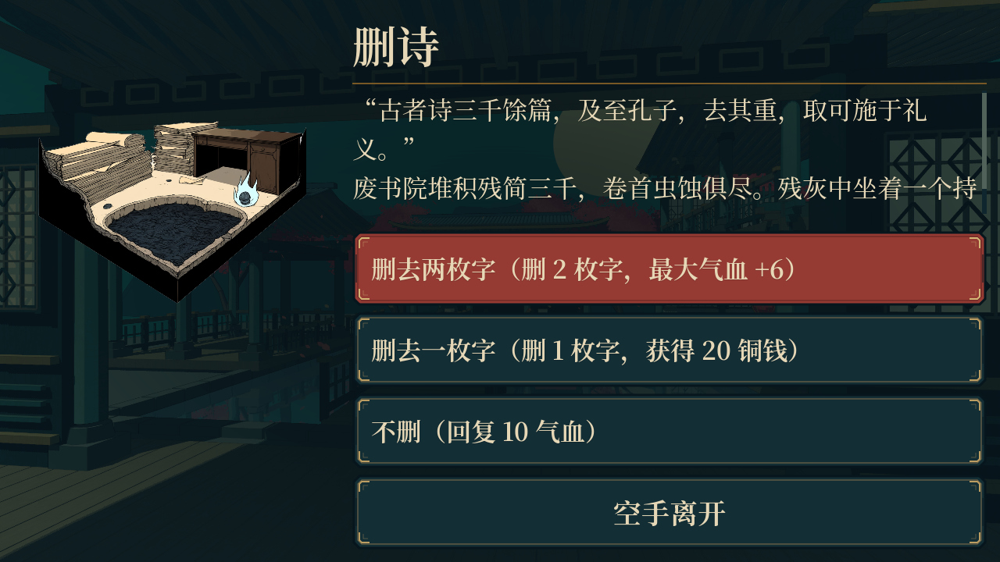
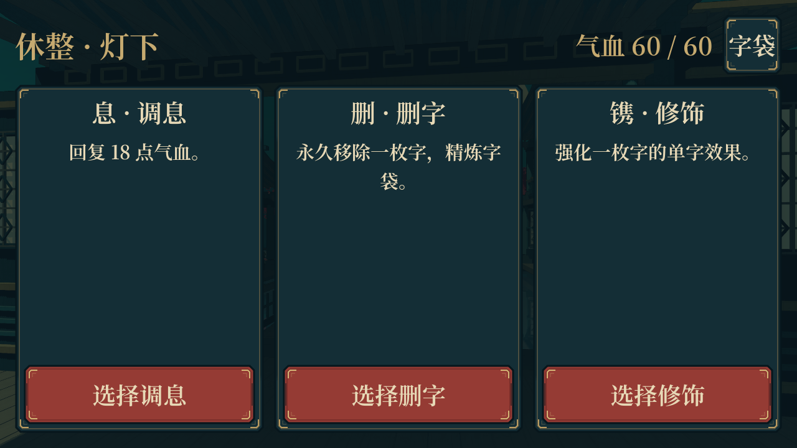
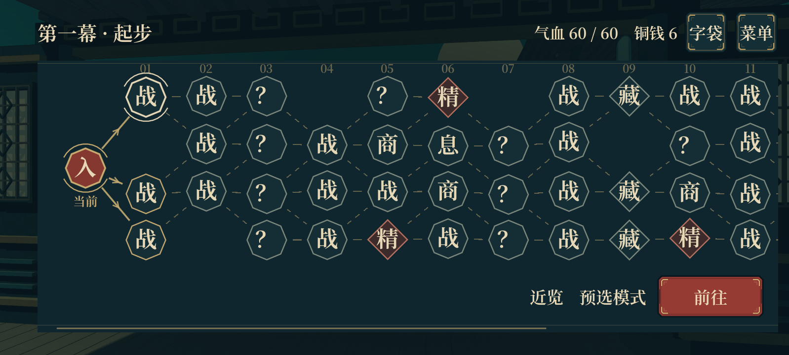

# 手机横屏适配与参数清单（2026-10-20）

本轮针对标题菜单、二维路线图、事件、休息、商店和战后奖励，使用实际手机分辨率配合模拟显示密度与安全区检查。基于同步后的 main（d28dfa5），保留远程的遗物、敌人美术、奖励展示和存档更新。

## 厂商屏幕参数

下表按游戏横屏书写长边 × 短边。仅采样屏幕参数，旧机型的系统版本、指令集与图形能力不作为本项目的运行兼容承诺。

| 品牌 / 机型 | 屏幕尺寸 | 横屏分辨率 | 官方来源 |
|---|---|---|---|
| vivo Y33 | 4.7 英寸 | 1280 × 720 | [vivo 规格页](https://www.vivo.com.cn/vivo/param/y33) |
| Redmi 7A | 5.45 英寸 | 1440 × 720 | [小米规格页](https://www.mi.com/redmi7a/specs) |
| vivo Y3 | 6.35 英寸 | 1544 × 720 | [vivo 规格页](https://www.vivo.com.cn/vivo/param/y3) |
| iQOO U1x | 6.51 英寸 | 1600 × 720 | [vivo / iQOO 规格页](https://www.vivo.com.cn/vivo/param/iqoou1x) |
| 华为畅享 70S | 6.75 英寸 | 1600 × 720 | [华为规格页](https://consumer.huawei.com/cn/phones/changxiang-70s/specs/) |
| Redmi 9A | 6.53 英寸 | 1600 × 720 | [小米产品问答](https://www.mi.com/global/support/faq/details/KA-07667/) |
| iQOO 10 | — | 2400 × 1080 | [vivo 开发者设备清单](https://swsdl.vivo.com.cn/appstore/upload2/pdfFile/202209272/20220929171341660_14523852.pdf) |

另覆盖用户截图的 2664 × 1200、同尺寸的放大显示、854 × 480 压力档与桌面 1280 × 720，共 11 档。完整数据保存在 `tests/fixtures/mobile_screen_profiles.json`。

**密度与安全区是模拟设定。** 不用厂商的物理 PPI 冒充 Android 的界面密度；测试分别注入 1.0～3.5 的显示密度，以及侧边挖孔 / 刘海和底部手势区。测试不代表这些手机的实测 DPI、系统字体倍率或真机性能。

## 修复内容

- 统一物理像素、界面坐标和安全区的换算。标题、路线、事件、休息及商店 / 奖励 HUD 避开屏幕缺口，按钮保留至少 48 个触控逻辑像素的高度。
- 标题按可用高度切换单列 / 双列，继续冒险出现时也计入空间预算。
- 路线图取消过大的高度下限，限制最外侧节点的纵向抖动，必要时缩小图形；横向拖动仍可查看整幕，不缩小整张图来塞入屏幕。路线节点和右下角操作区分开。
- 事件按可用宽高选择紧凑布局。正文过长时单独滚动，保留完整故事和选项；出现错误提示时重新分配正文高度，确保操作仍可见。
- 休息页移除撑高布局的固定大卡片，紧凑模式隐藏重复的大印字，保留字袋入口及原有结算逻辑。
- 安卓导出包含事件与遗物插画清单，避免编辑器能找到而安装包缺失。

用户提供的地图截图仍有“字匣·版面”和旧说明条，与最新源码界面不同。本轮的修改需要重新导出、覆盖安装对应版本，旧安装包不会随源码更新。

## 重现检查

```powershell
# 不依赖安卓 SDK：真实页面在 SubViewport 中使用手机像素 / 密度 / 安全区换算。
Godot --headless --path . tests/mobile_layout_matrix.tscn

# 使用桌面渲染器输出参考图。截图以游戏逻辑画布尺寸保存。
Godot --path . tests/mobile_layout_matrix.tscn -- --profile=vivo-y33 --capture
Godot --path . tests/mobile_layout_matrix.tscn -- --profile=reference-2664 --capture

# 已配置安卓环境时，对模拟器切换同一套参数；不会改实体手机显示参数。
.\安卓测试.cmd --profile redmi-7a
.\安卓测试.cmd --profile iqoo-u1x
.\安卓测试.cmd --profile huawei-70s
```

自动检查包括操作区边界、48 逻辑像素触控高度、标题与菜单重叠、地图四行节点、节点与操作区分离、故事可完整滚动和事件错误提示。显示密度注入只用于回归，正常运行读取设备参数。

## 验证结果

- 11 档完整矩阵：264 项布局断言，0 失败。
- 4 档桌面 Forward+ 渲染回归：各 24 项，均通过，并保存真实页面截图。
- 12 组当前可执行套件通过（含布局矩阵）。其中战斗响应布局 211 项、事件插画 525 项、新奖励展示 86 项、商店操作 162 项；其余见 [验证汇总](qa/phone-layout-2026-10-20/verification.json)。
- 事件取消、地图缓存往返、休息字袋入口及新奖励结算沿用既有行为；本轮不修改数值和路线规则。
- 远程已有四份历史套件与当前接口脱节，**未通过且未计入通过数**：`battle_ui_test` 仍调用已删除的 `GameStyle.paper` 与旧书房视口；`frontend_feedback_test` 使用已删除的 `temp_funds`；`mobile_density_layout_test` 调用已删除的 `_open_guide`；`autosave_test` 访问不存在的 `_continue_button`。对应日志保留在 QA 目录；本次使用新布局矩阵与现有响应布局、节点往返、事件交互和奖励测试验证改动，没有为适应旧测试而恢复废弃功能。自动存档全流程尚不能据此声称已回归通过。
- 部分既有套件退出时有资源占用 / ObjectDB 清理告警，原始日志保留。本轮布局与渲染断言不将这些告警包装成“全项目无错误”。
- 当前环境没有可用安卓 SDK / ADB 和实体手机，**未重新构建 APK，也未验证安卓真机帧率或硬件兼容性**。桌面渲染截图以逻辑画布保存，不等于对应手机物理分辨率的真机截图。

### 参考截图

1280 × 720、模拟 320 DPI：标题与地图操作均位于可视区，地图四行完整显示。




较短画面保留完整事件故事，正文区域可独立滚动；休息操作直接可见。




用户截图比例并加入模拟安全区：


