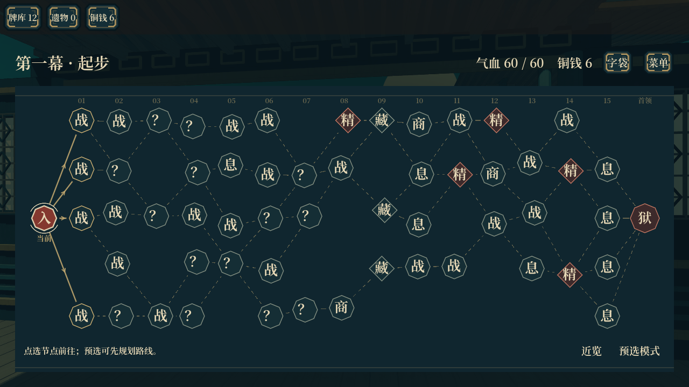
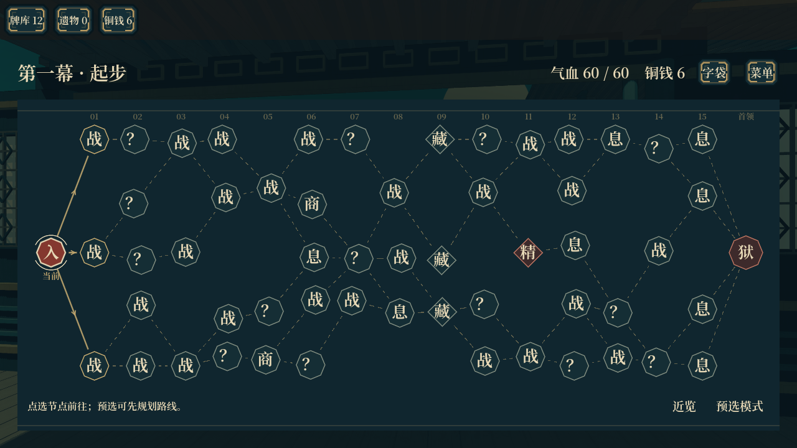
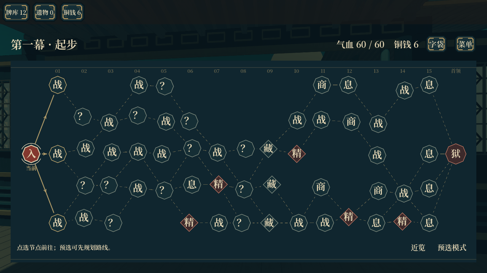
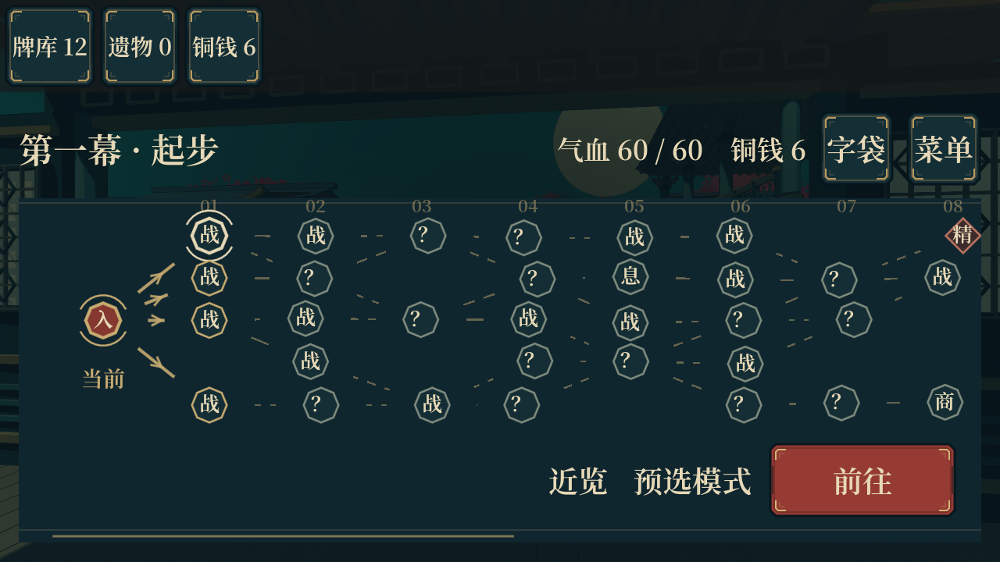

# 横向节点生成 v2

本轮替换节点生成规则，沿用二维路线界面和现有战斗、事件、字肆、休息与宝藏结算。验证基线为 main 的 `7a74563`，不包含另行开发中的遗物、战斗与平衡表改动。

## 生成规则

- 先在五行、十五层的候选空间里抽六条向右推进的路线，合并重复经过的节点和连线。每次只向下一层的同一行或相邻行移动，禁止交叉连线。
- 路线可分叉、汇合、再次分叉；只保留实际经过的节点，不补齐整排。候选总量按 46～64 筛选，包含起点和首领，取消固定 55 个的要求。
- 对所有完整路线计算实际择路次数，筛选至少四次选择（包含入口选择）的布局。
- 每次实际经过十五个普通节点，再到首领。候选总量和单次经过的站数分开计算。
- 路线确定后，再为节点分配遭遇。开局第一层战斗、第九层宝藏、第十五层休息保留；其他层可混合战斗、奇遇、精英、字肆和休息。
- 对分叉、汇合后产生的全部可行路线校验预算，每条路线有 3～5 次奇遇、6～10 次战斗遭遇（含精英，不含首领）。每张地图至少包含字肆和精英。
- 精英从第五层开始出现，同一路线上不直接连着两个精英、两个字肆或两个休息点。汇合处若无法安置不重复的服务，改放战斗。
- 同一地图至少五层混合不同遭遇，避免约束修整后又退化成整列同类节点。预算修整有次数上限，安全兜底仍保留可通关路线和事件预算；本次 180 张样本均未触发兜底。

预算使用前后缀路径计数计算，校验所有可走的组合，而不只检查最初抽出的六条路线。不枚举全部路径。

## 表现与兼容

节点视图按实际行跨度排版，支持新地图五行及旧地图四行；少量横纵偏移减轻网格感。手机压缩序号留白，并为底部按钮保留净空，新增节点间距断言。

仍然向右择路、不能回头，预选和查看未来节点不进入遭遇。事件、奖励与地图实例复用流程保留。

新生成图使用 `layout_version=2`。当前存档继续使用保存的节点、连线、内容种子和进度；新开冒险或进入下一幕时采用新规则，不重生成正在游玩的这一幕。

## 验证

- 60 个种子 × 3 幕，共 180 张图，1,627 项生成与存档断言通过。样本候选量 47～63 个，单层占用 2～5 行；平均每张有约 9.57 层混合遭遇。
- 原有路线与预选检查 196 项、实机流程 29 项、事件领取专项 61 项通过。
- 11 档手机布局模拟 308 项通过，检查节点之间、节点与按钮之间的间距。
- 从 `7a74563` 的旧生成器实际生成 55 节点地图，在战斗奖励阶段保存，再由新代码恢复；旧版本号、连线、当前节点、待选奖励与随机数状态保持。
- 使用桌面 Forward+ 渲染三个种子以及两档手机比例截图。本轮没有安卓真机测试，不据此推断手机性能。

原始记录见 [验证汇总](qa/node-route-v2-2026-10-20/verification.json)。

