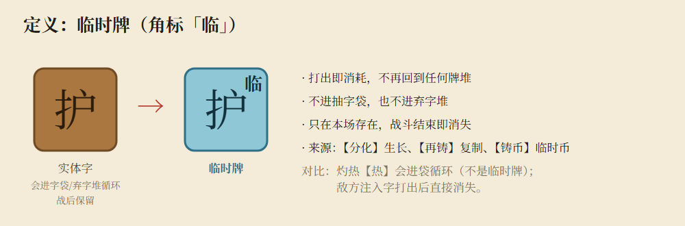
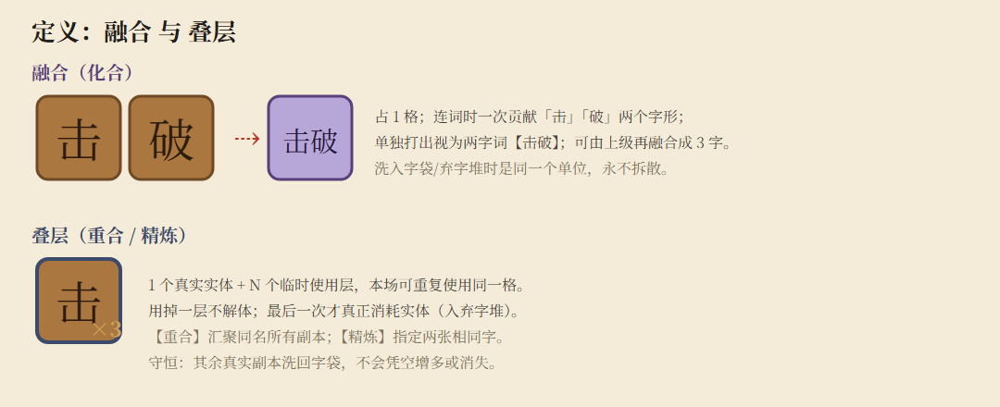
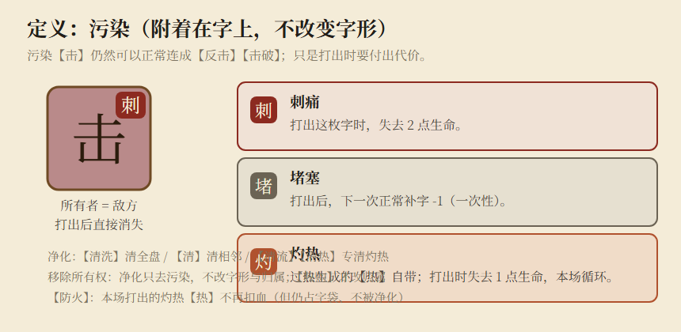
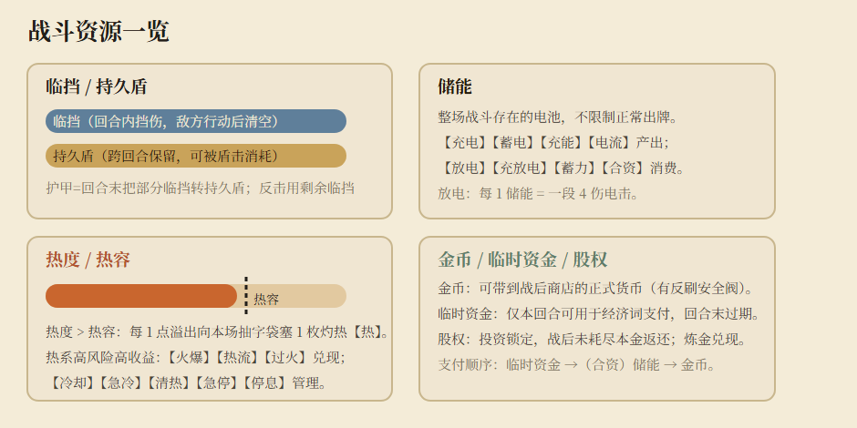
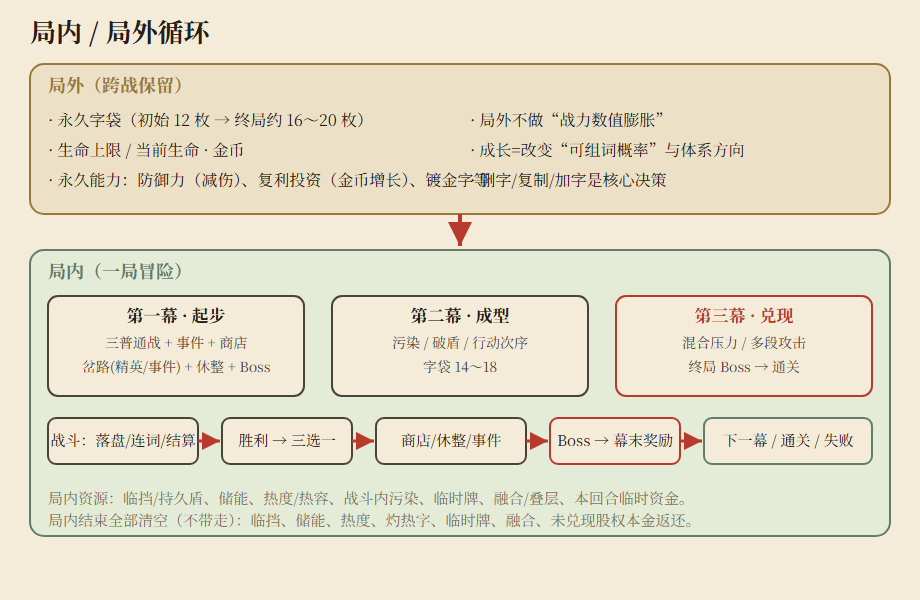

# 《活字战斗》游戏策划案

**版本：V1.0（实现对齐版）**　|　**日期：2026-10-10**　|　**平台：PC（键鼠，预留触摸）**
**引擎：Godot 4.7 · GDScript**　|　**状态：规则已全部实现，进入平衡与表现打磨阶段**

> **本版定位**：这是第一份「与可运行实现逐条对齐」的策划案。V0.1/V0.2/V0.3 的设计意图、以及后续逐词的重新定义，全部收敛到这里。总账 105 个候选词中，**100 个已实现**（裁撤 5 个），另有 **6 个额外词**（含彩蛋）。所有数值为**测试起点**，不是平衡定稿。
>
> 配套文件：`../data/import/`（原始总账与 GDD）、`附录_字表.md`（65 字独立字表）、`附录_字网图谱.md`（出度/入度图与表）、`裁撤记录.md`、`词效设计提案_V0.4.md`。

---

## 1. 一句话玩法

玩家管理**一袋会循环出现的实体汉字**，在 **4×4 字盘**上按**四邻接**连接字块，拼出**真实中文词语**，以词义触发攻击、防御、改盘、补字、储能、热度、经济等效果；战后通过**加字 / 删字 / 复制 / 镀金 / 商店**改变自己的「可组词概率」，完成 **3 幕 × 8 节点**的 Roguelike 冒险。

**真正的核心乐趣**（不是看词语播动画）：

1. **空间找词**：同一组字位置不同，能连出的词不同；重力、回转、反转、投放会改变局势。
2. **实体字经营**：一枚【击】拿去打【反击】，就暂时不能用于【击破】【重击】【合击】。
3. **跨词组合**：有些词改变后续规则，例如【合击】共享实体【击】、【重合】堆叠临时层、【重复】重演第一次多字词。
4. **取舍与反噬**：高速循环产生**自我污染（灼热字）**；敌方污染字能组词，但打出要付代价。

---

## 2. 设计边界（不可在开发中擅自改动）

| 事项 | 基准 | 状态 |
|---|---|---|
| 战斗棋盘 | **4 行 × 4 列 = 16 格** | 确定 |
| 连线方向 | **仅四邻接**（上/下/左/右）；可转弯；同一路径不重复同格 | 确定 |
| 词语长度 | 2～4 字为主，单字单独使用 | 确定方向 |
| 单字操作 | **「出牌」与「弃字」是同一操作**；无单字效果也能打出 | 确定 |
| 无效多字路径 | **不执行、不消耗任何字、不扣次数** | 确定 |
| 一回合行动数 | **无固定出字次数上限**，受字袋/空格/位置/资源制约 | 确定 |
| 补字 | 回合开始基础补 **3**；只有空格与来源足够才补得进 | 方案 |
| 初始落盘 | 4×4 随机落 **10** 枚己方字，留 6 空 | 方案（V0.3） |
| 初始字袋 | **12 枚 / 9 种** | 方案（V0.3） |
| 出字后空位 | **不自动补满** | 确定 |
| 临时格挡 vs 持久盾 | 分开计算 | 确定 |
| 污染 | 附着在字上、不改字形、可正常组词、打出付代价 | 确定 |
| 过热 | 热度超过热容，每点溢出塞 1 枚带灼热的【热】进本场字袋 | 确定方向 |

> **注意**：P26 网页原型的「5×5 / 自动填满 / 无效组合也消耗」**都不是**正式规则，不得照搬。

---

## 3. 字盘与连线

- **一次出字的生命周期**：按下起始格 → 拖过四邻接格延长路径 → 实时显示当前字串、识别状态与**按真实战况计算的预计效果** → 回拖上一格可撤销 → 松手/确认。
- **单字**：允许打出，结算该字已定义的单字效果（没有则只消耗）。
- **合法有效词**：结算词效，消耗参与路径的实体字。
- **未识别多字组合**：撤销本次选择，盘面不变（轻量提示，不消耗）。
- **污染代价**：路径中带污染的字被消耗时，附带触发其代价（见第 5 章）。
- **结算顺序**：先消耗 → 再触发词效 → 再触发自动能力（加速/流转/重力/补位）→ 最后按顺序补字。

---

## 4. 字块数据模型

一个实体字块必须有**独立 ID**；同一个【击】可能同时存在多个所有权、污染与叠层状态，**不能只存字符串**。

| 字段 | 作用 |
|---|---|
| `uid` | 全局唯一实体实例号（可追踪、可回放） |
| `字形` | 单个汉字（如 击），只是属性之一 |
| `所有者 owner` | `PLAYER` / `ENEMY` / `SELF_GENERATED`（本场自生污染） |
| `污染 pollutions` | 0 个或多个附着状态（刺痛/堵塞/灼热），见第 5 章 |
| `临时牌 temporary` | 打出即销毁、不进任何牌堆，见下 |
| `融合 fusion` | 复合单位附带的其他字形（化合），见下 |
| `临时层 temporary_uses` | 原格上可额外使用的**非实体复制层**（重合/精炼） |
| `镀金 gilded` | 精金：永久；参与有效多字词 +1 金币 |
| `位置 location` | `抽字袋 / 弃字堆 / 盘面 / 已消耗`，始终唯一 |

### 4.1 临时牌（临）

- **打出即消耗**，不再回到任何牌堆；**不进抽字袋、也不进弃字堆**；**只在本场存在**，战斗结束即消失。
- 来源：【分化】（生长）、【再铸】（复制）、【铸币】（临时【币】）等。
- **与「灼热【热】」的区别**：灼热【热】会进袋循环，**不是**临时牌；敌方注入字打出后直接消失。
- **与「融合」的区别**：融合单位若由真实牌构成，仍是真实单位（会循环），只是「多个字形绑在一起」。

### 4.2 融合与叠层

- **融合（化合）**：选两张相邻己方牌 → 合成**占 1 格的复合单位**。连词时一次贡献两个字形；单独打出视为那个两字词；洗入牌堆不拆散；**可继续融合**成 3 字复合。
- **叠层（重合 / 精炼）**：1 个真实实体 + N 个临时使用层，本场可**重复使用同一格**；用掉一层不解体；最后一次才真正消耗实体。守恒：其余真实副本洗回字袋。
- **所有权原则**：敌方字即使被净化，也只是去掉污染，**不会**自动进玩家字袋；只有【收购】才把敌方实体转为玩家永久实体。

---

## 5. 污染系统

污染是**字块状态**，不改变汉字本身。污染【击】仍可连成【反击】【击破】；打到它时付出代价。

| 污染 | 代号 | 代价 |
|---|---|---|
| **刺痛** | 刺 | 打出这枚字时失去 2 点生命 |
| **堵塞** | 堵 | 打出后，下一次正常补字 −1（一次性） |
| **灼热** | 灼 | 过热生成的【热】自带；打出时失去 1 点生命，本场循环 |

- **净化**（保留字形/位置/所有权，只去标签）：【清洗】清全盘、【清】（单字）清相邻、【清流】【清热】专清灼热。
- **防火**：本场打出的灼热【热】不再扣血（仍占字袋、不被自动净化）。
- **防爆**：被爆破/爆炸摧毁的己方实体字改为回字袋，每救回 1 枚 +1 持久盾。
- **敌人不偷偷改词典**：若要做「字被封印、词义改变」，必须在 UI 预告。

---

## 6. 战斗资源

| 资源 | 说明 | 回合行为 |
|---|---|---|
| **临时格挡（临挡）** | 本回合挡伤 | 敌方行动后清空 |
| **持久盾** | 跨回合保留 | 不随回合清空；可被【盾击】消耗 |
| **储能** | 整场电池 | 不被正常出牌限制；【放电】等消费 |
| **热度 / 热容** | 高风险资源 | 热度 > 热容时溢出塞灼热【热】 |
| **金币** | 可带商店的正式货币 | 有单战收入安全阀 |
| **临时资金** | 仅本回合可支付经济词 | 回合末过期 |
| **股权** | 投资锁定，战后返还本金 | 由【炼金】兑现 |

- **支付顺序**：临时资金 →（合资开启时）2 储能抵 1 金币 → 金币。
- **反刷**：战内金币收入有安全阀（原型 18/场），正式版需在「递减收益 / 软上限 / 风险动作」中择一测试，不保留隐藏硬上限。

---

## 7. 一回合的结算顺序

| 阶段 | 内容 |
|---|---|
| 回合开始 | 结算补字修正与精力加成；从字袋尝试落入基础补字 3 枚；中毒结算；状态衰减；武装「重复/停火」等 |
| 玩家操作 | 任意次数出字（单字 / 有效多字词）；可主动结束 |
| 玩家结束 | 结算【蓄能】等留词收益、持续能力（护甲转换） |
| 敌方行动 | 执行预告的攻击 / 注入污染字 / 护盾 / 增益 |
| 后置结算 | 【反击】延迟触发；清除临时格挡与临时资金；**急停/停息**此处结束出字 |
| 轮次推进 | 更新敌方下一次意图，进入下回合 |

---

## 8. 玩家操作与交互

- **拖动连线**：实时预览；回拖撤销；非法不消耗。
- **手感设置**（标题页 / 战斗内「设置」按钮）：`拖拽松手立即出字` 开关。**默认关**——松手只保留选择，需按「出字」或回车/空格确认（节奏从容）；开启则松手即结算（节奏更快）。设置持久化到 `user://settings.cfg`，两处共用且不打断战斗。
- **选目标**（需要时自动进入选择模式，`ESC` 取消）：
  - 选**盘面格**（重合、分化、转化定点、清）
  - 选**空格**（投放、精铸、再铸、合流）
  - 选**相邻两张己方牌**（化合）/ 选**两张相同己方字**（精炼）
  - 选**行 / 列**（反转）、选 **2×2**（回转、爆破）
  - 选**弃字堆 / 本场牌 / 字袋字**（回收、回购、精铸、再铸、炼化、强化、精金）
  - **揭示 N 选 1 → 再点盘面**（转化）

---

## 9. 词库（精确效果总表）

> 全部 106 词，按体系分组。**总账 100/100 已实现**；额外 6 词（火化/化合/精金/精铸/精分/开灯）见对应分组或「空间/彩蛋」。

### 9.1 单字效果（V0.2 附录 C）

| 字 | 效果 |
|---|---|
| 击 | 造成 4 伤害 |
| 防 | 获得 4 临时格挡 |
| 护 | 获得 2 持久盾 |
| 御 | 获得 2 临时格挡 |
| 回 | 按原位置抽一枚随机字替换 |
| 重 | 当前字盘按列向下重力 |
| 清 | 清除一个四邻污染标签（保留字与所有权） |
| 反 | 造成 2 伤害（占位） |
| 甲 | 获得 2 临时格挡（占位） |
| 盾 | 获得 3 临时格挡（占位） |
| 破 | 造成 3 伤害（占位） |
| **再** | 重复上一个词/字的最后一个字（临时） |
| 其他字 | 可单字打出，暂无单字效果（用于腾空格） |

### 9.2 多字词总表

> 独立的**字表**（含单字效果与出度/入度）见 `附录_字表.md`；**字网图谱**见 `附录_字网图谱.md`。

### 防反（15）
| 词 | 组成 | 交互/目标 | 效果 |
|---|---|---|---|
| **防御** | 防御 | — | 获得 10 点临时格挡 |
| **防护** | 防护 | — | 本场持续：抵消下一次敌人对字盘的干扰（注入/塞字） |
| **护甲** | 护甲 | — | 回合结束把一半剩余临挡转为持久盾 |
| **护盾** | 护盾 | — | 获得 6 点持久盾 |
| **重甲** | 重甲 | — | 获得 12 点持久盾；下一次正常补字 -1 |
| **反击** | 反击 | — | 预留反击；敌人整次行动后把剩余临挡转为伤害并 +3/层 |
| **盾击** | 盾击 | — | 造成 4 伤并消耗全部持久盾，每 2 点额外 3 伤 |
| **回防** | 回防 | — | 获得 8 点临时格挡；若此前已有即时攻击则补 1 字 |
| **破防** | 破防 | — | 使敌人获得【易伤】×2 |
| **破甲** | 破甲 | — | 移除敌人全部护盾 |
| **击破** | 击破 | — | 造成 8 伤；拆盾效率×2；击碎护盾再补 1 字 |
| **防火** | 防火 | — | 本场持续：自己打出的灼热【热】不再扣血（仍占字袋、不被自动净化） |
| **防爆** | 防爆 | — | 本场持续：被爆破/爆炸摧毁的己方实体字改为回字袋，每救回 1 枚 +1 持久盾 |
| **防御力** | 防御力 | — | 首次组出后本局永久每次实际生命伤害 -1 |
| **反超** | 反超 | — | 低于半血补 4 字，否则补 1 字 |
### 连携（14）
| 词 | 组成 | 交互/目标 | 效果 |
|---|---|---|---|
| **连击** | 连击 | — | 重演上一个即时攻击词的效果 |
| **重击** | 重击 | — | 6 伤 + 重力移动的每枚字块 2 伤 |
| **合击** | 合击 | — | 本回合后续攻击词共享【击】且每词 +4 伤 |
| **回击** | 回击 | — | 造成 7 点伤害；若此前已有即时攻击则补 1 字 |
| **电击** | 电击 | — | 造成 6 伤 + 2×储能 |
| **火力** | 火力 | — | 造成 6 伤 + 2×热度 |
| **合力** | 合力 | — | 获得 6 临挡与 2 储能 |
| **强力** | 强力 | — | 获得状态【强力】×2 |
| **加强** | 加强 | — | 获得状态【加强】×2 |
| **超强** | 超强 | — | 获得状态【超强】×1 |
| **重合** | 重合 | 盘面格 | 汇聚同字：保留 1 实体并获得同数量临时层，其余回字袋 |
| **重复** | 重复 | — | 开启后每回合第一次有效多字词再执行一次其即时效果（不重复消耗字；需支付的照常再付） |
| **连载** | 连载 | — | 本战每打出 3 种不同多字词，下一次攻击 +6 伤 |
| **反复** | 反复 | — | 本回合首次无效果单字出牌时，在原格补 1 字 |
### 流转（12）
| 词 | 组成 | 交互/目标 | 效果 |
|---|---|---|---|
| **精铸** | 精铸 | 选弃字堆 1 枚 → 选空格 | 支付 3 金币，把弃字堆中的一枚字放进指定空格 |
| **回流** | 回流 | — | 随机补 4 字 |
| **分流** | 分流 | — | 清除当前字盘的全部污染（所有权不变） |
| **合流** | 合流 | 揭示 1 + 选弃字 1 → 选 2 相邻空格 | 揭示字袋 1 枚 + 弃字堆指定 1 枚，按任选顺序放入两个相邻空格；无相邻空格则不移动 |
| **回收** | 回收 | 弃字堆 | 从弃字堆回收本回合消耗的 1 枚字到袋顶 |
| **回购** | 回购 | 弃字堆 | 支付 3 金币，回收本回合消耗的 1 枚字到袋顶 |
| **回转** | 回转 | 2×2 区域 | 顺时转旋转所选 2×2 区域 |
| **流转** | 流转 | — | 本回合每打出 2 种不同多字词补 2 字 |
| **清洗** | 清洗 | — | 清除当前字盘所有污染标签（所有权不变） |
| **清流** | 清流 | — | 净化全部灼热并补 2 字 |
| **复合** | 复合 | — | 下一次≥3字词保留 1 枚用过的字为临时层 |
| **电流** | 电流 | — | 本回合已补字则储能 +2，否则补 2 字 |
### 蓄放（11）
| 词 | 组成 | 交互/目标 | 效果 |
|---|---|---|---|
| **蓄能** | 蓄能 | — | 回合结束若仍有可用多字词，储能 +1 |
| **蓄力** | 蓄力 | — | 消耗全部储能，下一次攻击每点储能 +2 伤 |
| **蓄电** | 蓄电 | — | 基础 +1；词尾电周围每个己方四邻字再 +1 储能 |
| **充电** | 充电 | — | 获得 3 点储能 |
| **充能** | 充能 | — | 获得 1 点储能；随机补 2 字 |
| **放电** | 放电 | — | 清空全部储能，每点造成一段 4 伤电击 |
| **放热** | 放热 | — | 消耗全部储能：转为热度并对敌每点 2 伤 |
| **充放电** | 充放电 | — | 清空全部储能，每点 4 伤并随机补 1 字 |
| **热能** | 热能 | — | 当前热度转为等量储能 |
| **热力** | 热力 | — | 当前热度转为下一次攻击强化（每点 +2） |
| **充电过热** | 充电过热 | — | 获得 8 储能 + 8 热度；本战此后每次出字后立即补满盘面 |
### 热暴（21）
| 词 | 组成 | 交互/目标 | 效果 |
|---|---|---|---|
| **过热** | 过热 | — | 本回合首次溢热后，下一次多字词额外补 2 字 |
| **过载** | 过载 | — | 随机补 6 字；热度 +3 |
| **超载** | 超载 | — | 获得状态【超载】×1；热度 +3 |
| **加速** | 加速 | — | 本回合每次打出多字词额外补 1 字并热度 +1 |
| **急速** | 急速 | — | 下一次多字词结算后在其空格补至多 3 字并升温 2 |
| **超速** | 超速 | — | 本回合下一次补字翻倍，最多额外 4 字；每额外 1 字升温 1 |
| **冷却** | 冷却 | — | 热度 -4 |
| **急停** | 急停 | — | 清空热度并移除本回合溢热生成的灼热【热】（字袋/弃字堆/盘面），立即结束出字阶段 |
| **停火** | 停火 | — | 本回合未造成敌伤则免疫敌方攻击 |
| **停息** | 停息 | — | 立即结束出字阶段：清零全部热度，每 1 热度换 2 持久盾；敌人正常行动 |
| **清热** | 清热 | — | 热度 -2 并清除灼热污染 |
| **热流** | 热流 | — | 按本回合补字数最多降 4 热，每实际降 1 热造成 2 伤 |
| **火爆** | 火爆 | — | 消耗全部热度，造成 8 + 4×热度伤害 |
| **爆破** | 爆破 | 2×2 区域 | 摧毁 2×2 区域，每摧毁 1 字造成 4 伤 |
| **爆冷** | 爆冷 | — | 4 伤 + 上回合每失 1 生命额外 2 伤，清空热度 |
| **重载** | 重载 | — | 本场热容 +3，此后每回合基础补字 -1 |
| **加热** | 加热 | — | 热度 +3 |
| **急冷** | 急冷 | — | 清空当前热度；下一次正常补字 -1 |
| **放火** | 放火 | — | 敌方接下来 2 次行动各受 3+施放时热度 伤 |
| **过火** | 过火 | — | 下一次攻击额外 + 当前热度×3 伤，同时热度 +2 |
| **电流过载** | 电流过载 | — | 本战每次溢热：生成灼热热字、储能 +1、对敌 3 伤 |
### 经济（18）
| 词 | 组成 | 交互/目标 | 效果 |
|---|---|---|---|
| **精金** | 精金 | 选 1 个字永久镀金 | 选择一枚己方字永久镀金 |
| **金币** | 金币 | — | 获得 3 金币 |
| **合金** | 合金 | — | 获得 6 持久盾与 2 金币 |
| **铸币** | 铸币 | — | 获得 2 金币，并在原格生成一枚临时【币】 |
| **资金** | 资金 | — | 获得 3 点临时资金（本回合有效） |
| **投币** | 投币 | — | 支付最多 3 金币，每金币造成 5 伤 |
| **收购** | 收购 | 敌方字 | 支付 4 金币，净化并永久收编一枚敌方实体字 |
| **投资** | 投资 | — | 支付 3 金币锁定为 3 股权（战后返还本金） |
| **利息** | 利息 | — | 持有≥2股权时，支付 1 股权获得 2 金币并补 1 字 |
| **复利** | 复利 | — | 本回合首次存股权时额外 +1 股权 |
| **炼金** | 炼金 | — | 消耗全部股权：每点 +3 金币并补 1 字 |
| **投放** | 投放 | 空格 | 支付 3 金币，随机揭示一枚实体字并指定空格落下 |
| **分利** | 分利 | — | 本回合剩余时间，每当实际获得金币就额外获得等量储能 |
| **再投资** | 再投资 | — | 锁定最多 6 金币，下一场胜利后返还 2 倍 |
| **合资** | 合资 | — | 本场持续：支付金币发动词效时可用 2 储能抵 1 金币，允许混合支付 |
| **流利** | 流利 | — | 下一次组词允许最多一步对角线 |
| **重金** | 重金 | — | 支付 5 金币悬赏，本回合击杀返 12，否则本金不返 |
| **复利投资** | 复利投资 | — | 首次打出后，本局每场胜利使现有金币额外增长 20% |
### 夺字（1）
| 词 | 组成 | 交互/目标 | 效果 |
|---|---|---|---|
| **反转** | 反转 | 选 1 行 / 1 列 | 选择一整行或一整列，倒转其 4 格（含空格与完整叠层） |
### 淬炼（6）
| 词 | 组成 | 交互/目标 | 效果 |
|---|---|---|---|
| **精炼** | 精炼 | 选 2 张相同己方字 | 选择两个相同的己方字，本场它们一直重合（一格可重复使用，另一张回字袋） |
| **强化** | 强化 | 选字袋 1 个字 | 选择字袋中一个字；本场它被打出时（单字或成词）额外触发其单字效果 |
| **重铸** | 重铸 | — | 把盘面上已有的字全部重新替换（己方字回袋重抽，敌方/临时字清除） |
| **炼化** | 炼化 | 选本场 1 张牌 | 热度 -3、获得 4 金币，并指定一张牌在本场战斗移出循环 |
| **再铸** | 再铸 | 选弃字堆 1 枚 → 选空格 | 从弃字堆选一张，把它的临时复制放进指定空格（原牌留在弃字堆） |
| **精力** | 精力 | — | 本回合每打出一种不同的多字词，下回合基础补字 +1 |
### 空间（3）
| 词 | 组成 | 交互/目标 | 效果 |
|---|---|---|---|
| **化合** | 合化 | 选 2 张相邻己方牌 | 选择两张相邻的己方牌融合为一格（本场不可拆） |
| **转化** | 转化 | 揭示 5 选 1 → 选盘面格 | 随机揭示 5 枚实体字，选 1 枚，把一个盘面字定向改成它 |
| **分化** | 分化 | 盘面格 | 删除一个盘面字，在其上下左右的空格各生长一枚可组词的临时字（打出即消耗，不进字袋） |
### 彩蛋（4）
| 词 | 组成 | 交互/目标 | 效果 |
|---|---|---|---|
| **火化** | 火化 | — | 【火化】原地变成【骨灰】两个字 |
| **精分** | 精分 | — | 本回合敌我攻击都打向自己 |
| **开灯** | 开灯 | — | 来电了 |
| **停电** | 停电 | — | 彩蛋：停电，屏幕变黑；拖动连出【开灯】才能恢复 |
### 空间/连携
| **重力** | 重力 | — | 本战每次有效出字后自动全盘向下重力 |

---

## 10. 局内 / 局外循环

### 10.1 一局冒险：3 幕 × 8 节点

| 节点 | 类型 | 是否有战后成长 |
|---:|---|---|
| 1 | 普通战 | 有（三选一） |
| 2 | 普通战 | 有（三选一） |
| 3 | 事件 | 视选项 |
| 4 | 普通战 | 有（三选一） |
| 5 | 商店 | 购买取得 |
| 6 | 岔路：精英 / 事件 | 精英有专属奖励 |
| 7 | 休整 | 治疗 / 删字 / 修饰 三选一 |
| 8 | Boss | 前两幕幕末大奖，第三幕通关 |

- 3 幕共 **24 个节点**，至少 **9 普通战 + 3 Boss = 12 战**，每幕都选精英则最多 **15 战**。
- 每幕机会预算相同，避免某条路线多拿 4 次改牌。

### 10.2 战后奖励

三选一：**补足相邻词链 / 复制关键字 / 等量换字 / 修整（治疗/删字/修饰）**，以及明确的**「跳过，拿少量金币」**出口。
奖励生成时**必须说明能与现有字组成哪些词**，禁止随机发孤立新字；界面同时展示「词种覆盖」与「关键字稀释风险」。

### 10.3 商店 / 休整 / 事件

- **商店**（每幕 1 个）：买字、复制、指定删字、修饰、治疗。
- **休整**（每幕 1 个）：治疗 / 删字 / 修饰**三选一**，不叠加。
- **事件**：风险换资源（少量风险换加字/换字/金币/净化等）。

### 10.4 局内 / 局外的分界

| | 局内（战斗结束清空） | 局外（跨战保留） |
|---|---|---|
| 资源 | 临挡、储能、热度、战斗内污染、临时牌、融合、临时资金、灼热字 | 生命、金币、永久字袋、永久能力、镀金字 |
| 结算 | 【反击】【防爆】等在本场生效 | 【防御力】【复利投资】跨战永久 |

---

## 11. 敌人与节奏

- 首版敌人只需三种可预测意图，但每种逼迫不同应对：
  1. **攻击**：预告「本回合结束后攻击 N」。
  2. **注入污染字**：往空格塞 1～N 枚敌方字（刺痛/堵塞/灼热）。
  3. **护盾 / 强化**：使【击破】【破甲】【破防】有用。
- **难度曲线按行为提升**，不是单纯血量翻倍：一幕给安全组词空间；二幕加污染与破盾/多段；三幕把板面操作与血量压力组合。

**当前敌人（原型）**：墨灵、纸卫、焦火、锈笔、铁画（精英）、铜印、字魔（一幕 Boss）、铅版（二幕）、混铅海（三幕）。

---

## 12. 数值基线（测试起点）

| 项 | 值 |
|---|---|
| 生命上限 / 开局金币 | 60 / 6 |
| 4×4 / 开局落盘 / 回合补字 | 16 格 / 10 / 3 |
| 热容 | 10 |
| 普通战 / 精英 / Boss 金币 | 6–9 / 13–16 / 18–22 |
| 商店：单字 / 删字 / 复制 / 修饰 / 治疗 | 12–15 / 16–20 / 18–22 / 28–35 / 10–14 |
| 每战金币收入安全阀 | 18（原型，待正式化） |

### 12.1 组词概率与盘面选型（模拟结论）

用 106 词全量、每配置 4000 次随机开局模拟（工具 `src/tools/board_sim.tscn`）：

| 字袋 | 4×4 落10 | 4×4 落12 | 六边 落10 | 六边 落12 |
|---|---:|---:|---:|---:|
| 初始（9 种） | 83.5% | **96.5%** | 90.3% | 98.6% |
| 中期（14 种） | 69.4% | **89.1%** | 80.7% | 93.8% |
| 热系（10 种） | 50.7% | **73.4%** | 61.6% | 83.3% |

*（表内为 P(≥2 个不同词)）*

- **结论：维持 4×4。** 六边形的收益 ≈ 方阵多落 2 枚字；而换六边形会打废依赖行列/2×2 的几何词（反转、回转、爆破、重力、分化），且 4×4 是锁定边界。
- 若「组词太少」，优先调**落盘密度**（10→12）而非换盘面。
- **3+ 字词概率仅 0.5%～5%**：长词不能靠随机开局，需靠空间工具（投放/合流/转化/分化/化合）与目标词追踪主动追求。

---

## 13. 美术与 UI

**美术方向（两套可切换）**：视觉由令牌（`GameStyle`）驱动，运行时可在标题/战斗内「设置」切换：

- **宣纸活字**（默认）：宣纸底 + 木活字 + 朱印，程序化（`paper.gdshader` / `wood.gdshader`）。
- **墨芯（大模型概念）**：深蓝渐变 + 网格 + 冷光晕背景（`bg_neon.gdshader`）、玻璃发光字块（`tile_neon.gdshader`）、半透明面板与青色强调。

两套共用同一套令牌名（`Palette.XXX` → 由 `GameStyle` 填充）；新增风格只需照抄一个 `GameStyle` 构造函数并接线。全部程序化，无外部贴图。

**战斗屏常驻信息不超过**：战况、字盘、当前连词与预计后果、结束回合。

| 区域 | 内容 |
|---|---|
| 顶部 | 回合 / 金币 / 字袋入口 |
| 左侧 | 生命、临挡、持久盾、储能、热度/热容、状态 |
| 中部核心 | **4×4 字盘（最高优先级）** |
| 底部 | 当前词串、有效性、预计效果、出字/清除/结束回合 |
| 右侧 | 战报 |
| 浮层 | 图鉴/字袋/选目标（抽屉式，不常驻） |

**字块状态可视化**：木纹 = 己方；偏红 = 敌方；琥珀 = 自生灼热；冷蓝 +「临」= 临时牌；紫色 = 融合；金色边 = 镀金；角标 = 污染/状态；`×N` = 叠层。

---

## 14. 测试与调试

- **逻辑层**：`tests/logic_test.tscn`，**96 条断言**，覆盖临挡/持久盾、污染代价、过热入袋、重合守恒、回原位换字、反击、注入、击破、股权闭环、储能热度互转、缩放攻击、爆冷、停火、放火、反复、铸币、回购、重力、转化、分化、强化、火化、炼化、化合、精炼、精力、精金、精铸、精分、停电、充电过热、反转、合流、急停、重复、防火、防爆、合资、分利、停息……
- **工具**：
  - `board_sim.tscn`：棋盘组词概率蒙特卡洛。
  - `glyph_graph.tscn`：字网图谱（出度/入度），输出报告 + Graphviz + Mermaid。
  - `dump_words.tscn`：导出精确词效表。
- **可复现**：战斗 RNG 固定种子；特效/台词使用**独立的 visual_rng**，不消耗战斗 RNG。
- **开发者工具建议**（GDD 原要求）：强制指定盘面、指定抽字次序、创建同字、插污染、改热度/热容、跳过敌行动、查看字块去向。

---

## 15. 术语表

| 术语 | 含义 |
|---|---|
| **实体字** | 会循环、战后保留的真实字块 |
| **临时牌** | 打出即销毁、不进牌堆、战后消失 |
| **融合** | 多个字形绑成一件、占 1 格、不可拆 |
| **叠层** | 1 实体 + N 临时使用层 |
| **临挡 / 持久盾** | 本回合格挡 / 跨回合护盾 |
| **储能** | 战斗内电池 |
| **热度 / 热容** | 高收益高风险资源 / 溢出阈值 |
| **污染** | 附着状态（刺痛/堵塞/灼热） |
| **灼热【热】** | 溢热自生污染字，本场循环 |
| **临时资金 / 股权** | 回合内支付额 / 投资本金 |
| **镀金** | 永久；参与多字词 +1 金币 |

---

## 16. 版本记录与裁撤

- **V0.1**：玩法合同、Godot 架构、纵向切片。
- **V0.2**：105 词总账、P25 审计、单字表、原型偏差。
- **V0.3**：初始 12 字袋、开局落 10、3 幕 × 8 节点。
- **V0.4（重定义）**：转化/分化/强化/炼化/精炼/精力/精金/精铸/精分/再/重铸/再铸/反转/合流/急停/重复/防火/防爆/合资/分利/停息 等按设计负责人重定义。
- **V1.0（本版）**：全部词实现并与实现对齐，补图解，确认维持 4×4。

**裁撤记录**（`裁撤记录.md`）：纯、纯化、纯金、纯利、精纯、强力反击。

---

## 17. 未决 / 后续

1. **平衡**：用逻辑层固定种子批量对局，统计胜率 / 词触发率 / 单字比 / 污染成本 / 金币溢出。
2. **表现**：词效动画、屏幕震动、音效；彩蛋台词扩池。
3. **存档与回放**：完整存档 + 同种子回放。
4. **长词可达性**：目标词追踪、空间工具的奖励定向。
5. **数值正式化**：金币反刷方案、初始配比（10/12/14 落盘）由试玩复验。
