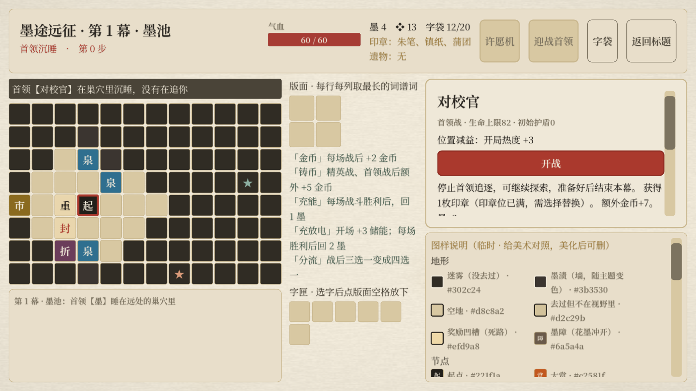
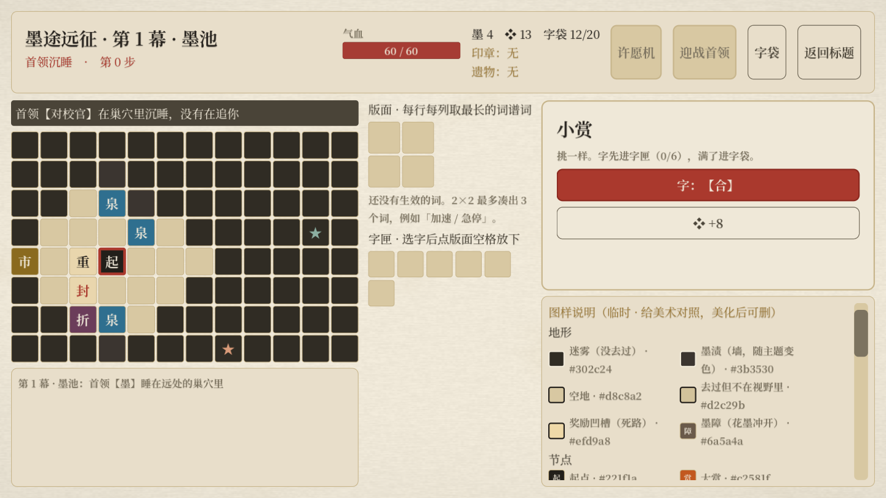

# 墨途远征：奖励选项与战前信息调整

> 后续调整：探索版面与词谱已移除，扩版奖励、词谱收益与原来的整幕随机怪池已被替换。当前规则以[版面移除与怪物成长投放](远征版面移除与怪物成长_2026-10-17.md)为准；本页保留对应轮次的记录。

> 后续规则已更新：首领胜利后立即封层，不能继续探索；数值与流程以[封层与难度调整](远征首领封层与难度调整_2026-10-17.md)为准。下文保留当时的设计记录。

2026-10-17。本轮仅调整奖励选项及战前/地图敌人信息。

## 奖励选项

| 赏级 | 默认选项数 | 保证出现 | 其余位置 |
|---|---:|---|---|
| 小赏 | 2 | 字、8金币各一项 | 拓本追加一项 |
| 中赏 | 3 | 字、15金币各一项 | 从剩余字/情报抽取；拓本追加一项 |
| 大赏 | 3 | 字、25金币各一项；有资格时保证一个印章或扩版选项 | 重金、拓本各追加一项；从剩余候选中抽取 |

修复原来按固定列表截取前几项、导致金币和后排奖励无法出现的问题。展示顺序随机；同份字奖励去重，候选不足时补入可成词的普通字，避免额外选项空耗。印章已拥有/扩版已完成时不会再次提供对应奖励。

候选采用远征自己的随机数，固定种子可复现。打开赏时生成并存入面板；普通UI刷新不重抽。额外选项提供更多选择，玩家仍只选一项。金币数额、字稀有度规则、商店价格均沿用现有配置。

## 战前与地图信息

- 战前显示实际怪物名称、生命上限、初始盾、行动循环、完整机制说明。
- 显示实际的战利品选项数量、跳过换8金币、印章和满位替换提示，以及词谱带来的额外金币/回墨。
- 普通/精英胜利后耗2步，伏兵耗1步；首领已败时明确不再追逐。首领战说明改为击败后可继续探索，由玩家选择结束本幕。
- 伏兵写明其实际首个行动，不再笼统说“先打一下”，以免把翻签、补盾、重力也误报成攻击；有反击词谱则说明玩家先手。
- 新首领不再显示旧护甲/护盾/力量词条；朱笔后的生命上限、位置减益和破甲/破防/停火说明与现有战斗一致。
- 地图可见或已经探索的明敌格使用实际怪物字形，悬停可看怪名、机制、收益、耗时；迷雾未探索格不显示敌人身份。首领提示条、巢穴及棋子悬停显示实际首领名称；主题棋子字形继续用于辨认地图位置。
- 预览与开战共用选敌方法，战前收益与胜利结算共用计算方法。查看预览不会改遭遇、推进时间，或消耗远征/首领/遗物随机数。
- 开战按钮放在简短的敌人和风险信息之后，保证长收益说明不会把按钮挤出首屏；其余详情可滚动查看。

上方生命标为“生命上限”；开场伤害、护盾等词谱仍按说明进入战斗后结算，未将其冒充为模拟得到的实际开局HP。

## 验证

| 检查 | 结果 |
|---|---|
| 原有 expedition_test | 156通过，0失败 |
| monster_regression | 240通过，0失败 |
| 新增 expedition_options_test（无头） | 67通过，0失败 |
| 原生 Metal 窗口同套检查与截图 | 69通过，0失败 |

新检查覆盖各档奖励保底与去重、额外选项、不同种子变化、固定种子重现、已打开奖励稳定、金币结算、三幕四类遭遇预览与实际选敌一致、预览无副作用、收益实际到账、迷雾信息边界、实际UI文字以及开战按钮首屏可见。原生窗口另保存两张截图并检查布局。

复现：

```bash
Godot --headless --path . res://tests/expedition_options_test.tscn
# 保存原生截图到/private/tmp/huozi-options-{boss,loot}.png
Godot --path . res://tests/expedition_options_test.tscn -- --capture
```

代码保留在本地，未提交或推送。变更前的相关文件已另行备份。




