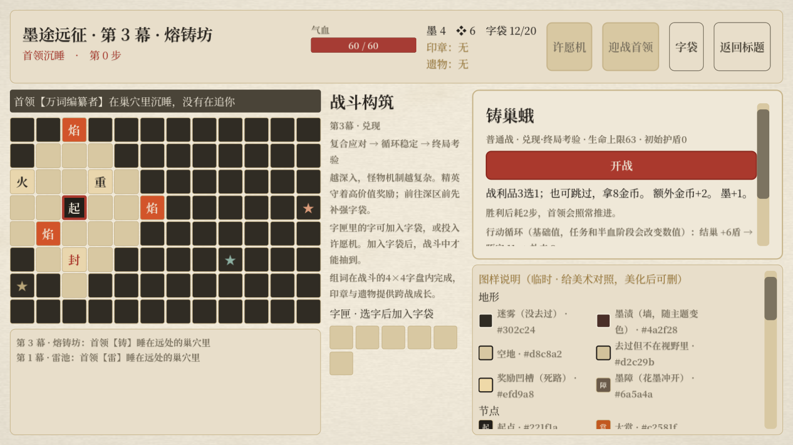

# 墨途远征：版面移除与怪物成长投放

> 后续规则：许愿机与熔炉许愿已移除，遗物改为中赏／大赏候选；地图熔炉仅两字换一枚稀有字。见[遗物奖励调整](远征遗物奖励调整_2026-10-17.md)。本页保留本轮历史记录。

2026-10-17。本轮落实：去掉探索版面组词，让怪物投放体现构筑成长；沿用击败首领立即封层与偏难基线。

## 玩法收束

地图只保留字匣与字袋。散字、战利品先进字匣，再由玩家加入战斗字袋；也能投入熔炉／随身许愿机。战斗内4×4组词、所有战斗词效与怪物解题机制保留。地图中间改为战斗构筑与本幕成长提示。

版面状态、放字／取字、词谱扫描与全部探索词谱加成已从远征状态和调用链删除；包括开场盾、储能、减伤、抢先手、探索免伤／加速、额外掉落、商店折扣、回收、利息与投资返还。旧Lexicon文件仅留作旧设计资料与名称核查，不再接入任何运行时玩法。“精力”拆装回血的入口随版面一并消失。

原“宽版”印章替换为“字印”：每场开场多抽1枚实际字袋实体，受空格与袋中剩余字限制，不复制字。大赏不再出现扩版选项；拓本仍增加一个有效且去重的奖励选项。丢弃字的半价回购改为商店基础服务（基价13，实价7）。印章仍最多3枚，遗物与许愿规则保留。

## 怪物怎样跟随成长

每幕生成地图后，用起点到普通敌与伏兵锚点的可行走最短路距离排序，按前／中／深三个区段固定分池。排序只计算地面连通性，墨障视为可付代价通过，暂时关闭的闸门不改变阶段；不是曼哈顿直线距离，也不按等待时间或当前牌组强度动态调怪。精英按相同距离进度落入对应阶段。

| 幕／构筑阶段 | 前区 | 中区 | 深区 |
|---|---|---|---|
| 一幕·起步 | 纸壳兵、连针蜂；基础攻防 | 倾砚、折页蛾；移动与消耗原实体 | 留白童、墨蚀蠹；空格与污染管理 |
| 二幕·成型 | 饕餮、炉腹兽；循环与热度 | 余电獾、赊墨商；储能净消费与费用支付 | 双面简、铸巢蛾、爆印机；互换、补字成词与撤离 |
| 三幕·兑现 | 余电獾、赊墨商、爆印机；复合资源应对 | 饕餮、双面简、铸巢蛾；稳定循环 | 炉腹兽、双面简、铸巢蛾；持续运转与热度控制 |

| 精英 | 前区 | 中区 | 深区 |
|---|---|---|---|
| 一幕 | 铁画 | 铁画 | 铁画 |
| 二幕 | 拓印师 | 拓印师、钤印官 | 轮印师、漏电水蛭 |
| 三幕 | 拓印师、钤印官 | 钤印官、轮印师 | 轮印师、漏电水蛭 |

精英仍是守口挑战，玩家可自行选择是否承担风险。三幕首领依次为对校官、铅轨机、万词编纂者。第三幕目前复用已有怪型，通过组合要求与生命成长提升压力；没有新增第三幕专属普通怪资源。

同一种子、同一地图位置会固定抽出同一敌人。伏兵使用领地主人作锚点，进入同一领地的任意格都不改怪；地图提示、战前信息与实战共用投放方法。未探索迷雾继续隐藏敌人身份。

## 数值基线

生命成长在远征中复制敌人资源后应用，不写回全局资源；标准3×8节点冒险不受影响。生命向上取整，普通敌／伏兵／精英采用同一倍率；招式伤害、盾值、解题奖励沿用初稿。

| 幕 | 前区生命 | 中区生命 | 深区生命 |
|---|---|---|---|
| 一、二幕 | 原值×1.00 | 原值×1.04 | 原值×1.08 |
| 三幕 | 原值×1.12 | 原值×1.16 | 原值×1.20 |

示例：一幕初见纸壳兵32生命／连针蜂34；深区留白童39／墨蚀蠹42。二幕中区余电獾、赊墨商均50；深区双面简54、铸巢蛾57、爆印机52。三幕深区炉腹兽53、双面简60、铸巢蛾63。首领生命维持88／124／168；朱笔在实战与预告中均减6。

移除词谱经济后，胜利固定收益提供可预测的保底，而非把全部旧版收益免费叠给玩家：

| 胜利类型 | 固定金币 | 回墨 | 其他 |
|---|---:|---:|---|
| 普通／伏兵 | 2 | 1 | 战利品3选1，可跳过换8金币；伏兵解封领地奖励 |
| 精英 | 4 | 1 | 战利品3选1与符合条件的精英印章 |
| 首领 | 6 | 1 | 首领印章；立即封层、进入结算，无普通战利品 |

普通战跳过选字共获得2+8金币；首领固定收益先结算，幕间补给只在确认进入下一幕时发一次。一幕→二幕仍为金币12／回血最多8／墨1，二幕→三幕仍为16／10／1。最终幕不发下一层补给。地图剩余资源放弃，禁止首领后探索，8–11步自然惊动、7–10步缓冲继续有效。

## 冲突与验证

- 无效扩版奖励与印章：删除／替换，拓本候选不足仍补有效字奖励。
- 移除版面后隐形收益：所有远征词谱分支移除，预告不再展示这些加成。
- 不同伏兵入口抽到不同怪：统一领地主人锚点。
- 预告与实战不一致：共同使用阶段、种子、资源复制与朱笔计算；展示真实阶段与生命。
- 成长污染全局资源：只修改副本，重复查看不会叠加生命或改写普通冒险数据。
- 旧层清图和重复领奖：封层锁定、印章替换顺序、进入下一层幂等性回归仍通过。

| 检查 | 通过／失败 |
|---|---|
| 地图、探索、构筑、战斗接入与三幕流程 | 132／0 |
| 奖励与战前信息 | 67／0 |
| 首领封层与补给 | 31／0 |
| 20怪物机制 | 240／0 |
| 遗物、商店、许愿与实体守恒 | 119／0 |
| 新成长投放（12种子×3幕及真实界面） | 1671／0 |

六套无头回归共2260项通过。原生Metal窗口成长测试另有1672项通过（含截图保存），确认阶段、生命、奖励展示及首屏开战入口。

自动整局按胜利结算战斗，验证的是流程可走通；机制与资源测试验证规则一致性，不能推出真实通关率。本轮为偏难的第一版数值，仍需通过代表性构筑的真人试玩校准伤害损耗和三幕通关率。

复现：

```sh
<godot> --headless --path . res://tests/expedition_growth_test.tscn
<godot> --path . res://tests/expedition_growth_test.tscn -- --capture
```


