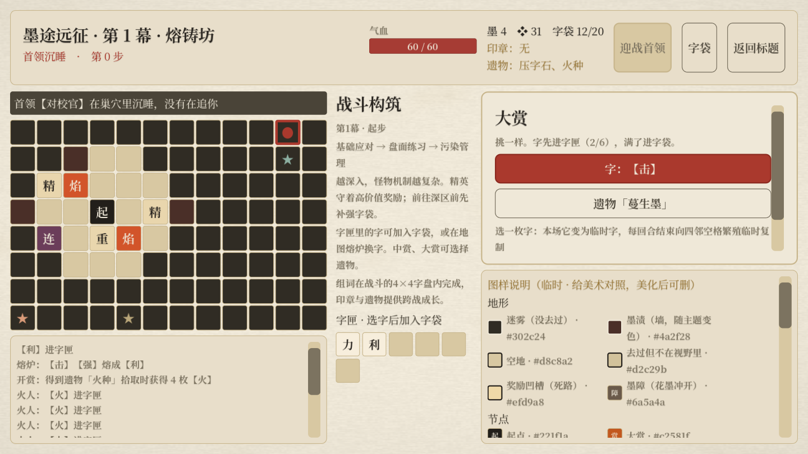

# 墨途远征：取消许愿机，遗物加入中赏与大赏

2026-10-17。按本轮需求调整遗物获取来源，沿用怪物成长投放及首领立即封层。

## 奖励规则

| 奖励 | 基础选项数 | 遗物投放 |
|---|---:|---|
| 小赏 | 2 | 无遗物，字与8金币 |
| 中赏 | 3 | 常见、少见遗物加入候选，最多2档（12件）；仍保证字与15金币选项 |
| 大赏 | 3 | 全档次遗物（15件）；仍保证字与25金币，特色位从符合条件的遗物／印章里选一个 |

拓本对所有赏额外加一个选项。奖励是多选一，选择遗物便不会同时领取金币或字；显示明确名称、完整效果，选项展示顺序随机。大赏不是必出遗物：遗物与大赏印章均可出现时，基础特色位各有一半概率。无遗物候选时回退到印章或其他有效奖励，保持选项数；不会给重复已持有遗物或为了补位让中赏越级出3档遗物。遗物种类在本赏符合条件的未拥有池中均匀抽取。

选择遗物复用正式拾取流程：压字石／蔓生墨继续弹出绑定字袋实体的面板；火种即时发4枚火；字种记录战斗胜场。遗物不占印章位。遗物身份使用独立随机序列，已打开的赏不会因查看或刷新界面重新抽取。若通过调试等方式提前取得同一件遗物，旧选项禁用，仍可选择其余奖励。

## 许愿与熔炉

移除随身许愿机按钮、每幕使用状态、虚拟熔炉编号、相关字合成概率及许愿接口。地图熔炉保留为两枚字匣字换一枚稀有字，每处一次；校验实际站在熔炉格、使用次数及两个不同的合法材料下标，不再产出遗物。地图机关说明、构筑提示、调试命令一并同步。

商店仍可购买、出售遗物，价格与战斗效果不变；卖出的遗物可以再次进入大赏候选。奖励的遗物长说明单独换行，避免按钮撑宽面板；顶部遗物超过两件时显示摘要与件数，悬停查看完整列表及绑定状态。

## 验证

| 回归 | 通过／失败 |
|---|---|
| 新遗物奖励、重复／耗尽回退、真实界面与绑定 | 1323／0 |
| 遗物战斗效果、拾取、实体守恒与商店 | 104／0 |
| 地图、探索、熔炉与三幕完整流程 | 132／0 |
| 奖励选项与战前信息 | 67／0 |
| 首领封层与幕间补给 | 31／0 |
| 怪物成长投放与预告／实战一致性 | 1671／0 |

六套无头回归共3328项通过。原生Metal窗口新奖励测试1324项通过（包含截图保存），核对长说明不撑出屏幕，实际点击遗物进入绑定。

这是本轮奖励来源调整，没有做代表性构筑的真人通关率校准。遗物是奖励选择之一，不会随开赏直接额外赠送，因此仍需在即时资源与跨战成长之间取舍。

```sh
<godot> --headless --path . res://tests/expedition_relic_loot_test.tscn
<godot> --path . res://tests/expedition_relic_loot_test.tscn -- --capture
```


