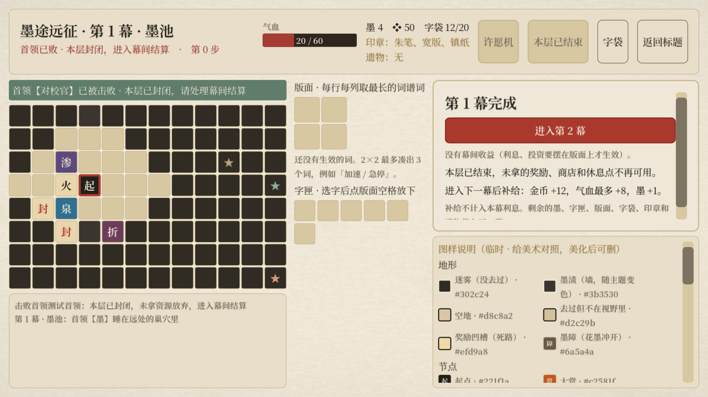

# 墨途远征：首领封层与偏难基线

> 后续调整：探索版面与词谱已移除，扩版奖励、词谱收益与原来的整幕随机怪池已被替换。当前规则以[版面移除与怪物成长投放](远征版面移除与怪物成长_2026-10-17.md)为准；本页保留对应轮次的记录。

2026-10-17。用户决定：击败首领后不能继续探索，按此调整数值，难度略高。本说明替代早期“击败首领后自由清图”的规则。

## 流程

首领胜利 → 本层立即封闭 → 领取首领印章（满位先选择替换/放弃）→ 自动显示幕间结算 → 点击“进入第2幕/第3幕” → 发放有限补给并进入新地图。第三幕显示“完成远征”，不生成第四层。

不用再点击“结束本幕”。地图格、迎战按钮、字的调配、遗漏散字拾取、旧层休息/商店入口全部锁定。结算期间时间冻结；未取得的奖励不自动折现。幕间面板上的进入下一层按钮放在首屏。下层加载后解除封层。

旧层的事件/商店/休息面板在首领胜利时关闭。幕间面板先入栈，首领印章替换在其上方处理，避免丢奖励或跳过替换。重复胜利回调、重复进入下一幕按钮均不会再次发补给。

## 本轮数值

| 项目 | 旧规则 | 新规则 |
|---|---|---|
| 首领胜利后的地图 | 无追逐压力，可以继续搜完 | 立即封层，遗漏资源放弃 |
| 一幕进入二幕 | 无固定补给，可继续搜图治疗 | 金币+12、生命最多恢复8、墨+1 |
| 二幕进入三幕 | 无固定补给，可继续搜图治疗 | 金币+16、生命最多恢复10、墨+1 |
| 第三幕 | 可先搜图再完成 | 直接进入最终结算，无下一层补给 |
| 自然惊动 | 第7–10步 | 第8–11步 |
| 惊动后起身缓冲 | 7–10步 | 7–10步 |
| 大赏惊动/接近巢穴惊动 | 提前触发 | 继续提前触发 |
| 普通/精英/伏兵耗时 | 2/2/1步 | 2/2/1步 |
| 单只怪物生命与攻击 | 当前20怪基线 | 本轮沿用 |

设计意图：整体挑战提高来自必须在首领前完成路线取舍，以及无法战后安全收集和治疗。有限补给承担跨层保底，保留受伤与缺资源的压力。自然惊动延后1步提供少量规划余地，缓和直接取消清图的难度突增。

金币12/16约覆盖一次普通买字（12–15）或治疗（10–14），一般不足以兼顾两者；回血8/10低于基础60生命下休息点的18点，且不会超过生命上限，不等于幕间回满。未给予额外选字、遗物或遗漏赏自动兑现。

补给在确认进入下一层时发放。先按旧余额计算当幕利息/投资返还，再发补给；新增金币不参与当幕利息。已有墨、字匣、版面、字袋、印章与遗物正常保留。

## 验证

| 测试 | 结果 |
|---|---|
| 新封层/数值/真实界面回归 | 31通过，0失败 |
| 原有远征回归（同步新规则） | 156通过，0失败 |
| 奖励选项与战前信息回归 | 67通过，0失败 |
| 20怪物机制回归 | 240通过，0失败 |
| 原生Metal窗口含截图 | 32通过，0失败 |

四套无头回归共494项通过。覆盖封层动作限制、旧面板清理、印章满位顺序、补给与利息、生命上限、重复调用幂等性、三幕衔接、最终胜利、惊动区间，以及真实界面上下一层入口的首屏可见性。

流程测试中的自动整局会按胜利结算战斗，它用于确认三幕流程可走完，不能据此推断真实通关率。此轮是偏难的首轮基线，未进行代表性构筑的真人通关校准。此前发现的“精力”拆装回血问题仍待单独处理，含该利用方式的路线不能用于判断正常损耗曲线。

复现：

```bash
Godot --headless --path . res://tests/expedition_act_exit_test.tscn
Godot --path . res://tests/expedition_act_exit_test.tscn -- --capture
```

改动保留本地，未提交或推送；原文件另有备份。


